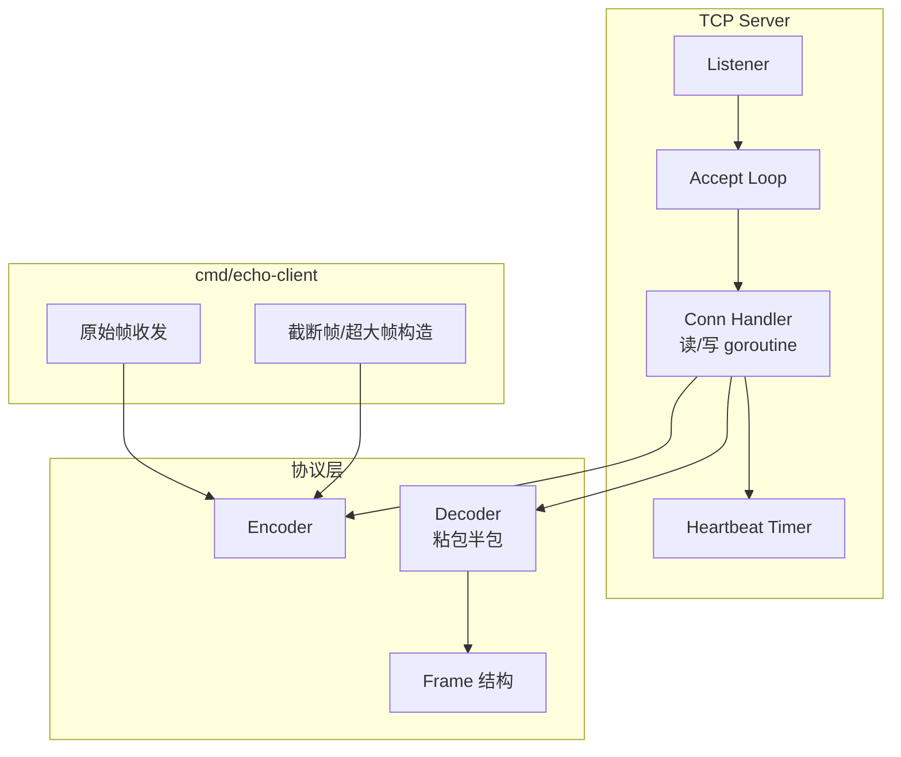
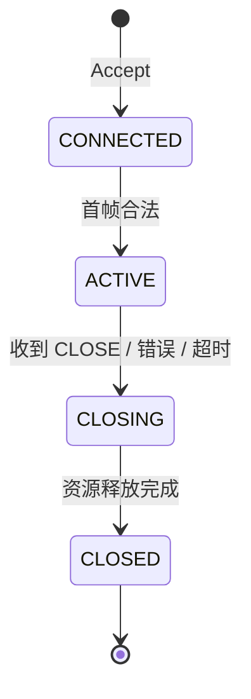
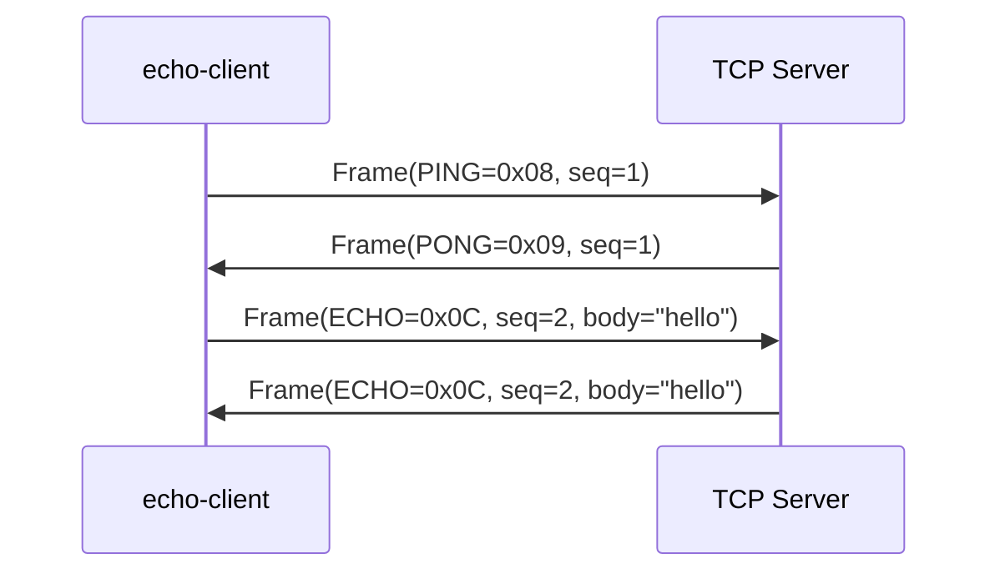
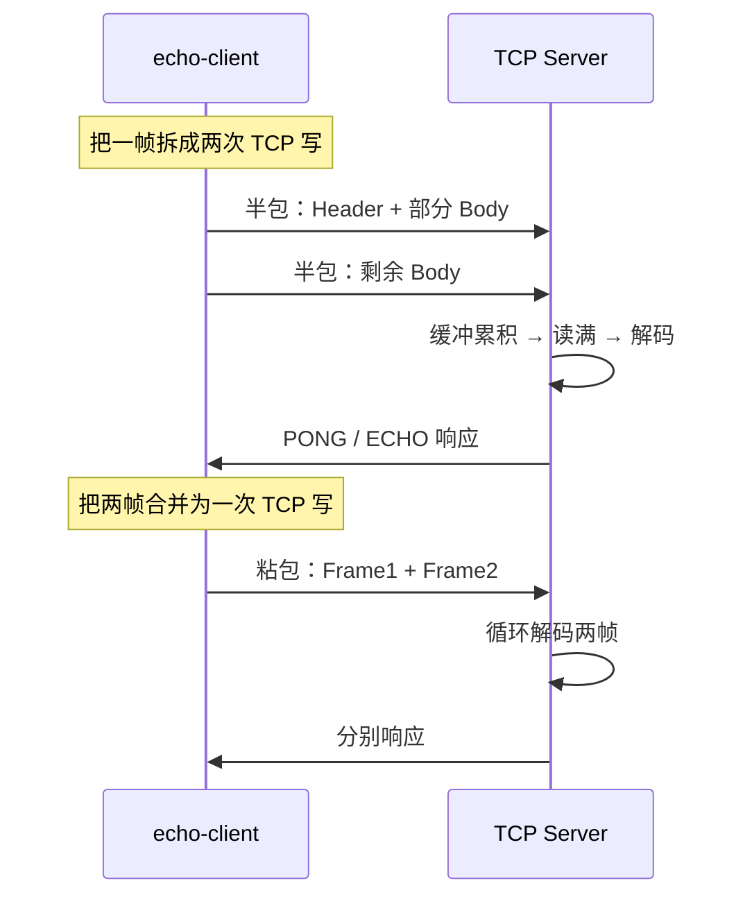
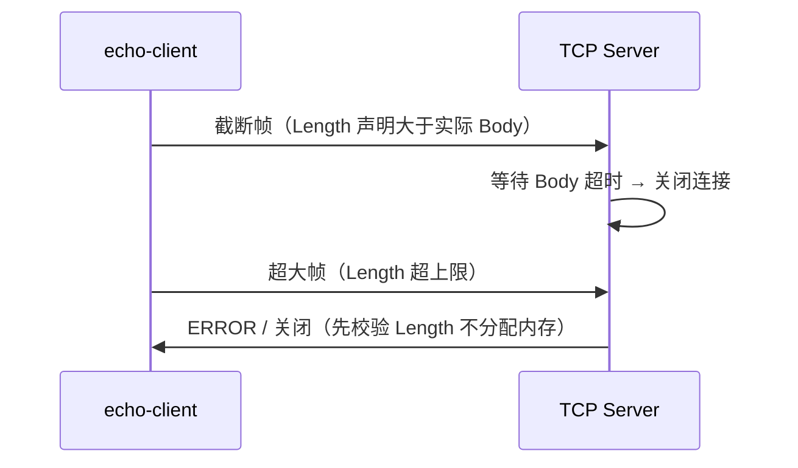

# S0 传输层与协议
# 详细设计（Low-Level Design）

> 本文是《通用实时消息 Gateway Platform — 架构设计方案 v1》中 **S0 阶段**的实现级展开。
>
> - **上位文档**：`通用实时消息 Gateway Platform - 架构设计方案.md`（架构方案）
> - **阶段定位**：传输层基座。定义全项目复用的 **Frame 二进制协议格式**与可复跑基准骨架。
> - **冻结产物**：Frame 头部结构、编解码规则、基础帧号段 `0x01`–`0x0E`。S1–S8 在此之上扩展，不重定义帧格式。
> - **明确不做**：连接管理/Session/路由（S1）、持久化（S2）、鉴权逻辑（S1 前移）、广播（S3）、事件（S4）。

| 项 | 内容 |
|---|---|
| 阶段编号 | S0 |
| 依赖阶段 | 无（起点） |
| 架构增量 | L0 传输层 |
| 核心资产 | Frame 编解码器、粘包半包处理、基准骨架 |
| 交付客户端 | `cmd/echo-client`（原始帧、截断帧、超大帧构造） |

---

## 目录

1. [设计目标与契约边界](#1-设计目标与契约边界)
2. [模块划分](#2-模块划分)
3. [Frame 协议格式（冻结）](#3-frame-协议格式冻结)
4. [编解码设计](#4-编解码设计)
5. [粘包半包与读循环](#5-粘包半包与读循环)
6. [心跳与超时](#6-心跳与超时)
7. [连接状态机与优雅关闭](#7-连接状态机与优雅关闭)
8. [帧序列](#8-帧序列)
9. [基准骨架](#9-基准骨架)
10. [故障处理矩阵](#10-故障处理矩阵)
11. [测试用例设计](#11-测试用例设计)
12. [验收标准与冻结清单](#12-验收标准与冻结清单)

---

# 1. 设计目标与契约边界

## 1.1 本阶段要解决的问题

掌握 Go 标准库网络编程，理解 TCP 连接建立、数据传输与连接生命周期。建立全项目复用的二进制协议格式与编解码基准骨架。

## 1.2 为什么帧格式必须在 S0 冻结

Frame 头部结构是所有后续阶段的载体。S2 的策略字段、S3 的订阅帧、S4 的事件帧都承载在同一个 Frame 里。若帧格式晚定，后续每个阶段都要改编解码器——这正是架构方案「语义先于传输」在传输层的对应：**格式先定，语义后填**。

## 1.3 性能纪律

S0 只要求「有可重复的基准骨架」，**不要求优化**。优化统一在 S5 执行，避免在负载形态尚未稳定时调参。

---

# 2. 模块划分

## 2.1 组件视图



## 2.2 目录结构

```text
s0/
├── cmd/
│   ├── server/                # TCP Server 入口
│   └── echo-client/           # 验证客户端（含异常帧构造）
├── internal/
│   ├── protocol/
│   │   ├── frame.go           # Frame 结构 + 常量（冻结）
│   │   ├── encode.go
│   │   ├── decode.go
│   │   └── errors.go
│   ├── server/
│   │   ├── listener.go
│   │   └── conn.go
│   └── config/
├── benchmark/
│   ├── codec_bench_test.go    # Encode/Decode/Send（-benchmem）
│   └── harness.sh
├── docs/
│   ├── protocol.md
│   └── adr/
└── test/
    ├── unit/
    └── integration/
```

---

# 3. Frame 协议格式（冻结）

## 3.1 帧结构

```text
+--------+--------+--------+--------+--------+--------+--------+--------+
|  Magic (2B)     | Version(1B)   | Type (1B)     | Length (4B, BE)       |
+--------+--------+--------+--------+--------+--------+--------+--------+
|  Sequence (4B, BE)     |  Header CRC (2B)  |  Body (Length B)         |
+--------+--------+--------+--------+--------+--------+--------+--------+
```

| 字段 | 长度 | 说明 |
|---|---|---|
| Magic | 2B | 固定 `0x52 0x58`（"RX"），帧对齐与非法连接快速识别 |
| Version | 1B | 协议版本，当前 `0x01` |
| Type | 1B | 帧类型（见 §3.2 帧号段） |
| Length | 4B | Body 长度（大端），上限 `maxBodySize = 65536`（64 KiB） |
| Sequence | 4B | 连接内单调递增序号，用于去重与有序检测 |
| Header CRC | 2B | 头部校验（CRC16），防 Length 损坏导致的内存攻击 |
| Body | Length B | 帧负载，语义由 Type 决定 |

- **Header 固定 14 字节**，Body 变长。
- `Length` 上限校验先于内存分配，防止超大 Length 声明导致 OOM（S0 验收项）。
- `Sequence` 由发送端连接内单调分配，**从 1 开始、不回绕（uint32，连接级上限 2^32-1，超限直接断开）**。

**`Sequence` 的消费方（避免"定义了从不使用"）**：

| 阶段 | 用途 | 行为 |
|---|---|---|
| S0 | 仅定义与分配 | 编解码往返校验单调性，不做业务判定 |
| S1 起 | 接收端重复/乱序检测 | 序号 ≤ 已见最大序号 → 计 `frame_out_of_order_total` 并记日志（**不丢弃、不改变业务处理**）；发现跳号 → 计 `frame_gap_total` |
| S5 | 观测项 | 上述两个计数器纳入性能报告，用于判断是否存在客户端并发写导致的乱序 |

> 之所以"检测但不处置"：`Sequence` 不是可靠投递的去重键（那是 `client_msg_id` / `message_id`），它只服务于传输层可观测性。把它当去重键会与 S2 的幂等键形成第二套语义。


### 3.1.1 两个上限必须成对理解

| 上限 | 值 | 位置 | 说明 |
|---|---|---|---|
| `maxBodySize`（单帧 Body） | **65536 B（64 KiB）** | 本阶段冻结，编解码层校验 | 超过即 `ErrFrameTooLarge`，先校验后分配 |
| 单条消息 `payload` | **61440 B（60 KiB）** | S2 §3.2 `ck_payload_limit` | 合法 payload + 协议字段（`client_msg_id`、`target_user_ids`、`expires_at` 等）≤ 64 KiB |

> **为什么 payload 不能等于帧上限**：`SEND` / `DELIVER` 的 Body 是「字段序列 + payload」，字段本身占几百字节到数 KB（多设备列表、策略字段）。若 payload 上限取 64 KiB，合法的最大 payload 编码后必然超过 `maxBodySize` 而被拒。因此 payload 上限固定为 60 KiB，留 4 KiB 字段空间。两个值同属冻结清单，改动其中一个必须同时改动另一个。


## 3.2 帧号段（冻结，与架构方案 §8.2 一致）

| 号段 | 用途 | 引入阶段 |
|---|---|---|
| `0x01`–`0x0E` | 连接与可靠消息基础帧 | S0–S2 |
| `0x10`–`0x1F` | 频道订阅与广播 | S3 |
| `0x20`–`0x2F` | 客户端事件与生命周期 | S4 |
| `0x30`–`0x3F` | 节点间转发与容量扩展（内部帧） | **S6 起启用** |

> 号段按「用途域」划分，不按阶段顺序；新阶段从所属域内取号，禁止跨域复用。
>
> `0x30` 段不是"预留到 S7"：S6 的跨节点尽力转发已经在用（S6 §4.2 内部帧），本表与架构方案 §8.2、S6 §10.2 统一标为 **S6**。

## 3.3 本阶段使用的基础帧

| 帧号 | 名称 | 方向 | Body | 说明 |
|---|---|---|---|---|
| `0x01` | LOGIN | C→S | token | S1 实现鉴权逻辑，S0 仅定义帧类型 |
| `0x02` | LOGIN_ACK | S→C | capabilities | S1 填充能力位 |
| `0x03` | SEND | C→S | 消息 | S2 实现可靠语义 |
| `0x04` | SEND_ACK | S→C | 受理结果 | S2 |
| `0x05` | DELIVER | S→C | 消息 | S2 |
| `0x06` | RECEIPT_ACK | C→S | message_id | S2 |
| `0x07` | BUSINESS_ACK | C→S | 应用数据 | S2 透传 |
| `0x08` | PING | 双向 | 空 | 心跳 |
| `0x09` | PONG | 双向 | 空 | 心跳响应 |
| `0x0A` | CLOSE | S→C | 原因（S4 扩展） | 关闭 |
| `0x0B` | ERROR | S→C | 错误码 | 错误 |
| `0x0C` | ECHO | 双向 | 任意字节 | **仅 `cmd/echo-client` 与测试服务端使用**，生产路径不注册该 handler |
| `0x0D`–`0x0E` | 预留 | — | — | 冻结 |

> S0 的 `cmd/echo-client` 用 PING/PONG 与 `ECHO (0x0C)` 验证编解码；SEND 等帧的语义在 S1/S2 实现，但帧号与结构此时冻结。
>
> `ECHO` 是**测试帧**而非业务帧：它不进入能力位、不进入任何状态机，服务端仅在 `--enable-echo` 配置下注册；关闭该配置时收到 `0x0C` 按"未知帧类型"处理（回 `ERROR` 并计数）。这样既让 §8.1 的 echo 序列有号可依，又不给生产协议增加一个可被滥用的回显端点。

---

# 4. 编解码设计

## 4.1 编码（Encode）

```go
type Frame struct {
    Type     uint8
    Sequence uint32
    Body     []byte
}

func Encode(f Frame, dst []byte) ([]byte, error)
```

- 预分配固定 Header 空间，Body 直接写入，避免多次拷贝。
- 大端序写入数值（`binary.BigEndian`）。
- CRC16 覆盖 Header 前 12 字节。
- 返回写入字节数，便于缓冲区管理。

## 4.2 解码（Decode）

```go
func Decode(src []byte) (Frame, int, error)
```

- 校验 Magic、Version、Header CRC；失败返回明确错误。
- 校验 `Length <= maxBodySize`；超限返回 `ErrFrameTooLarge`（**先于分配**）。
- 不足一帧时返回 `ErrIncomplete`，由读循环继续累积。

## 4.3 编码复用（为 S3 广播预埋）

编码器设计为「输入 Body 返回只读字节」的纯函数，便于 S3 广播时**一次编码、多连接共享**（S3 §7）。S0 不启用共享，但接口形态预留。

---

# 5. 粘包半包与读循环

## 5.1 读循环状态机

```text
READ_HEADER (等待 14B)
   ↓ 读满 Header
VALIDATE (校验 Magic/CRC/Length)
   ↓ 合法
READ_BODY (等待 Length B)
   ↓ 读满 Body
DISPATCH (交付 Frame)
   ↓
回到 READ_HEADER
```

## 5.2 关键实现约束

- 用 `io.ReadFull` 读满固定 Header 与 Body，正确处理短读。
- 读缓冲区按连接维护，避免每帧重新分配（S5 池化的观察点）。
- 单个连接的读缓冲区有上限（Header + maxBody），防止慢客户端堆积。
- 读到 Magic 不匹配 → 判定非法协议，关闭连接并记录。

## 5.3 粘包半包处理

- **粘包**：一次 read 返回多帧 → 循环解码，剩余字节留在缓冲区。
- **半包**：一次 read 不足一帧 → 保存已读字节，等待后续数据。
- `cmd/echo-client` 提供构造能力：把一帧拆成多次 TCP 写（半包），或多帧合并为一次写（粘包），验证服务端处理。

---

# 6. 心跳与超时

## 6.1 参数

| 参数 | 默认值 | 说明 |
|---|---|---|
| `heartbeat_interval` | 30s | 空闲时发送 PING 周期 |
| `pong_timeout` | 10s | 发 PING 后等待 PONG 超时 |
| `read_deadline` | 由心跳驱动 | 空闲超时判定 |
| `write_deadline` | 10s | 防止对端不读导致写永久阻塞 |

> S5 会把「每帧刷新 Deadline」改为「粗粒度空闲扫描」降低 timer 开销；S0 先按简单实现，不改语义。

## 6.2 心跳流程

- 连接空闲超过 `heartbeat_interval` → 发 PING。
- 收到 PONG → 刷新活跃时间。
- 超过 `pong_timeout` 未收到 PONG → 判定断线，关闭连接。

---

# 7. 连接状态机与优雅关闭



- **优雅关闭**：停止读 → 排空待写帧（带超时）→ 关闭 Socket → 回收 goroutine。
- 读/写 goroutine 退出必须通知对端 goroutine，避免 Goroutine 泄漏（S0 验收项）。
- 用 `context.Context` 统一取消信号。

---

# 8. 帧序列

## 8.1 正常 Echo



## 8.2 半包与粘包



## 8.3 异常帧



---

# 9. 基准骨架

| 基准 | 观测指标 | 用途 |
|---|---|---|
| `BenchmarkEncode` | ns/op, B/op, allocs/op | 编码开销基线（S5 起点） |
| `BenchmarkDecode` | ns/op, B/op, allocs/op | 解码开销基线 |
| `BenchmarkSend` | ns/op, allocs/op | 写循环基线 |

- 全部带 `-benchmem`。
- `harness.sh` 固定 GOOS/GOARCH/GOMAXPROCS，输出结构化报告。
- S0 只建骨架不优化；S5 在此基线上做前后对比。

---

# 10. 故障处理矩阵

| # | 场景 | 行为 | 验收口径 |
|---|---|---|---|
| T1 | 半包 | 缓冲累积直到读满 | 正确解码并响应 |
| T2 | 粘包 | 循环解码 | 每帧独立响应 |
| T3 | 截断帧 | 等待超时后关闭 | 无 Goroutine 泄漏 |
| T4 | 超大帧 | Length 校验先于分配 | 不 OOM，明确拒绝 |
| T5 | Magic 错误 | 关闭连接 | 非法连接快速识别 |
| T6 | CRC 错误 | 丢弃帧/关闭 | 明确错误 |
| T7 | 心跳超时 | 关闭连接 | 检测断线 |
| T8 | 优雅关闭 | 排空待写后退出 | 无突发断连错误 |

---

# 11. 测试用例设计

## 11.1 单元测试

| 用例 | 断言 |
|---|---|
| Encode/Decode 往返 | Frame 字段一致 |
| CRC 校验 | 篡改头部被拒 |
| Length 上限 | 超上限返回 ErrFrameTooLarge 且不分配 |
| 多帧连续编解码 | Sequence 单调、无串帧 |

## 11.2 集成测试

| 用例 | 断言 |
|---|---|
| 多客户端并发连接 | 全部可收发 |
| 半包场景 | 正确重组 |
| 粘包场景 | 正确拆分 |
| 心跳 | 空闲发 PING，超时断连 |
| 优雅关闭 | 无 Goroutine 泄漏（pprof 对比） |

## 11.3 验收场景（`cmd/echo-client`）

- `echo-roundtrip`：正常帧收发。
- `fragmented-frame`：半包构造。
- `coalesced-frames`：粘包构造。
- `truncated-frame`：截断帧。
- `oversized-frame`：超大帧。

---

# 12. 验收标准与冻结清单

## 12.1 验收标准

- 能启动 TCP Server；支持多客户端并发连接与收发。
- 正确处理粘包和半包；识别客户端断开；无 Goroutine 泄漏。
- 支持服务优雅退出；存在基础 Benchmark 可复跑。
- `gofmt`、`go vet`、`go test ./...`、`go test -race ./...` 通过。

## 12.2 冻结清单（S0 验收通过后生效）

| 冻结项 | 值 / 位置 |
|---|---|
| Frame 头部结构 | §3.1（Magic/Version/Type/Length/Sequence/CRC，Header 14B） |
| 单帧 Body 上限 | §3.1 / §3.1.1：`maxBodySize = 65536`（64 KiB），超限先拒后分配 |
| 消息 payload 上限 | 61440（60 KiB），由 S2 `ck_payload_limit` 落地；与 `maxBodySize` 成对冻结 |
| 帧号段划分 | §3.2（基础段 `0x01`–`0x0E`，后续段按域，`0x30` 段 S6 起启用） |
| 基础帧号 | §3.3（LOGIN…ERROR + `ECHO=0x0C` 测试帧，`0x0D`–`0x0E` 预留） |
| 编解码规则 | §4（大端、CRC16、Length 先校验） |
| Sequence 语义 | 连接内从 1 单调递增、不回绕；S1 起用于乱序/跳号观测，不作去重键 |

> **冻结后纪律**：S1–S8 只在此 Frame 之上扩展 Type 与 Body 语义，不改头部结构与编解码规则。若需改头部，视为重开冻结线，所有阶段都要重测。

---

> **结语**：S0 的产物是一个「一次定义、全程复用」的二进制信封。它把最容易在后期变得混乱的东西——帧边界、字节序、长度校验——在项目起点就固定下来，让 S1–S8 可以专心填语义，而不必回头改传输格式。
