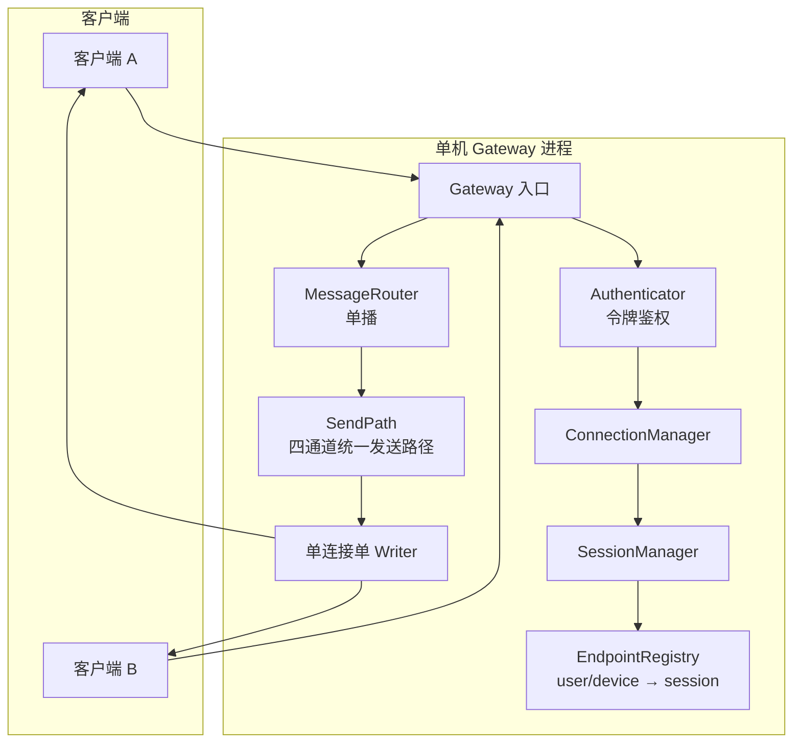
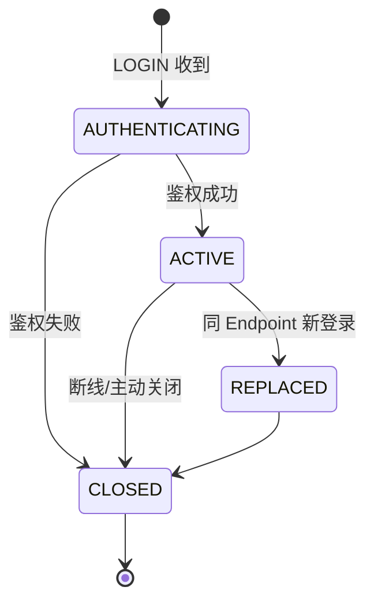
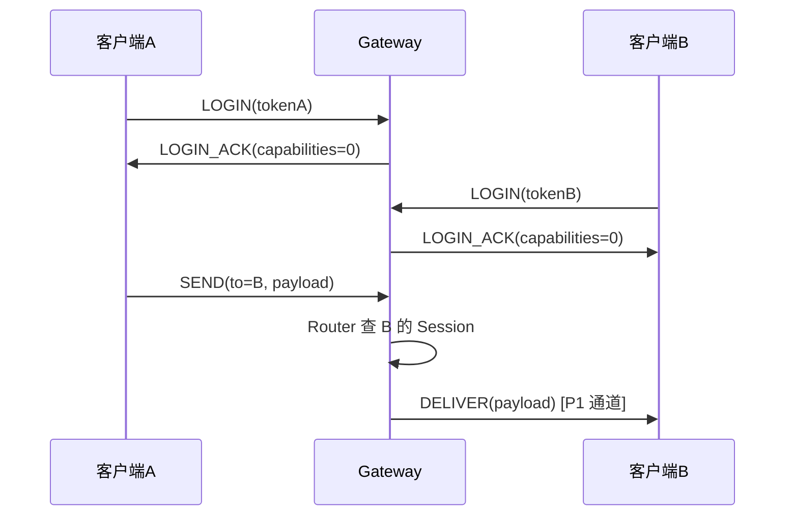
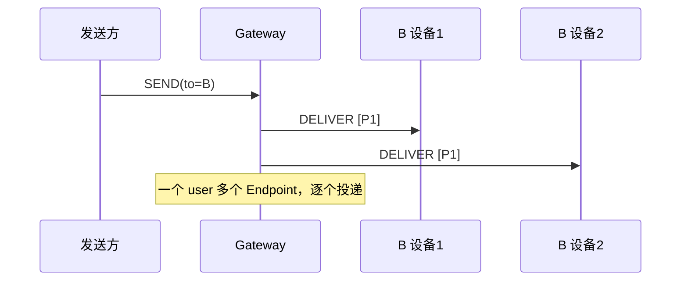
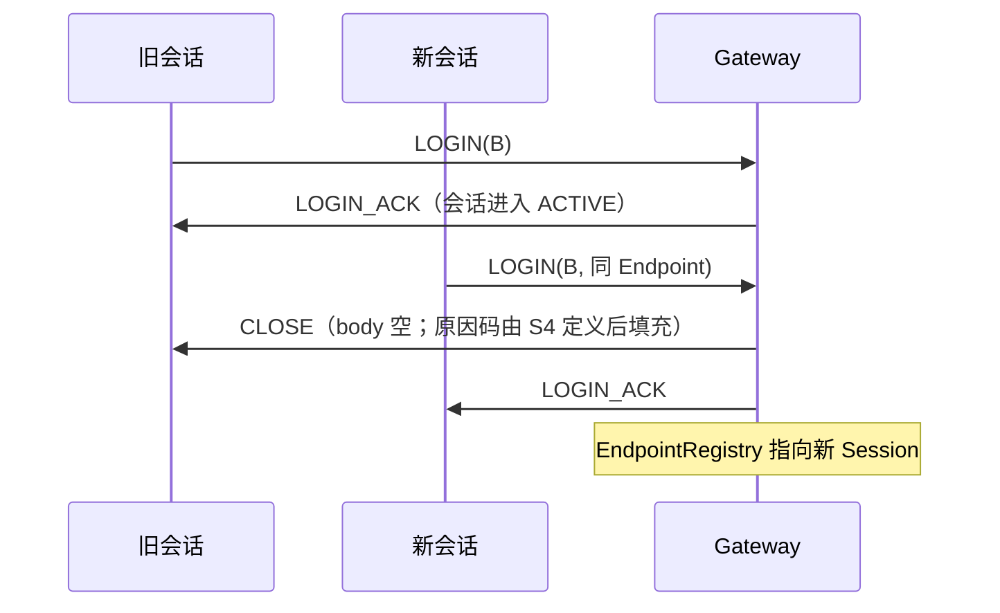

# S1 单机 Gateway 核心与统一发送路径
# 详细设计（Low-Level Design）

> 本文是《通用实时消息 Gateway Platform — 架构设计方案 v1》中 **S1 阶段**的实现级展开。
>
> - **上位文档**：`通用实时消息 Gateway Platform - 架构设计方案.md`（架构方案）
> - **前置契约**：S0 冻结的 Frame 协议格式。本阶段在其之上建立领域模型与**全系统唯一的出站发送路径**。
> - **冻结产物**：Connection/Session/Endpoint 模型、统一发送路径四通道、能力位分配表、鉴权前移原则。S2–S8 复用，不重造。
> - **明确不做**：持久化/ACK/幂等/facts（S2）、广播（S3）、事件（S4）、性能调优（S5）、分布式（S6）。

| 项 | 内容 |
|---|---|
| 阶段编号 | S1 |
| 依赖阶段 | S0（Frame 协议） |
| 架构增量 | L1 接入层 + L2 单播寻址 + 四通道发送路径 |
| 核心资产 | 单连接单 Writer、四通道隔离、能力位协商、鉴权前移 |
| 交付客户端 | `cmd/im` 雏形（登录、多设备、点对点 TUI） |

---

## 目录

1. [设计目标与契约边界](#1-设计目标与契约边界)
2. [模块划分](#2-模块划分)
3. [领域模型](#3-领域模型)
4. [统一发送路径与四通道（冻结）](#4-统一发送路径与四通道冻结)
5. [鉴权前移](#5-鉴权前移)
6. [能力位协商](#6-能力位协商)
7. [单播路由](#7-单播路由)
8. [连接与会话生命周期](#8-连接与会话生命周期)
9. [核心帧序列](#9-核心帧序列)
10. [并发控制](#10-并发控制)
11. [故障处理矩阵](#11-故障处理矩阵)
12. [测试用例设计](#12-测试用例设计)
13. [验收标准与冻结清单](#13-验收标准与冻结清单)

---

# 1. 设计目标与契约边界

## 1.1 本阶段要解决的问题

建立 Gateway 的核心领域模型（连接、会话、路由），并**一次性定义全系统唯一的出站发送路径**。

S2 的可靠消息、S3 的广播、S4 的事件都走这条发送路径的不同通道。若各阶段各自造发送逻辑，QoS 隔离会失效——这是架构方案 D5 的核心要求。

## 1.2 两项必须在此定死的决策

1. **统一发送路径四通道**：CONTROL / RELIABLE / BROADCAST / EVENT 的优先级与预算隔离。
2. **鉴权前移（I3）**：首个外部接口（客户端连接）出现时即落地鉴权，不留「先裸奔后补」的窗口。

## 1.3 与后续阶段的关系

| 后续阶段 | 复用 S1 的什么 |
|---|---|
| S2 | P1 RELIABLE 通道、能力位骨架、身份绑定 |
| S3 | P2 BROADCAST 通道（25% 预算）、能力位 |
| S4 | P3 EVENT 通道、CLOSE 帧 |
| S6 | Session/Endpoint 模型、Connection Version 扩展点 |

---

# 2. 模块划分

## 2.1 组件视图



## 2.2 目录结构

```text
s1/
├── cmd/gateway/
├── internal/
│   ├── protocol/              # 继承 S0
│   ├── connection/
│   │   ├── manager.go
│   │   └── conn.go
│   ├── session/
│   │   ├── manager.go
│   │   └── session.go
│   ├── identity/
│   │   ├── authenticator.go
│   │   └── producer.go        # 令牌 → producer 身份
│   ├── route/
│   │   ├── registry.go
│   │   └── router.go
│   ├── sendpath/
│   │   ├── sendpath.go        # 四通道（冻结）
│   │   ├── channel.go         # 通道定义与预算
│   │   └── writer.go          # 单连接单 Writer
│   ├── telemetry/             # 最小可观测集（I3 起点）
│   │   ├── metrics.go         # /metrics：连接数、队列深度、丢弃计数、frame_gap/out_of_order
│   │   └── log.go             # 结构化日志字段约定
│   └── config/
├── docs/
│   ├── gateway-lld.md
│   └── adr/
└── test/
    ├── unit/
    ├── integration/
    └── concurrency/
```

---

# 3. 领域模型

## 3.1 核心结构

```go
type Endpoint struct {
    TenantID string
    UserID   string
    DeviceID string
}

func (e Endpoint) Key() string { return e.TenantID + ":" + e.UserID + ":" + e.DeviceID }

type Connection struct {
    ID       string
    NetConn  net.Conn
    SendPath *SendPath        // 该连接的统一发送路径
    State    ConnState
    Version  uint64           // Connection Version：**per-endpoint（user+device）单调**，S6 用 Redis INCR gateway:{ep:<tenant>:<user>:<device>}:seq 分配
}

type Session struct {
    ID         string
    Endpoint   Endpoint
    Connection *Connection
    ProducerID string           // 由令牌派生，不可伪造
    Capabilities uint32         // 协商出的能力位
    State      SessionState
}

type Producer struct {
    ID   string   // "u:alice"（用户）/ "svc:billing"（服务）
    Kind string   // "user" | "service"
    TenantID string
}
```

## 3.2 关系

```text
Endpoint (逻辑身份, 可多设备)
   └── Session (一次登录)
         └── Connection (一条 TCP)
               └── SendPath (四通道发送)
```

- 一个 Endpoint 同一时刻只有一个活动 Session（重复登录替换旧 Session）。
- 一个用户可有多个 Endpoint（多设备），每个独立 Session。

---

# 4. 统一发送路径与四通道（冻结）

## 4.1 结构

```text
每个 Connection
  └── 单 Writer（唯一 Socket 写者，唯一 goroutine）
        └── 优先级取帧
              ├── P0 CONTROL     PING/PONG/CLOSE      固定小份额，最高优先
              ├── P1 RELIABLE    SEND/DELIVER         帧数 + 字节双上限；满 → 背压/断连
              ├── P2 BROADCAST   BROADCAST            发送队列约 25%；满 → 丢弃+计数
              └── P3 EVENT       CLIENT_EVENT         独立份额；满 → 丢弃低优先级
```

## 4.2 通道定义（冻结）

```go
type ChannelClass int
const (
    ChControl   ChannelClass = 0  // P0
    ChReliable  ChannelClass = 1  // P1
    ChBroadcast ChannelClass = 2  // P2
    ChEvent     ChannelClass = 3  // P3
)

type Channel struct {
    Class      ChannelClass
    MaxFrames  int              // 帧数上限
    MaxBytes   int64            // 字节预算上限
    OnFull     FullPolicy       // 满队列行为
}

type FullPolicy int
const (
    BlockAndDrain FullPolicy = iota  // P1：背压，持续满则断连
    DropAndCount                     // P2/P3：丢弃 + 计数，不断连
    DropLowPriority                  // P3：丢弃低优先级事件
)
```

## 4.3 预算与优先级规则（冻结）

| 通道 | 默认预算 | 满队列行为 | 消费者 |
|---|---|---|---|
| P0 CONTROL | 固定小份额 | 不丢弃，优先写出 | 心跳/关闭（S0/S4） |
| P1 RELIABLE | 帧数 + 字节双上限 | 背压，持续满则断连 | 可靠消息（S2） |
| P2 BROADCAST | 发送队列约 25% | 丢弃 + 计数，不断连 | 广播（S3） |
| P3 EVENT | 独立份额 | 丢弃低优先级 | 客户端事件（S4） |

- **P0 绝对优先**：任何时刻 Writer 先取 P0 帧，确保心跳不被拖死。
- **物理隔离**：四通道各自独立队列与预算，一类打满不影响其他类。
- **单 Writer**：只有该 goroutine 写 Socket，杜绝并发写冲突。
- **P2 入队接口传指针**：`TrySendBroadcast(frame *ImmutableFrame)`（S3 §2.3）。帧内含 `atomic.Int32` 引用计数，**按值传递会复制计数器**，等价于提前归还 buffer —— S1 的实现不得为省事改成值类型。
- **术语固定**：本模型的通道数固定为四（P0–P3），全部文档一律称「四通道」；任何阶段都不得把它改写为其他数目（S5 的隔离验收按四通道判定）。

## 4.4 通道与帧的归属（只追加，不重分配）

下表只列**服务端发出的出站帧**（即经过 SendPath 的帧）：

| 通道 | 该通道承载的出站帧 | 引入阶段 |
|---|---|---|
| P0 CONTROL | `PING` `PONG` `CLOSE` `ERROR` | S0 / S4（CLOSE body） |
| P1 RELIABLE | `SEND_ACK` `DELIVER` | S2 |
| P2 BROADCAST | `BROADCAST` | S3 |
| P3 EVENT | `CLIENT_EVENT` `SUBSCRIBE_EVENTS_ACK` | S4 |

**入站帧不经过 SendPath，因而不参与通道预算**：`LOGIN` `SEND` `SUBSCRIBE` `UNSUBSCRIBE` `RECEIPT_ACK` `BUSINESS_ACK` `SUBSCRIBE_EVENTS` `PING` `ECHO` 全部在 `ReadLoop` 中解析并直接处理（其响应用上表的出站帧发出）。把入站帧写进"通道归属表"会让人误以为读路径也受写队列预算约束。

> 新阶段只能把新帧接入上表已有通道，不得新建通道或把某帧挪到另一个通道——这是 S5「四通道隔离」验收可比对的前提。

## 4.5 Writer 取帧逻辑

```text
for {
  frame = P0.pop() 
  if frame == nil: frame = P1.pop()
  if frame == nil: frame = P2.pop()
  if frame == nil: frame = P3.pop()
  if frame == nil: wait on cond/channel
  write(frame) with deadline
}
```

## 4.6 为什么在此定死

S2/S3/S4 只需把新帧「接入已存在的通道」，不再新造发送逻辑。这是全项目 QoS 隔离的根基，冻结后不允许各阶段私自改预算语义（S5 只能优化实现，不改语义）。

---

# 5. 鉴权前移

## 5.1 原则（I3）

客户端连接是第一个外部接口，鉴权必须在握手阶段落地——未通过鉴权的连接不得进入任何业务路径。鉴权随首个外部接口引入，不留「先裸奔后补」的窗口。

## 5.2 握手流程

```text
客户端 → LOGIN(token)
服务端 → 解析 token（HMAC/JWT）
      → 校验 tenant/user/过期/吊销（最小能力）
      → 派生 Producer 身份（u:user 或 svc:xxx）
      → 建立 Session
      → LOGIN_ACK(capabilities)
失败 → CLOSE（**body 为空**，不携带原因码）/ ERROR
      // S1 阶段 CLOSE 尚无原因码字段；1004 AUTH_FAILED 由 S4 §3.4 引入后才可携带
```

## 5.3 边界

- `producer_id` 由令牌派生，客户端在 SEND 中不得携带（S2 延续此约束）。
- S1 实现最小鉴权；吊销名单、密钥轮转、审计在 S8 完善——但「握手必鉴权」的语义在此定死。
- S6 的节点间 mTLS 是另一条链路（节点身份），与客户端鉴权分层，不混淆。

---

# 6. 能力位协商

## 6.1 机制

`LOGIN_ACK.capabilities`（uint32）告知客户端服务端支持的能力；客户端据此决定是否发起对应帧。旧客户端忽略未知位。

## 6.2 能力位分配表（S1 冻结，只追加）

以**十六进制掩码值**为唯一准绳（与各阶段 LLD 完全一致），bit 编号仅为对应说明：

| 掩码 | 位 | 名称 | 引入阶段 | 含义 |
|---|---|---|---|---|
| `0x01` | bit0 | — | — | 预留未分配 |
| `0x02` | bit1 | `CAP_TOPIC_SUBSCRIBE` | S3 | 支持订阅与广播 |
| `0x04` | bit2 | `CAP_RELIABLE_POLICY` | S2 | 支持 SEND 策略字段 |
| `0x08` | bit3 | `CAP_CLIENT_EVENTS` | S4 | 支持 CLIENT_EVENT / SUBSCRIBE_EVENTS |
| `0x10` | bit4 | `CAP_CLOSE_REASON` | S4 | CLOSE 帧携带原因码 |

> 一致性核对：S2 `CAP_RELIABLE_POLICY = 0x04`（bit2）、S3 `CAP_TOPIC_SUBSCRIBE = 0x02`（bit1）、S4 `CAP_CLIENT_EVENTS = 0x08`（bit3）/`CAP_CLOSE_REASON = 0x10`（bit4）。任何阶段引用能力位时一律使用掩码值，不依赖 bit 序号。

## 6.3 S1 阶段状态

- S1 的 `LOGIN_ACK.capabilities` 为 0（骨架），客户端不做任何能力相关动作。
- S2 起逐步置位；分配表此时冻结，确保后续阶段不冲突。

---

# 7. 单播路由

## 7.1 路由能力

- **指定 Endpoint 投递**：`tenant:user:device` 精确匹配。
- **同用户多设备**：按 user 找到所有 Endpoint，逐个投递（fan-out）。
- **路由失败处理**：目标不存在 → 返回明确错误（S1 无离线概念，离线消息在 S2 实现）。

## 7.2 路由表

```text
EndpointRegistry: map[EndpointKey]Session
  - 登录：注册 Endpoint → Session
  - 断开：注销
  - 重复登录：替换（旧 Session 收到 CLOSE）
```

## 7.3 与 S2 的关系

S1 的路由是「尽力转发，无确认」。S2 在其上叠加持久化、ACK、重试，但**寻址方式不变**——这体现「寻址原语先于可靠性」的设计。

---

# 8. 连接与会话生命周期

## 8.1 Session 状态机



## 8.2 重复登录

- 同 Endpoint 新登录 → 旧 Session 标记 REPLACED，收到 `CLOSE`（S1 阶段 Body 为空；原因码在 S4 §3.4 定义后才填充，S1 不得提前占用码值）。
- 新 Session 注册到 EndpointRegistry，覆盖旧映射。
- 「是否提示已替换其他设备」是业务决策，平台只发事件。

## 8.3 断线清理

- 连接断开 → 关闭 Session → 从 EndpointRegistry 注销（若仍是当前 Session）。
- 清理在连接关闭回调中同步执行，避免残留。

---

# 9. 核心帧序列

## 9.1 登录与单播收发



## 9.2 多设备 fan-out



## 9.3 重复登录替换



---

# 10. 并发控制

| 风险 | 手段 |
|---|---|
| 同 Socket 并发写 | 单 Writer goroutine（§4.3） |
| Session 注册表并发访问 | RWMutex 保护 EndpointRegistry |
| 登录与断线竞态 | Session 状态机 + 注销时校验是否仍为当前 Session |
| 慢消费者撑爆队列 | P1 双预算 + 满队列背压/断连 |
| 通道优先级饥饿 | P0 绝对优先 + P1/P2/P3 预算隔离 |

---

# 11. 故障处理矩阵

| # | 场景 | 行为 | 验收口径 |
|---|---|---|---|
| G1 | 非法令牌 | 握手拒绝 | 不进入业务路径 |
| G2 | 重复登录 | 旧会话 CLOSE 并替换 | 新会话正常，路由指向新 |
| G3 | 断线 | 注销 Session | 路由清理，无残留 |
| G4 | 慢消费者 | P1 队列满 → 背压/断连 | 队列不无限增长 |
| G5 | 广播洪峰（预埋） | P2 丢弃不影响 P1 | 隔离语义（S3 验证） |
| G6 | 并发写 | 单 Writer | 无写冲突（-race） |
| G7 | 心跳被数据淹没 | P0 优先 | 心跳不被拖死 |

---

# 12. 测试用例设计

## 12.1 单元测试

| 用例 | 断言 |
|---|---|
| 四通道优先级 | P0 帧优先于 P1/P2/P3 写出 |
| 预算隔离 | 打满 P2 不影响 P1 写出 |
| Frame Sequence 观测 | 乱序递增 `frame_out_of_order_total`、跳号递增 `frame_gap_total`，且不改变业务处理（S0 §3.1） |
| EndpointRegistry 增删 | 注册/注销/替换一致 |
| 能力位协商 | LOGIN_ACK 位正确 |

## 12.2 集成测试

| 用例 | 断言 |
|---|---|
| 多客户端连接 | 稳定连接与收发 |
| 身份路由 | 可以身份找到 Session |
| 多设备登录 | 同 user 多设备 |
| 客户端间转发 | 消息正确送达 |
| 断线清理 | Session 正确注销 |
| 鉴权拒绝 | 非法令牌被拒 |

## 12.3 并发测试（`go test -race`）

| 用例 | 断言 |
|---|---|
| 并发写同一连接 | 无冲突（单 Writer 保证） |
| 登录/断线竞态 | 状态一致 |
| 慢消费者 | 队列不无限增长 |

## 12.4 验收场景（`cmd/im` 雏形）

- `login-and-chat`：登录、点对点收发。
- `multi-device`：三台设备互相收发。
- `presence-simple`：看到对方上线/断线（连接级，非业务 presence）。

---

# 13. 验收标准与冻结清单

## 13.1 验收标准

- 多客户端稳定连接；可通过身份找到 Session；支持多设备登录与客户端间转发。
- 断线正确清理 Session；无同 Socket 并发写冲突；慢消费者不撑爆队列。
- `LOGIN_ACK.capabilities` 已携带字段（本阶段为 0，旧客户端可忽略）。
- 鉴权在握手阶段生效，非法令牌被拒。
- 进程暴露 `/metrics` 与 `/healthz`，能读到连接数、四通道队列深度、丢弃计数；日志含 `traceID`/`tenantID`/`endpointID`（I3 可观测最小集）。
- `gofmt`、`go vet`、`go test ./...`、`go test -race ./...` 通过。

## 13.2 冻结清单（S1 验收通过后生效）

| 冻结项 | 值 / 位置 |
|---|---|
| 领域模型 | §3（Endpoint / Session / Connection / Producer） |
| 统一发送路径四通道 | §4（P0–P3 优先级、预算、满队列行为） |
| 单 Writer 原则 | §4.3 |
| 鉴权前移 | §5（握手必鉴权，producer 由令牌派生） |
| 能力位分配表 | §6.2（`0x02 / 0x04 / 0x08 / 0x10`，只追加） |
| 单播路由语义 | §7（尽力转发，无确认） |

> **冻结后纪律**：S2–S8 复用四通道与能力位表，只接入新帧到已有通道、只追加能力位；不得改通道语义或重新分配已占用的位。S5 只优化实现，不改预算语义。

---

> **结语**：S1 的关键产物不是「一个能跑的 Gateway」，而是**一条全项目共用的出站发送路径和一张冻结的能力位表**。从 S2 的可靠消息到 S4 的客户端事件，所有出站帧都在这条路径上按既定优先级与预算流动。这种「先定发送骨架，后填业务语义」的顺序，是避免后期 QoS 互相干扰的根本手段。
