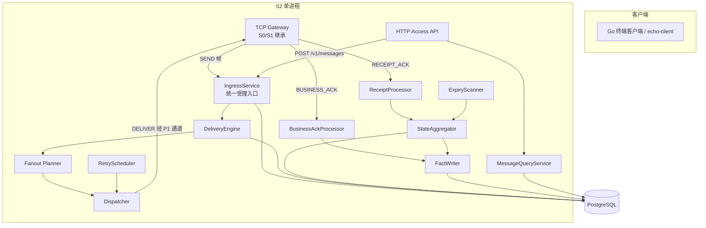
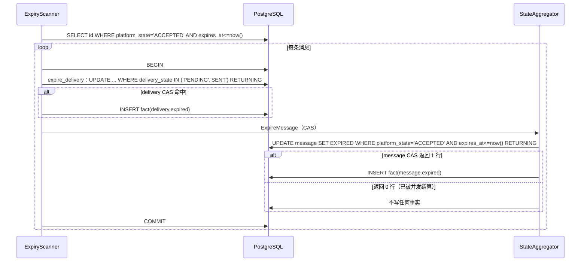
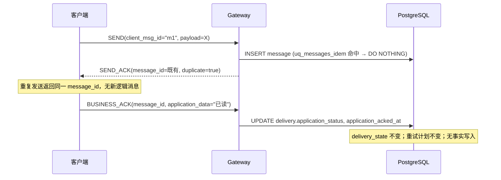
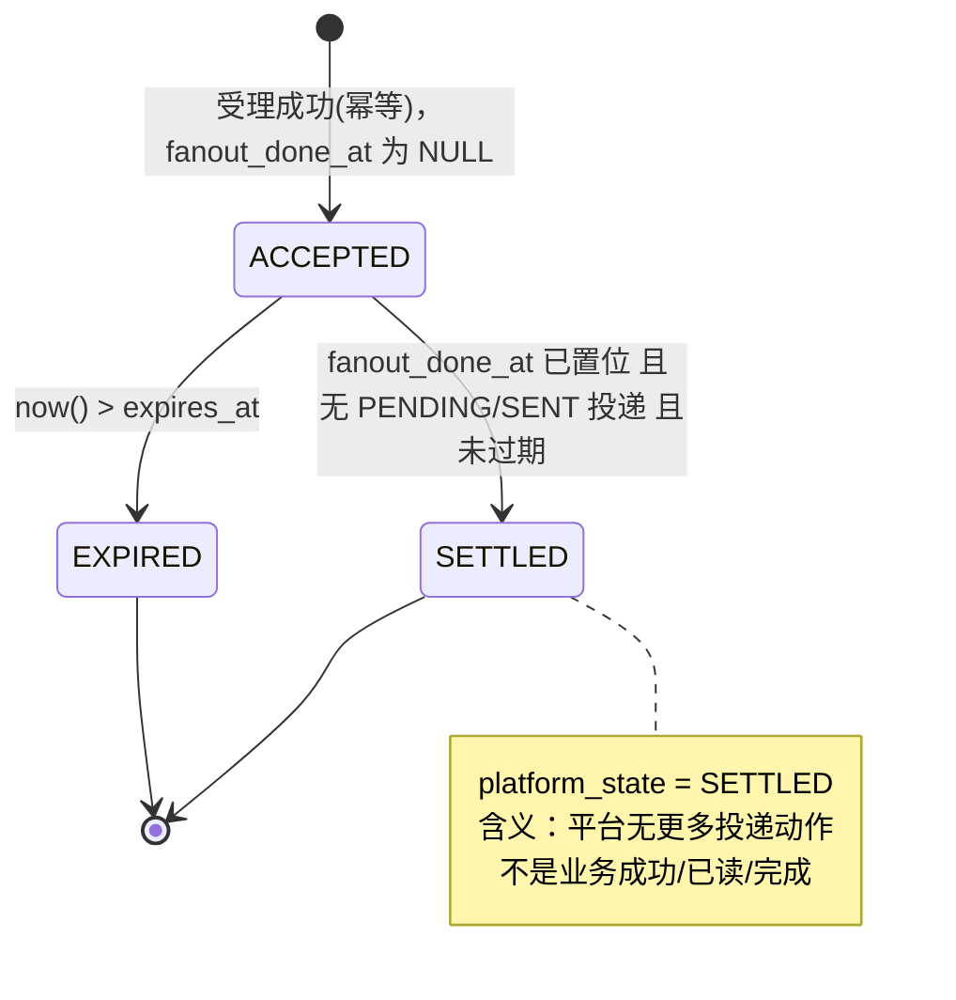
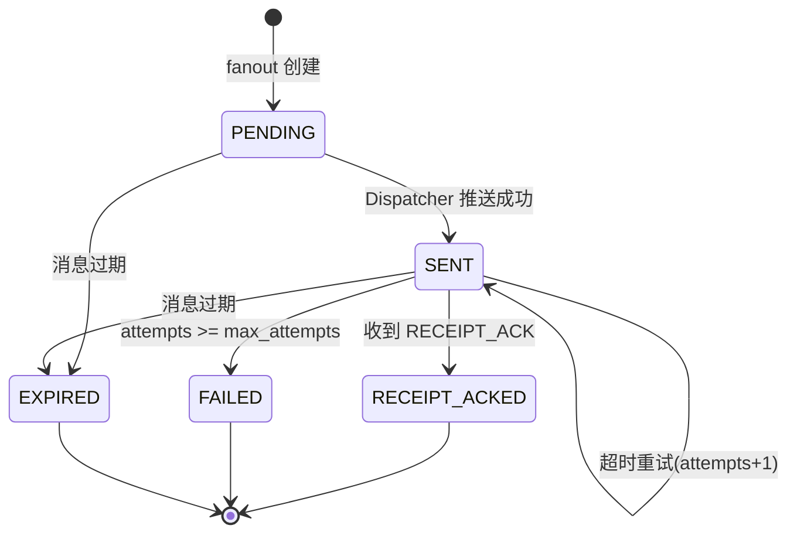

# S2 可靠消息内核 + 语义契约
# 详细设计（Low-Level Design）

> 本文是《通用实时消息 Gateway Platform — 架构设计方案 v1》中 **S2 阶段**的实现级展开。
>
> - **上位文档**：`通用实时消息 Gateway Platform - 架构设计方案.md`（下称 **架构方案**）
> - **契约来源**：架构方案 第四部分「语义契约」是唯一事实来源；本文所有枚举、幂等键、帧语义均以其为准，不重新定义。
> - **阶段定位**：单机、单库、零异步边界。所有语义在此一次性建对并**冻结**。
> - **明确不做**：Redis、Kafka、Outbox、租约、分片、SDK、广播（S3）、TLS 卸载、全局限流。

| 项 | 内容 |
|---|---|
| 阶段编号 | S2 |
| 依赖阶段 | S0（传输/协议）、S1（连接/会话/统一发送路径） |
| 冻结产物 | 语义契约 v1（`docs/contracts/semantic-contract-v1.md`） |
| 新增进程 | `cmd/message-service`（统一受理 HTTP + 引擎宿主） |
| 新增表 | `messages` / `deliveries` / `endpoints` / `delivery_facts` |
| 核心不变量 | I1 语义先于传输 · I2 正确构造 · I3 横切引入点落地 |

---

## 目录

1. [设计目标与必须守住的契约](#1-设计目标与必须守住的契约)
2. [模块划分](#2-模块划分)
3. [数据模型与 DDL](#3-数据模型与-ddl)
4. [事务边界与时间仲裁](#4-事务边界与时间仲裁)
5. [协议帧定义](#5-协议帧定义)
6. [核心帧序列](#6-核心帧序列)
7. [状态机与转换表](#7-状态机与转换表)
8. [核心流程 LLD](#8-核心流程-lld)
9. [并发控制与幂等](#9-并发控制与幂等)
10. [故障处理矩阵](#10-故障处理矩阵)
11. [测试用例设计](#11-测试用例设计)
12. [验收标准与冻结清单](#12-验收标准与冻结清单)

---

# 1. 设计目标与必须守住的契约

## 1.1 本阶段要一次性做对的事

S2 是语义契约的落地阶段：可靠语义在此**一次成型**，不在后续阶段修正。因此本阶段的实现必须直接体现下列契约，任何一条偏离都会重新引入「语义债」。

## 1.2 契约落地对照表

| 契约项（冻结值） | 在本阶段的落地点 |
|---|---|
| 身份 `tenant_id + producer_id + source_endpoint + 可选 sender` | §3.1 `messages.producer_id / producer_kind / source_device_id / sender`；§8.1 来源设备由 session 派生写入 |
| 接入幂等 `(tenant, producer_id, client_msg_id)` | §3.1 `UNIQUE` 约束；§8.1 受理流程 `ON CONFLICT` |
| 投递幂等 `(tenant, message_id, user, device)` | §3.2 `UNIQUE` 约束；§8.2 fanout 去重 |
| 消息状态 `ACCEPTED / SETTLED / EXPIRED`，无 `COMPLETED` | §3.1 枚举；§7.1 消息状态机 |
| 投递状态 `PENDING → SENT → RECEIPT_ACKED`，终态 `RECEIPT_ACKED / FAILED / EXPIRED`，无 `SETTLED` | §3.1 枚举；§7.2 投递状态机 |
| **fanout 完成标记 `fanout_done_at`** | §3.1 字段；§7.4 聚合守卫；§8.1 步骤 4f |
| **结算 CAS（SETTLED 只写一次）** | §4.2 SQL `settle_message`；§7.4 |
| Receipt ACK 驱动状态 | §5.2 / §8.4 |
| Business ACK 仅透传，不进状态机 | §8.5 |
| `SETTLED` = 平台结算完成，非业务成功 | §7.4 聚合规则；API 字段命名 `platform_state`，禁用 `success/completed` |
| 策略消息级可覆盖 + 平台硬上限 | §3.1 字段；§5.2 帧策略；§8.1 校验顺序 |
| 时间仲裁在 SQL `now()`，接口不传时间 | §4.2；全文所有到期/超时 SQL；§2.3 接口签名不含 `now` |
| 事实 `event_id` 确定性派生 + 同事务写入 | §3.4 / §4.1 / §8.7 |
| **事实发布水位 `published_at`** | §3.2 列；§3.3 索引；§8.7 发布顺序 |
| 统一受理入口（HTTP + Gateway 同一路径） | §2.2 `IngressService`；§8.1 |
| payload / 帧上限 | §3.2 `ck_payload_limit = 61440`；§11.1；S0 §3.1.1 `maxBodySize = 65536` |

---

# 2. 模块划分

## 2.1 组件视图

S2 保持**单机单进程形态**：TCP Gateway 与统一受理 HTTP 服务在同一 Go 进程内，共享同一个 `DeliveryEngine` 与数据库连接池。这样事务边界清晰，且与 S6 的拆分路径兼容（届时只需把 `IngressService` 调用换成跨进程 API，引擎接口不变）。



## 2.2 目录结构

```text
s2/
├── cmd/
│   ├── gateway/              # 进程入口：装配所有组件
│   ├── scenario/             # 场景运行器 v0（仅 IM/可靠消息用例，§11.5）
│   └── maintenance/          # 维护 CLI（S2 仅状态修复，S8 扩展）
├── internal/
│   ├── protocol/             # 帧编解码（继承 S0，本阶段扩展 SEND 策略字段）
│   ├── session/              # 会话管理（继承 S1）
│   ├── sendpath/             # 统一发送路径四通道（继承 S1）
│   ├── identity/             # 令牌解析 → producer 身份（继承 S1）
│   ├── ingress/              # 统一受理入口
│   │   └── service.go        # IngressService.Submit()
│   ├── engine/
│   │   ├── engine.go         # DeliveryEngine 编排
│   │   ├── fanout.go         # Fanout Planner
│   │   ├── dispatcher.go     # Dispatcher（写 DELIVER）
│   │   ├── receipt.go        # ReceiptProcessor
│   │   ├── businessack.go    # BusinessAckProcessor
│   │   ├── retry.go          # RetryScheduler
│   │   ├── expiry.go         # ExpiryScanner
│   │   ├── aggregator.go     # StateAggregator
│   │   └── facts.go          # FactWriter / event_id 派生
│   ├── store/
│   │   └── postgres/
│   │       ├── messages.go
│   │       ├── deliveries.go
│   │       ├── endpoints.go
│   │       ├── facts.go
│   │       └── tx.go         # 事务封装
│   ├── query/
│   │   └── service.go        # MessageQueryService（只读）
│   └── config/
├── migrations/
│   └── 0001_reliable_core.sql
├── docs/contracts/
│   └── semantic-contract-v1.md
└── test/
    ├── unit/
    ├── integration/
    ├── concurrency/
    └── failure/
```

## 2.3 核心 Go 接口

```go
// ===== ingress：统一受理入口 =====
type SubmitInput struct {
    TenantID     string
    ProducerID   string          // 由令牌派生，调用方不可伪造
    ProducerKind string          // "user" | "service"
    Sender       string          // 可选展示身份
    SourceDeviceID string        // 来源设备：SEND 时从 session 派生；HTTP 提交时取令牌绑定的设备或空
    ClientMsgID  string
    TargetUserID string
    TargetDevices []string       // 空 = 全部在线设备
    Payload      []byte
    Policy       DeliveryPolicy
}

type DeliveryPolicy struct {
    TTLSeconds   int32
    MaxAttempts  int32
    DeliveryMode string         // "all_endpoints" | "last_active"
    Fanout       int32          // 0 = 不限；>0 = 最多 N 个端点
}

type SubmitResult struct {
    MessageID   string
    State       string          // "ACCEPTED"；目标无任何端点时同事务已结算，返回 "SETTLED"
    Duplicate   bool            // true = 幂等命中，返回既有消息
    AcceptedAt  time.Time
}

type IngressService interface {
    Submit(ctx context.Context, in SubmitInput) (SubmitResult, error)
}

// ===== store：持久化 =====
type Tx interface {
    Messages() MessageStore
    Deliveries() DeliveryStore
    Facts() FactStore
    Commit() error
    Rollback() error
}

type Store interface {
    WithinTx(ctx context.Context, fn func(Tx) error) error
    Messages() MessageStore
    Deliveries() DeliveryStore
    Endpoints() EndpointRegistry
    Facts() FactStore
}

type MessageStore interface {
    Insert(ctx context.Context, tx Tx, m *Message) error  // ON CONFLICT DO NOTHING
    GetByID(ctx context.Context, id string) (*Message, error)
    MarkState(ctx context.Context, tx Tx, id, state string, version int) error
    // MarkFanoutDone 置 fanout_done_at = now()（同事务）；返回是否首次置位
    MarkFanoutDone(ctx context.Context, tx Tx, id string) (bool, error)
    // SettleIfEligible 聚合守卫的 CAS 写入：命中返回 true，0 行返回 false（不自旋、不重试推进）
    SettleIfEligible(ctx context.Context, tx Tx, id string) (bool, error)
}

type DeliveryStore interface {
    InsertBatch(ctx context.Context, tx Tx, ds []*Delivery) error
    GetByKey(ctx context.Context, tenant, msgID, user, device string) (*Delivery, error)
    ListByMessage(ctx context.Context, msgID string) ([]*Delivery, error)
    // ListDue 不接收 now：是否到期完全由 SQL 内的 now() 判定（时间仲裁纪律）
    ListDue(ctx context.Context, limit int) ([]*Delivery, error)
    Transition(ctx context.Context, tx Tx, id string, from []string, to string,
               patch DeliveryPatch, version int) (bool, error) // CAS：返回是否命中
}

type FactStore interface {
    InsertBatch(ctx context.Context, tx Tx, facts []*Fact) error
    ListByMessage(ctx context.Context, msgID string) ([]*Fact, error)
}

type EndpointRegistry interface {
    Resolve(ctx context.Context, tenant, user string, devices []string,
            mode string, limit int32) ([]Endpoint, error)
    MarkOnline(ctx context.Context, tenant, user, device string) error
    MarkOffline(ctx context.Context, tenant, user, device string) error
}

// ===== engine：投递引擎 =====
type Dispatcher interface {
    Dispatch(ctx context.Context, d *Delivery) error   // 在线则写 DELIVER 到 P1 通道；否则返回 ErrOffline
}

type StateAggregator interface {
    OnReceiptAck(ctx context.Context, d *Delivery) error
    OnDeliveryTerminal(ctx context.Context, d *Delivery, reason string) error
    // ExpireMessage 不接收 now：过期判定与 terminal_at/expires_at 写入统一用 SQL now()
    ExpireMessage(ctx context.Context, msgID string) error
    // OnFanoutDone fanout 事务内调用：置 fanout_done_at，并立即尝试结算（含 0 端点）
    OnFanoutDone(ctx context.Context, tx Tx, msgID string) (settled bool, err error)
}

// ===== 后台任务 =====
type RetryScheduler interface{ Run(ctx context.Context) error }
type ExpiryScanner  interface{ Run(ctx context.Context) error }
```

## 2.4 关键设计取舍

| 取舍 | 决定 | 理由 |
|---|---|---|
| 受理与引擎是否同进程 | 是 | 单机阶段事务边界最直接；S6 拆分仅换调用方式，接口不变 |
| `producer_id` 来源 | 令牌派生，非请求体 | 防止越权伪造系统身份 |
| 策略是否在 SEND 帧内 | 是，能力位协商 | 不引入 `SEND_EX`；旧客户端忽略尾部字节即可 |
| 事实写入位置 | 引擎层 `FactWriter`，非独立消费者 | 单机无异步边界，事实必须与状态同事务 |
| 时钟来源 | 后台任务触发用本地钟；**判定用 `now()`** | 触发频率可用本地钟，是否到期只信数据库 |

---

# 3. 数据模型与 DDL

## 3.1 枚举

```sql
-- 消息平台状态：无 COMPLETED，SETTLED 表示平台结算完成
CREATE TYPE message_state AS ENUM ('ACCEPTED', 'SETTLED', 'EXPIRED');

-- 投递状态
CREATE TYPE delivery_state AS ENUM
    ('PENDING', 'SENT', 'RECEIPT_ACKED', 'FAILED', 'EXPIRED');

-- 生产身份类型
CREATE TYPE producer_kind AS ENUM ('user', 'service');

-- 投递模式
CREATE TYPE delivery_mode AS ENUM ('all_endpoints', 'last_active');

-- 传输事实类型（确定性 event_id 的一部分，冻结后只允许追加）
CREATE TYPE fact_type AS ENUM (
    'message.accepted',
    'message.settled',
    'message.expired',
    'delivery.created',
    'delivery.sent',
    'delivery.receipt_acked',
    'delivery.failed',
    'delivery.expired'
);
```

## 3.2 表 DDL

```sql
-- ===== messages：逻辑消息（一行业务消息） =====
CREATE TABLE messages (
    id                TEXT        PRIMARY KEY,          -- 应用层生成 ULID/雪花 ID
    tenant_id         TEXT        NOT NULL,
    producer_id       TEXT        NOT NULL,             -- 如 "u:alice" / "svc:billing"
    producer_kind     producer_kind NOT NULL,
    sender            TEXT,                             -- 可选展示身份，不参与幂等
    source_device_id  TEXT        NOT NULL,             -- 来源设备：服务端从 session 派生，客户端不可指定
    client_msg_id     TEXT        NOT NULL,
    payload           BYTEA       NOT NULL,
    payload_size      INTEGER     NOT NULL CHECK (payload_size > 0),
    delivery_mode     delivery_mode NOT NULL DEFAULT 'all_endpoints',
    fanout            INTEGER     NOT NULL DEFAULT 0 CHECK (fanout >= 0),
    ttl_seconds       INTEGER     NOT NULL CHECK (ttl_seconds > 0),
    max_attempts      INTEGER     NOT NULL CHECK (max_attempts > 0),
    platform_state    message_state NOT NULL DEFAULT 'ACCEPTED',
    state_version     INTEGER     NOT NULL DEFAULT 0,   -- 乐观锁 + 事实版本
    fanout_done_at    TIMESTAMPTZ,                       -- NULL = fanout 未完成；非 NULL = 投递行集合已定型
    created_at        TIMESTAMPTZ NOT NULL DEFAULT now(),
    expires_at        TIMESTAMPTZ NOT NULL,             -- now() + ttl_seconds（见 §4.2）
    settled_at        TIMESTAMPTZ,

    CONSTRAINT uq_messages_idem
        UNIQUE (tenant_id, producer_id, client_msg_id),
    CONSTRAINT ck_payload_limit CHECK (payload_size <= 61440),   -- 60 KiB：与 S0 maxBodySize 成对冻结
    CONSTRAINT ck_ttl_limit CHECK (ttl_seconds <= 2592000),      -- 30 天硬上限
    CONSTRAINT ck_attempts_limit CHECK (max_attempts <= 10)
);


-- ===== deliveries：每个端点独立投递状态 =====
CREATE TABLE deliveries (
    id                TEXT        PRIMARY KEY,
    tenant_id         TEXT        NOT NULL,
    message_id        TEXT        NOT NULL REFERENCES messages(id) ON DELETE CASCADE,
    user_id           TEXT        NOT NULL,
    device_id         TEXT        NOT NULL,
    endpoint_id       TEXT        NOT NULL,             -- 冗余：user_id || ':' || device_id
    delivery_state    delivery_state NOT NULL DEFAULT 'PENDING',
    state_version     INTEGER     NOT NULL DEFAULT 0,
    attempts          INTEGER     NOT NULL DEFAULT 0,
    next_attempt_at   TIMESTAMPTZ,                      -- 下一次可被扫描领取的时间；NULL = 不参与到期扫描（离线等待/终态）
    application_status TEXT,                            -- Business ACK 仅写此列
    application_acked_at TIMESTAMPTZ,
    last_error        TEXT,
    created_at        TIMESTAMPTZ NOT NULL DEFAULT now(),
    updated_at        TIMESTAMPTZ NOT NULL DEFAULT now(),
    terminal_at       TIMESTAMPTZ,                      -- 进入投递终态（RECEIPT_ACKED/FAILED/EXPIRED）的时间

    CONSTRAINT uq_deliveries_idem
        UNIQUE (tenant_id, message_id, user_id, device_id)
);

-- ===== endpoints：设备端点注册信息（在线态为内存镜像的持久化投影） =====
CREATE TABLE endpoints (
    tenant_id         TEXT        NOT NULL,
    user_id           TEXT        NOT NULL,
    device_id         TEXT        NOT NULL,
    status            TEXT        NOT NULL DEFAULT 'OFFLINE'
                                  CHECK (status IN ('ONLINE','OFFLINE')),
    session_id        TEXT,
    last_seen_at      TIMESTAMPTZ NOT NULL DEFAULT now(),
    PRIMARY KEY (tenant_id, user_id, device_id)
);

-- ===== delivery_facts：传输事实（只追加，event_id 幂等） =====
CREATE TABLE delivery_facts (
    event_id          TEXT        PRIMARY KEY,          -- 确定性派生
    tenant_id         TEXT        NOT NULL,
    message_id        TEXT        NOT NULL,
    endpoint_id       TEXT,                             -- NULL = 消息级事实
    fact_type         fact_type   NOT NULL,
    state_version     INTEGER     NOT NULL,
    occurred_at       TIMESTAMPTZ NOT NULL DEFAULT now(),
    payload_summary   JSONB,                            -- 计数/摘要，绝不含 payload
    published_at      TIMESTAMPTZ,                      -- NULL = 待发布（S7 Outbox Relay 的发布水位）
    UNIQUE (tenant_id, message_id, fact_type, endpoint_id, state_version)
);
```

### 3.2.1 字段语义补充（易被实现者猜错的五处）

**`source_device_id` 的空值约定**

- 客户端 `SEND`：写连接 session 的 `device_id`，**必然非空**。
- 服务令牌 / HTTP 提交：无来源设备，写**空串 `''`**（不用 NULL）。
- 为什么不用 NULL：列是 `NOT NULL`，且事件路由需要区分"这条消息没有来源设备"（丢弃 + `no_route` 计数）与"未知/缺失"（数据缺陷）。空串是明确的业务值，NULL 会与"未填写"混淆。

**`next_attempt_at`（PENDING/SENT 行）**

| 场景 | `delivery_state` | `next_attempt_at` | 扫描是否捞取 |
|---|---|---|---|
| 刚由 fanout 创建（S2：端点在线；S7：**无论在线与否**） | `PENDING` | `now()` | 是 |
| 端点离线，等上线（由首次 Dispatch 失败置入） | `PENDING` | `NULL` | 否（由端点上线事件把它置为 `now()`） |
| 已推送、等 ACK | `SENT` | `now() + backoff(attempts)` | 是 |
| 终态（`RECEIPT_ACKED`/`FAILED`/`EXPIRED`） | 终态 | `NULL` | 否 |

> 规则一句话：**非 NULL 才参与扫描，NULL 表示"没有定时动作可做"**。离线等待与终态共用 NULL，靠 `delivery_state` 区分。

> **S2 与 S7 的差异**：S2 的 fanout 在受理时就知道端点连接态（同进程），因此可"在线置 `now()`、离线置 `NULL`"；**S7 的 fanout-worker 是独立进程，不读连接态**，因此一律置 `now()`，由 `delivery-worker` 的首次 Dispatch 失败把它改成 `NULL`（S2 §8.3 / S7 §4.3）。两次写入都由 `next_attempt_at` 单列承载，不需要额外状态位。

**`published_at`（facts 发布水位）**

- `NULL` = 尚未发布到总线；非 NULL = 已发布（幂等重发不更新该值）。
- 发布顺序固定为 `(occurred_at, event_id)`，同一 `shard_key` 内单调；跨分区不保证顺序。
- 该列由 S2 建设、S7 起使用（S2 单机阶段恒为 NULL，不影响任何语义）。

**`application_status`**

- **只在 `deliveries` 上存在**，是 per-endpoint 的业务透传字段（`message_id + device` 是业务回执的最小粒度）。
- `messages` 表**不设** `application_status`：消息级"是否有业务回执"由查询 API 按 deliveries 聚合得到，避免出现"有列无写入者"的悬空字段。
- 该列不参与状态机、不触发事实、不改变重试计划。

**`endpoints` 表的双写同步（与 S1 内存注册表）**

`endpoints` 是 S1 `EndpointRegistry`（进程内）的持久化投影，两者必须按三条规则同步：

| 规则 | 时机 | 动作 |
|---|---|---|
| 启动重建 | 进程启动 | 把 `endpoints` 中所有行置为 `OFFLINE`，再随 LOGIN 逐条置 `ONLINE`；**绝不相信库里的 ONLINE**（单机进程重启后内存无会话） |
| 断连更新 | 连接关闭 / 会话替换 | `status='OFFLINE', last_seen_at=now()`，且只在 `session_id` 匹配时更新（防旧连接覆盖新连接） |
| 漂移修复 | 定时（如 60s） | 库中 ONLINE 但内存无对应 Session → 纠正为 OFFLINE 并计 `endpoint_projection_drift_total`；反向不自动修复（以内存为准） |

> 判定权在内存，库只是投影：路由永远查内存，`Resolve` 读库仅为"离线端点也建 delivery"提供设备清单。

## 3.3 索引

```sql
-- 到期扫描：只扫未完成消息
CREATE INDEX idx_messages_expiry
    ON messages (expires_at) WHERE platform_state = 'ACCEPTED';

-- 重试扫描：只扫「有定时动作」的投递（next_attempt_at IS NULL 表示离线等待或终态，不参与扫描）
CREATE INDEX idx_deliveries_retry
    ON deliveries (next_attempt_at)
    WHERE delivery_state IN ('PENDING', 'SENT') AND next_attempt_at IS NOT NULL;

-- 按消息查投递 / 事实（查询 API 与聚合）
CREATE INDEX idx_deliveries_message ON deliveries (message_id);
CREATE INDEX idx_facts_message      ON delivery_facts (message_id, occurred_at);

-- 离线恢复：按端点找未完成投递
CREATE INDEX idx_deliveries_endpoint
    ON deliveries (tenant_id, user_id, device_id, delivery_state);

-- 事实发布（S7 Outbox Relay）：只扫未发布行，按发布顺序取
CREATE INDEX idx_facts_unpublished
    ON delivery_facts (occurred_at, event_id) WHERE published_at IS NULL;
```

## 3.4 事实 `event_id` 派生规则

```text
event_id = sha256(
    tenant_id   + "|" +
    message_id  + "|" +
    fact_type   + "|" +
    coalesce(endpoint_id, "") + "|" +
    state_version
)  →  hex 前 32 字符
```

- **确定性**：同一事实重算得到同一 `event_id`，消费端按主键幂等。
- **版本区分**：同一 `fact_type` 多次发生（如重试产生多条 `delivery.sent`）靠 `state_version` 递增区分。
- **消息级事实** `endpoint_id = NULL`。

**消息级事实的 `payload_summary` 必须携带 `source_device_id`**（事件路由的唯一可用键）：

```json
// message.accepted / message.settled / message.expired 的 payload_summary
{
  "producer_id": "u:alice",
  "source_device_id": "phone-1",      // 来源设备，事件路由的唯一可用键
  // message.accepted：只有 total（此刻还没有终态）
  // message.settled / message.expired：四个计数由 §4.2 的 CAS 语句 RETURNING 得到
  "counts": {"total": 2, "receipt_acked": 2, "failed": 0, "expired": 0}
}
```

- `counts` 是**终态计数的唯一权威来源**：S4 投影直接用这些数值，S7 的 router 不回查 deliveries（S4 §5.2）。
- `total` 恒等于该消息的 delivery 行数；四个分项之和 ≤ `total` 恒成立（中间态不计数）。
- 为什么放进事实而不是让下游回查 `messages`：S7 的 `client-event-router` 是独立进程、只消费 facts，不回查业务库；`endpoint_id` 是**收件人**端点，不能冒充发送设备。把来源设备随事实带出，是让"事件投影"在任何进程形态下都自洽的唯一办法。

---

# 4. 事务边界与时间仲裁

## 4.1 事务边界（全部「状态变更 + 事实写入」同事务）

| 流程 | 事务内操作 | 事实 |
|---|---|---|
| 受理（S2 同步 fanout） | INSERT message（幂等）+ Resolve 端点 + INSERT deliveries 批次 + `fanout_done_at=now()` + 聚合（含 0 端点直接结算） | `message.accepted`、`delivery.created`、`message.settled`（若 0 端点） |
| 投递成功 | UPDATE delivery → SENT | `delivery.sent` |
| Receipt ACK | UPDATE delivery → RECEIPT_ACKED + 聚合 message | `delivery.receipt_acked`、`message.settled`（若结算） |
| 投递失败/重试耗尽 | UPDATE delivery → FAILED + 聚合 | `delivery.failed`、`message.settled`（若结算） |
| 过期 | **`expire_delivery`**（只从 `PENDING/SENT` 转）+ **`expire_message` CAS**（只从 `ACCEPTED` 转，0 行即放弃） | `delivery.expired`、`message.expired`（仅在 CAS 成功时写） |
| Business ACK | UPDATE delivery.application_status（**不改状态**） | 无（非传输事实） |
| **S7 起：fanout 事务** | INSERT deliveries 批次 + `fanout_done_at=now()` + 聚合（含 0 端点直接结算） | `delivery.created`、`message.settled`（若 0 端点） |

> 事实与状态同事务，杜绝「状态已变但事实丢失」。S7 的 Outbox 只是把 `delivery_facts` 搬到 Kafka，**schema 不变**。

**S7 的唯一契约例外（显式记录，不宣称"零改动"）**：

- S7 的受理事务**不再**创建 deliveries：它只写 `message` + `message.accepted` 事实 + `outbox(subject=command)`。
- 投递行由 `fanout-worker` 在**自己的事务**里创建（含 `delivery.created` 事实与 `fanout_done_at`）。
- 因此"deliveries 与 message 同事务"在 S7 起变成"deliveries 与 `fanout_done_at` 同事务，`message` 与 `outbox` 同事务"。
- 语义未变：任何时刻 `platform_state='SETTLED'` 仍等价于"fanout 已完成且无未终态投递"。变化的是**事务边界落在哪个进程**，不是状态机。

## 4.2 时间仲裁规则（硬约束）

```sql
-- 到期判定：一律在 SQL 内用 now()，禁止 Go 侧比较
-- 过期扫描
SELECT id FROM messages
WHERE platform_state = 'ACCEPTED' AND expires_at <= now()
LIMIT $1;

-- 重试领取
SELECT id FROM deliveries
WHERE delivery_state IN ('PENDING','SENT')
  AND next_attempt_at IS NOT NULL
  AND next_attempt_at <= now()
ORDER BY next_attempt_at
LIMIT $1;

-- 受理时计算 expires_at（只能用 now()，不能引用同表 DEFAULT created_at）
INSERT INTO messages (..., expires_at)
VALUES (..., now() + ($ttl_seconds || ' seconds')::interval)
RETURNING id, expires_at;

-- 消息结算 CAS（SETTLED 只写一次；返回 0 行 = 条件不成立或已被并发结算，调用方放弃）
-- 同一条语句返回 counts：它是 payload_summary 的唯一权威来源，避免事后二次查询读到不一致的快照
WITH c AS (
    SELECT count(*)                                                     AS total,
           count(*) FILTER (WHERE d.delivery_state = 'RECEIPT_ACKED')   AS receipt_acked,
           count(*) FILTER (WHERE d.delivery_state = 'FAILED')          AS failed,
           count(*) FILTER (WHERE d.delivery_state = 'EXPIRED')         AS expired
    FROM deliveries d WHERE d.message_id = $1
)
UPDATE messages m
SET platform_state = 'SETTLED',
    state_version  = state_version + 1,
    settled_at     = now()
FROM c
WHERE m.id = $1
  AND m.platform_state = 'ACCEPTED'
  AND m.fanout_done_at IS NOT NULL
  AND NOT EXISTS (
        SELECT 1 FROM deliveries d
        WHERE d.message_id = m.id AND d.delivery_state IN ('PENDING','SENT')
      )
RETURNING m.state_version, m.settled_at,
          c.total, c.receipt_acked, c.failed, c.expired;

-- fanout 完成标记（幂等：只置一次，重复置位不影响语义）
UPDATE messages
SET fanout_done_at = coalesce(fanout_done_at, now())
WHERE id = $1
RETURNING fanout_done_at;

-- 消息过期 CAS（与结算 CAS 对称：只有 ACCEPTED 能被改成 EXPIRED）
-- 返回 0 行 = 已被并发结算/已过期，调用方放弃（不写 message.expired）
-- 不写 settled_at：EXPIRED 的终态时间由 expires_at 表达，settled_at 只服务 SETTLED
-- 同样返回 counts：MESSAGE_EXPIRED 也携带聚合计数
WITH c AS (
    SELECT count(*)                                                     AS total,
           count(*) FILTER (WHERE d.delivery_state = 'RECEIPT_ACKED')   AS receipt_acked,
           count(*) FILTER (WHERE d.delivery_state = 'FAILED')          AS failed,
           count(*) FILTER (WHERE d.delivery_state = 'EXPIRED')         AS expired
    FROM deliveries d WHERE d.message_id = $1
)
UPDATE messages m
SET platform_state = 'EXPIRED',
    state_version  = state_version + 1
FROM c
WHERE m.id = $1
  AND m.platform_state = 'ACCEPTED'
  AND m.expires_at <= now()
RETURNING m.state_version, c.total, c.receipt_acked, c.failed, c.expired;

-- 投递过期：只允许从非终态转入（终态不可再变）
UPDATE deliveries
SET delivery_state = 'EXPIRED',
    state_version   = state_version + 1,
    next_attempt_at = NULL,
    terminal_at     = now()
WHERE id = $1
  AND delivery_state IN ('PENDING','SENT')
RETURNING state_version;
```

- Go 后台任务用本地钟决定「多久扫一次」，**是否到期只由上列 WHERE 决定**。
- 验收项：人为把进程时钟调偏 ±1 天，过期与重试判定结果不变。
- `expires_at` 的 `INSERT` 里出现 `created_at` 是错的：同一语句中列 DEFAULT 尚未求值，且 SQL 不允许在 `VALUES` 里引用同表未赋值列；必须用 `now()`。

**结算 CAS 的三条纪律**（对应"SETTLED 只写一次"）：

1. **计数器不自增式重算**：`state_version + 1` 在 CAS 内完成，不用先读后写。
2. **返回 0 行不是错误**：说明并发已结算、或还有未终态投递、或 fanout 未完成——三种情况都不需要重试推进，直接返回。
3. **事实与 CAS 同事务**：只有 CAS 返回 1 行时，才在同一事务里写 `message.settled`；否则不写。
4. **counts 由 CAS 语句一并返回**：`payload_summary.counts` 取自同一条 UPDATE 的 RETURNING，不得事后二次查询——二次查询可能读到已继续变化的投递状态，与本次 `state_version` 不匹配（S4 §5.2 依赖该字段，不回查 deliveries）。

**过期 CAS 的三条纪律**（与结算对称，见 §7.5）：

1. **过期也是 CAS**：`WHERE platform_state='ACCEPTED'` 是必需的，不是可选优化。
2. **互斥事实只能出一条**：`message.settled` 与 `message.expired` 都由各自的 CAS 结果决定是否写入；0 行时**一条都不写**。
3. **delivery 过期同样受守卫**：只从 `PENDING/SENT` 转入，终态行不被改写（否则 `RECEIPT_ACKED` 会被改成 `EXPIRED`）。

> **为什么必须对称**：结算与过期在 `expires_at` 边界上会并发。若过期路径无 CAS，`SETTLED` 可被改写为 `EXPIRED`，且两条 `state_version` 不同的事实（`message.settled` 与 `message.expired`）同时存在——下游按 `event_id` 去重失效，客户端会先后收到"已结算"与"已过期"两条互斥事件。**任何写终态的路径都必须自带 CAS，缺一即为不对称缺陷。**


---

# 5. 协议帧定义

## 5.1 帧号分配（S2 使用 `0x01`–`0x0E`，冻结）

| 帧号 | 名称 | 方向 | 说明 |
|---|---|---|---|
| `0x01` | LOGIN | C→S | 令牌登录，继承 S1 |
| `0x02` | LOGIN_ACK | S→C | 含 `capabilities` 能力位 |
| `0x03` | SEND | C→S | 发送消息（本阶段扩展策略字段） |
| `0x04` | SEND_ACK | S→C | 受理确认 |
| `0x05` | DELIVER | S→C | 投递消息 |
| `0x06` | RECEIPT_ACK | C→S | 传输回执，驱动状态 |
| `0x07` | BUSINESS_ACK | C→S | 应用层透传，不改状态 |
| `0x08` | PING | 双向 | 心跳 |
| `0x09` | PONG | 双向 | 心跳响应 |
| `0x0A` | CLOSE | S→C | 关闭（原因码 S4 扩展） |
| `0x0B` | ERROR | S→C | 错误 |
| `0x0C` | ECHO | 双向 | 测试帧（S0 定义，仅 echo-client；S2 不注册） |
| `0x0D`–`0x0E` | 预留 | — | 冻结号段 |

> **无 `SEND_EX`**：策略字段直接纳入 `SEND`，通过 `LOGIN_ACK.capabilities` 的 `CAP_RELIABLE_POLICY (0x04)` 位协商。旧客户端不设置该位，服务端使用默认策略。

## 5.2 帧 Payload 结构

```text
SEND (0x03)
  client_msg_id   : string
  target_user_id  : string
  target_devices  : string[]        // 空数组 = 全部在线端点
  payload         : bytes
  policy          : struct          // 仅当 CAP_RELIABLE_POLICY 置位时存在
      ttl_seconds   : int32
      max_attempts  : int32
      delivery_mode : uint8
      fanout        : int32

SEND_ACK (0x04)
  client_msg_id   : string          // 回显
  message_id      : string
  platform_state  : "ACCEPTED" | "SETTLED"   // SETTLED 仅出现在"目标无任何端点、同事务结算"时
  accepted_at     : int64 (unix ms)
  duplicate       : bool            // 幂等命中

DELIVER (0x05)
  message_id      : string
  producer_id     : string          // 展示用，不等于 sender
  sender          : string?         // 可选
  payload         : bytes
  expires_at      : int64

RECEIPT_ACK (0x06)
  message_id      : string          // 端点身份由 session 隐含，客户端无法指定

BUSINESS_ACK (0x07)
  message_id      : string
  application_data: bytes           // 平台不解析，仅落 application_status
```

**安全约束**：`producer_id` / `producer_kind` / `source_device_id` **都不在 `SEND` 帧里**，全部由服务端从登录令牌与连接上下文派生；服务端忽略请求中的任何同名字段。

> 来源设备刻意不进 `SEND` 帧：它既可以是展示信息也可以是路由键，一旦允许客户端指定，就会变成"我的结算事件推到别人的设备上"的越权入口。服务端从 session 取到的 device_id 是不可伪造的，这也是 §3.1 把 `source_device_id` 设为 `NOT NULL` 而非可空的原因——每个受理都必须有确定来源，否则事件层无法路由。

## 5.3 错误码（ERROR 帧）

| 码 | 含义 | 是否可重试 |
|---|---|---|
| `1001` | 策略超上限（TTL / attempts / payload / fanout） | 否 |
| ~~`1002`~~ | **保留不用**：原「目标不可达（无在线端点且不允许离线）」不可达——平台没有"禁止离线"策略位，无在线端点时投递行保持 `PENDING` 等待重连，受理仍然成功 | — |
| `1003` | 幂等键冲突但 payload 不同 | 否 |
| `1004` | 未知 message_id（ACK） | 否 |
| `1005` | 数据库暂时不可用 | 是 |

> **编号空间声明**：`ERROR` 帧错误码与 `CLOSE` 原因码是**两套独立编号空间**，数值重叠（都有 1001–1005）不代表同义。`ERROR` 由 S2 定义（本表），`CLOSE` 原因码由 S4 §3.4 定义；两者不得互相引用，也不得因为数值相同而合并处理。
>
> **限流拒绝不占 ERROR 码**：HTTP 侧用 `429` + `Retry-After`，TCP 侧用 `CLOSE(1007 POLICY_VIOLATION)`（S8 §4.5）。`ERROR 1001` 的语义固定为"策略超上限"，不得挪用。
>
> `1002` 保留不用而不重新编号：把后续号值前移会让已固化的号值在其他阶段文档与客户端日志里指错含义，代价高于留一个空洞。


---

# 6. 核心帧序列

## 6.1 在线发送完整成功路径

```mermaid
sequenceDiagram
    participant C as 客户端
    participant G as Gateway
    participant I as IngressService
    participant E as DeliveryEngine
    participant DB as PostgreSQL

    C->>G: SEND(client_msg_id, target, payload, policy)
    G->>I: Submit(身份由 session 派生)
    I->>DB: BEGIN; INSERT message(source_device_id, expires_at=now()+ttl) ON CONFLICT DO NOTHING
    I->>DB: INSERT deliveries 批次；UPDATE messages SET fanout_done_at=now()
    I->>DB: facts(message.accepted 含 source_device_id, delivery.created)；0 端点则同事务结算
    I->>DB: COMMIT
    I-->>G: SubmitResult(message_id, ACCEPTED, duplicate=false)
    G-->>C: SEND_ACK(message_id, ACCEPTED)
    E->>DB: ListByMessage → 取 PENDING deliveries
    E->>G: Dispatch → DELIVER 写入 P1 通道
    G-->>C: DELIVER(message_id, payload, expires_at)
    Note over E,DB: 同事务 UPDATE delivery→SENT + fact(delivery.sent)
    C->>G: RECEIPT_ACK(message_id)
    G->>E: ReceiptProcessor
    E->>DB: BEGIN; UPDATE delivery→RECEIPT_ACKED
    E->>DB: 聚合：全部终态 → UPDATE message→SETTLED
    E->>DB: INSERT facts(delivery.receipt_acked, message.settled); COMMIT
```

## 6.2 离线发送与重连恢复

```mermaid
sequenceDiagram
    participant C as 客户端(离线)
    participant G as Gateway
    participant DB as PostgreSQL
    participant E as DeliveryEngine

    Note over C: 目标设备离线
    C->>G: SEND 提交
    G->>DB: 受理成功，deliveries 保持 PENDING
    Note over DB: Dispatcher 返回 ErrOffline，不产生 delivery.sent，不重试（等待端点上线）
    C->>G: LOGIN(重连)
    G->>DB: endpoints.status=ONLINE; session 绑定
    E->>DB: 查该端点 PENDING/SENT 未完成投递 (idx_deliveries_endpoint)
    E->>G: 逐条 DELIVER
    G-->>C: DELIVER(离线期间消息)
    C->>G: RECEIPT_ACK(逐条)
    E->>DB: 同 6.1 完成结算
```

## 6.3 重试路径（推送成功但 ACK 丢失）

```mermaid
sequenceDiagram
    participant R as RetryScheduler
    participant DB as PostgreSQL
    participant E as DeliveryEngine
    participant C as 客户端

    Note over R: 本地钟触发扫描，判定用 now()
    R->>DB: SELECT WHERE delivery_state='SENT' AND next_attempt_at<=now()
    R->>DB: BEGIN; UPDATE attempts+1, state→SENT, fact(delivery.sent); COMMIT
    R->>E: Dispatch
    E->>C: DELIVER(同一 message_id)
    Note over C: 客户端按 message_id 去重，不重复渲染
    C->>E: RECEIPT_ACK
    E->>DB: 结算 SETTLED
```

## 6.4 TTL 过期路径（与结算路径对称）



| 对照 | 结算路径 | 过期路径 |
|---|---|---|
| 守卫 | `settle_message` CAS（`platform_state='ACCEPTED'` + `fanout_done_at` + 无未终态投递） | `expire_message` CAS（`platform_state='ACCEPTED'` + `expires_at <= now()`） |
| 0 行的含义 | 已被结算 / 还有在途投递 / fanout 未完成 → 放弃 | 已被结算 / 已过期 → 放弃 |
| 事实 | 命中才写 `message.settled` | 命中才写 `message.expired` |
| 互斥 | 两条事实**永不同时存在**（靠两个 CAS 争同一行的 `platform_state='ACCEPTED'` 前置条件） | 同左 |

## 6.5 幂等与 Business ACK 透传



---

# 7. 状态机与转换表

## 7.1 消息状态机



## 7.2 投递状态机



## 7.3 状态转换表（守卫 + 动作 + 事实）

| 当前状态 | 事件 | 守卫条件 | 动作 | 新状态 | 产出事实 |
|---|---|---|---|---|---|
| — | 受理 | 幂等未命中 | 建 message + deliveries + `fanout_done_at` | ACCEPTED | `message.accepted`, `delivery.created` |
| — | 受理 | 幂等未命中且 Resolve 得 0 个端点 | 建 message + `fanout_done_at`，同事务直接结算 | SETTLED | `message.accepted`, `message.settled` |
| PENDING | Dispatch | 端点在线 | 写 DELIVER，attempts=1，`next_attempt_at = now()+backoff` | SENT | `delivery.sent` |
| PENDING | Dispatch | 端点离线 | `next_attempt_at = NULL`，等上线事件 | PENDING | — |
| PENDING | 端点上线上报 | 该端点新会话建立 | `next_attempt_at = now()` | PENDING | — |
| SENT | RECEIPT_ACK | `state_version` 匹配 | 记回执时间，`next_attempt_at=NULL`，`terminal_at=now()` | RECEIPT_ACKED | `delivery.receipt_acked` |
| SENT | 重试触发 | `next_attempt_at <= now() AND attempts < max_attempts` | 重投，attempts+1 | SENT | `delivery.sent` |
| SENT | 重试耗尽 | `attempts >= max_attempts` | 记 last_error，`next_attempt_at = NULL`，`terminal_at = now()` | FAILED | `delivery.failed` |
| PENDING/SENT | 过期扫描 | `expires_at <= now()`（`expire_delivery` CAS：`WHERE delivery_state IN ('PENDING','SENT')`） | 终止投递，`next_attempt_at=NULL`，`terminal_at=now()` | EXPIRED | `delivery.expired`（CAS 命中才写） |
| ACCEPTED | 聚合 | `fanout_done_at IS NOT NULL` 且所有 delivery ∈ {RECEIPT_ACKED, FAILED, EXPIRED} | `settle_message` CAS 写 `settled_at` | SETTLED | `message.settled`（CAS 命中才写） |
| ACCEPTED | 过期扫描 | `expires_at <= now()`（`expire_message` CAS） | 取消未完成投递 | EXPIRED | `message.expired`（CAS 命中才写） |

> 表中"聚合"一行有两个容易漏掉的前置：**fanout 必须已完成**（否则"还没有 deliveries"会被误判为"全部终态"），以及**不能已过期**（过期优先，走 EXPIRED）。

## 7.4 SETTLED 聚合规则

```text
当且仅当：message.platform_state = 'ACCEPTED'
     且 message.fanout_done_at IS NOT NULL                                  -- 前提 1：投递行集合已定型
     且 NOT EXISTS (delivery WHERE message_id = ? AND delivery_state IN ('PENDING','SENT'))  -- 前提 2：无未终态投递
则：CAS 写 platform_state='SETTLED', state_version+1, settled_at=now()（§4.2 settle_message）
    CAS 返回 0 行 → 放弃，不重试、不自旋

注意：
- 全部失败/全部过期也会 SETTLED —— 这是「平台结算完成」，不是「业务成功」。
- 0 端点也会 SETTLED：fanout 展开 0 条时，`fanout_done_at` 与结算在同一个事务内完成。
- API 字段统一命名 platform_state，禁止 success / completed / done 等误导性命名。
- 部分 RECEIPT_ACKED + 部分 FAILED 仍 SETTLED，计数通过事实表还原。
```

**三个必须同时成立的条件，缺一会导致的具体故障**：

| 缺失的条件 | 具体故障 |
|---|---|
| 无 `fanout_done_at` 守卫 | 异步 fanout 的消息在"还没有 deliveries"时被误判为"全部终态"，或永久停在 ACCEPTED（两个方向的错都会出现） |
| 无 `NOT EXISTS` 守卫 | 部分投递还在重试就提前 SETTLED |
| 无 CAS | 并发 ACK + 过期扫描各写一条 `message.settled`（`state_version` 不同 → `event_id` 不同 → 下游去重失效） |

**对称性检查（固定的审查方法，见 A §4.3.1）**：每一条写终态的路径，都必须问"它的对立面有没有同等守卫"。

| 写路径 | 守卫 | 对立路径 | 对立守卫 |
|---|---|---|---|
| `SETTLED` | `settle_message` CAS | `EXPIRED` | `expire_message` CAS（`expires_at <= now()` + `platform_state='ACCEPTED'`） |
| 投递 `RECEIPT_ACKED` | `Transition` CAS（`state_version` + `fromStates`） | 投递 `EXPIRED` | `expire_delivery` CAS（`delivery_state IN ('PENDING','SENT')`） |
| Redis 绑定 | 绑定 Lua `INCR+HSET` | Redis 解绑 | 解绑 Lua compare-and-delete（S6 §3.2/§3.3） |

## 7.5 非法转换守卫

所有状态变更走 `DeliveryStore.Transition(ctx, tx, id, fromStates, to, patch, version)`，采用 **CAS + 乐观锁**：

```sql
UPDATE deliveries
SET delivery_state = $to, state_version = state_version + 1,
    updated_at = now(), next_attempt_at = $next, attempts = $attempts
WHERE id = $id
  AND delivery_state = ANY($from_states)
  AND state_version = $expected_version
RETURNING state_version;
```

- 返回 0 行 = 并发冲突或状态已变 → 调用方重新读取并重新判定，**绝不强行推进**。
- 这保证重复 ACK、迟到 ACK、重试与 ACK 竞态都不会破坏状态机。

---

# 8. 核心流程 LLD

## 8.1 受理流程（统一入口）

```text
IngressService.Submit(in):
  1. 校验 producer 身份来自令牌（禁止请求体携带 producer_id / source_device_id）
  1.5 派生来源设备：SEND 帧 → 连接 session 的 device_id；HTTP 提交 → 令牌绑定的设备（无则置 "")
      —— 客户端无法指定，服务端忽略任何同名请求字段
  2. 校验策略：ttl/attempts/payload(≤60KiB)/fanout 超上限 → ERROR 1001
  3. 若 capacity 不支持策略字段（旧客户端）→ 用默认策略
  4. WithinTx:
     a. INSERT messages (..., source_device_id, expires_at = now()+ttl)
        ON CONFLICT (tenant, producer_id, client_msg_id) DO NOTHING
        - 命中冲突：校验 payload 摘要一致 → 返回既有 message_id, duplicate=true
        - 摘要不一致 → ERROR 1003
     b. EndpointRegistry.Resolve(...) → 目标端点列表
        - fanout=0 且 mode=all_endpoints → 全部关联端点（含离线，便于恢复）
        - mode=last_active / fanout=N → 按 last_seen 截断
        - 结果去重（投递幂等键）
     c. INSERT deliveries 批次（ON CONFLICT DO NOTHING）；`next_attempt_at = now()`
     d. UPDATE messages SET fanout_done_at = now()          -- 投递行集合在此定型
     e. FactWriter: message.accepted（含 source_device_id）+ delivery.created（同事务）
     f. 若本次展开 0 条 delivery → 同一事务内执行 settle_message CAS + message.settled 事实
     g. COMMIT
  5. 返回 SubmitResult(ACCEPTED 或 SETTLED（0 端点）)
  6. 同步触发 Dispatcher 对在线端点投递
```

**幂等保证**：接入幂等键阻止重复逻辑消息；投递幂等键阻止同一消息对同一端点重复建行。

**S2 与 S7 的差异（唯一一处）**：S2 在一个事务里完成 a–f；S7 把 a 放在受理事务、c–f 放在 fanout 事务（§4.1 例外记录）。两条路径的**状态语义完全一致**，因为 `fanout_done_at` 与 deliveries 的相对顺序没有变。

**来源设备落库的意义**：`source_device_id` 让"这条消息是从哪台设备发出的"成为持久事实。没有它，S4 的事件路由在进程重启后失效，S7 的独立 router 则永远拿不到该键（详见 §3.4 消息级事实的 `payload_summary`）。

## 8.2 Fanout Planner

- 输入：目标 user + devices + 策略。
- 输出：去重后的 `[]Endpoint`，每个端点一条 `delivery`。
- 离线端点也创建 `delivery`（PENDING），保证重连可恢复，这是「离线消息」契约的直接体现。

## 8.3 Dispatcher

- 端点在线：通过 S1 继承的 **P1 RELIABLE 通道**写 `DELIVER`；成功写 `delivery.sent` 事实。
- 端点离线：返回 `ErrOffline`，不做状态转换、不写事实，并把该行 `next_attempt_at` 置为 `NULL`（移出扫描范围，§3.2.1）。
- 端点上线上报：把该端点的 PENDING 行 `next_attempt_at` 置为 `now()`，使补投在下一次扫描被领取——**不依赖内存事件回调**，避免重启后丢失补投触发。
- 写队列满：可靠通道按 S1 契约处理（背压 / 断连），不得静默丢弃可靠消息。

## 8.4 ReceiptProcessor

```text
1. 从 session 解析 endpoint（客户端无法伪造）
2. 查 delivery by (tenant, message_id, endpoint)
   - 不存在 → ERROR 1004
3. Transition(from=[SENT], to=RECEIPT_ACKED, version)
   - CAS 未命中 → 忽略（重复 ACK / 迟到 ACK）
4. 同事务写 delivery.receipt_acked
5. StateAggregator.OnReceiptAck → 尝试聚合 SETTLED
```

## 8.5 BusinessAckProcessor（语义边界关键）

```text
1. 查 delivery by (tenant, message_id, endpoint)
2. UPDATE application_status, application_acked_at
3. 不调用 Transition（状态机不变）
4. 不调度重试变更、不触发聚合、不写任何事
```

> 这是语义边界的核心点：平台从头就不把业务 ACK 当终止信号。

## 8.6 RetryScheduler / ExpiryScanner

- 两者均由本地定时器触发，但判定完全依赖 §4.2 的 SQL `now()` 查询；接口不接收 `now` 参数（§2.3）。
- 单 goroutine 串行执行即可（S2 单机）；每轮处理有上限 `limit`，避免长事务。
- **S7 起 `RetryScheduler` 下线**：到期投递改由 `delivery-worker` 按虚拟分片并行领取（S7 §4.3），扫描条件与退避公式完全沿用本节，不保留两套调度器同时扫同一批行。
- `ExpiryScanner` 在 S7 仍保留单实例（过期是消息级、量级远小于投递），S8 再按时间桶并行化。
- **过期必须走 CAS 而不是无条件 UPDATE**（§4.2 `expire_message` / `expire_delivery`）：扫描出来的 id 只代表"当时看起来过期"，处理时可能已被 ACK 结算；无条件 UPDATE 会把 `SETTLED` 改写成 `EXPIRED` 并多写一条互斥事实。

## 8.7 FactWriter

```text
WriteFacts(tx, facts):
  for f in facts:
    f.event_id = derive_event_id(...)          // §3.4
    if f.endpoint_id == nil:                    // 消息级事实
        f.payload_summary.source_device_id = msg.source_device_id
        f.payload_summary.producer_id      = msg.producer_id
  INSERT ... ON CONFLICT (event_id) DO NOTHING
```

- 事实写入与调用方的状态变更共用同一个 `Tx`。
- `payload_summary` 只含计数/摘要与身份键，绝不含 payload（防泄漏）。
- S2 不写 `published_at`（恒为 NULL）；S7 的 Outbox Relay 负责"取未发布 → 发布 → 置 `published_at`"，顺序与幂等见 §3.2.1。

## 8.8 MessageQueryService（只读）

- `GET /v1/messages/{id}`：返回 `platform_state`、计数、时间戳，不含 payload。
- `GET /v1/messages/{id}/deliveries`：分页返回 per-endpoint 状态，供业务对账。
- 仅允许同租户且身份为发送者或服务令牌；跨租户返回 404（不暴露存在性）。
- 查询 API 不触发任何状态变化。

---

# 9. 并发控制与幂等

| 风险场景 | 控制手段 | 实现位置 |
|---|---|---|
| 重复 SEND | `UNIQUE(tenant,producer_id,client_msg_id)` + `ON CONFLICT DO NOTHING` | §8.1 |
| 重复建 delivery | `UNIQUE(tenant,message_id,user,device)` | §8.2 |
| 重复 / 迟到 ACK | CAS + `state_version` | §7.5 / §8.4 |
| 重试与 ACK 竞态 | `state_version` 乐观锁 | §7.5 |
| 聚合与 ACK 并发 | 聚合在同一事务内、基于最新 delivery 快照 | §7.4 |
| **并发结算（ACK × 过期 × fanout 完成）** | `settle_message` 单语句 CAS：`platform_state='ACCEPTED'` + `fanout_done_at IS NOT NULL` + `NOT EXISTS`；返回 0 行即放弃 | §4.2 / §7.4 |
| **结算与过期互斥** | 两条路径都以 `platform_state='ACCEPTED'` 为 CAS 前置：`settle_message` 与 `expire_message` 争同一行，只有一方命中；事实各自随 CAS 结果写入 | §4.2 / §6.4 / §7.5 |
| **fanout 重复执行（S7 重投 command）** | 投递幂等键 + `fanout_done_at = coalesce(fanout_done_at, now())` 只置一次 | §3.2.1 / §4.2 |
| 事实重复写入 | 确定性 `event_id` 主键幂等 | §3.4 / §8.7 |
| 时钟偏移影响判定 | 判定只用 DB `now()`，接口不传时间 | §4.2 |

---

# 10. 故障处理矩阵

| # | 故障场景 | 系统行为 | 恢复机制 | 验收口径 |
|---|---|---|---|---|
| F1 | 消息保存后进程崩溃 | 事务未提交则全部回滚；已提交则消息完整 | 重启后从 DB 继续调度 | 无半条消息 / 无孤儿事实 |
| F2 | 推送成功但 ACK 丢失 | delivery 停留 SENT，`delivery.sent` 已写 | `next_attempt_at` 到期重投 | 客户端按 message_id 去重，仅一次业务渲染 |
| F3 | 重复 ACK | CAS 未命中被忽略 | 无需恢复 | 状态与事实不重复 |
| F4 | 客户端离线 | delivery 保持 PENDING | 上线事件触发补投 | 重连后收到全部离线消息 |
| F5 | 引擎 goroutine 崩溃 | 状态已在事务中落库 | 重启后扫描 PENDING/SENT 继续 | 无消息卡死 |
| F6 | TTL 到期 | 未完成投递终止，消息 EXPIRED | 事实可供对账 | 过期消息不再重试 |
| F7 | 数据库暂时不可用 | 受理返回 ERROR 1005 | 客户端按幂等键重试 | 恢复后无重复消息 |
| F8 | 进程时钟被调偏 | 判定不受影响 | — | ±1 天偏移下过期/重试结果不变 |
| F9 | payload 超限（>60 KiB） | 受理被拒 ERROR 1001 | 客户端压缩或改引用 | 无超上限消息入库 |
| F10 | 目标无任何端点（用户从未登录） | `fanout_done_at` 置位 + 同事务直接结算 | — | 消息立即 `SETTLED`，**不存在永久 `ACCEPTED`** |
| F11 | fanout 事务崩溃后重投（S7） | 投递行按幂等键重建；`fanout_done_at` 只随提交置位 | 重投 command 消息 | 无重复 delivery、消息最终结算 |
| F12 | 结算与过期在 `expires_at` 边界并发 | 两条路径都以 `platform_state='ACCEPTED'` 为 CAS 前置，只有一方命中 | 未命中方返回 0 行、放弃 | `message.settled` 与 `message.expired` 不同时存在；终值唯一 |

---

# 11. 测试用例设计

## 11.1 单元测试（表驱动）

| 用例 | 断言 |
|---|---|
| 状态机合法/非法转换表 | 每个 `(from, event)` 产出正确 `to` 与事实类型 |
| `derive_event_id` 确定性 | 相同输入恒定输出；不同 `state_version` 产生不同 ID |
| 策略上限校验 | ttl>30d / attempts>10 / payload>61440B 被拒 |
| 聚合规则 | 全终态→SETTLED；含 PENDING→不结算；全失败→SETTLED；**`fanout_done_at IS NULL`→不结算** |
| 结算 CAS | 两次并发调用 `settle_message` 只有一次返回 1 行，`message.settled` 只写一条 |
| **counts 一致性** | `settle_message` 返回的四个计数与该消息实际投递终态分布一致；`total` 等于 delivery 行数 |
| **payload_summary 完整** | 消息级事实必含 `producer_id` + `source_device_id` + `counts`；缺任一视为缺陷 |
| 过期 CAS | `SETTLED` 后再调 `expire_message` 返回 0 行、不写 `message.expired`；`EXPIRED` 后再调 `settle_message` 同样 0 行 |
| 终态不可改写 | `RECEIPT_ACKED`/`FAILED` 行执行 `expire_delivery` 返回 0 行 |
| 0 端点结算 | Resolve 返回空集 → 受理事务内 `platform_state='SETTLED'`，无 `delivery.created` |
| 来源设备派生 | `SubmitInput.SourceDeviceID` 落库到 `messages.source_device_id`；请求体伪造字段被忽略 |
| 幂等键生成 | 同 producer+client_msg_id 恒定 |

## 11.2 集成测试（真实协议 + DB）

| 用例 | 断言 |
|---|---|
| 在线收发成功 | SEND_ACK + DELIVER + RECEIPT_ACK + fact 齐全 |
| 多设备 fanout | 同 user 两设备各收到 1 条，deliveries 2 行 |
| 离线补发 | 离线提交 → 重连 → 收到，状态 SETTLED |
| TTL 过期 | 短 TTL 消息到期后 EXPIRED，不再投递 |
| 重试耗尽 | 始终不 ACK，attempts 达上限 → FAILED + fact |
| Business ACK 透传 | ACK 后 `platform_state` 不变、无新事实 |
| 查询 API | 只返回自己的消息；跨租户 404 |
| 幂等重发 | 同 client_msg_id 两次 → 一条消息、同一 message_id |

## 11.3 并发测试（`go test -race`）

| 用例 | 断言 |
|---|---|
| 并发重复 ACK（100 goroutine） | 仅一次状态转换，事实不重复 |
| 重试与 ACK 同时发生 | 状态机不被破坏，最终一致 |
| 并发受理同一幂等键 | 仅一条消息 |
| 聚合与 ACK 并发 | 无丢失更新，SETTLED 只写一次 |
| 三路并发（最后一条 ACK × 过期扫描 × fanout 完成标记） | 只有一条路径能写 SETTLED/EXPIRED，且与事实一一对应 |
| **过期 × 最后一条 ACK（边界，100 轮）** | `message.settled` 与 `message.expired` **不同时存在**；`platform_state` 终值唯一且与事实类型一致；`state_version` 只增一次 |

## 11.4 故障测试（故障注入）

| 用例 | 注入方式 | 断言 |
|---|---|---|
| 崩溃恢复 | 受理后 kill -9 | 重启无半条消息 |
| ACK 丢失 | 拦截 RECEIPT_ACK 帧 | 重投后客户端仅渲染一次 |
| 时钟调偏 | 修改进程系统时间 | 过期/重试判定不变 |
| DB 不可用 | 暂停数据库 | 受理返回 1005，恢复后幂等无重复 |

## 11.5 验收场景（`cmd/scenario` **v0**，本阶段交付）

> S2 交付 `cmd/scenario` v0：只含 IM/可靠消息用例。S3 的验收复用该 v0，S4 扩展为 v1（新增 hooks/事件/兼容矩阵用例）。这样 S2/S3 的验收不再依赖尚未交付的工具。

- `reliable-online-delivery`：双人收发 + 状态到 SETTLED。
- `multi-device-fanout`：多设备 + 幂等 + 计数一致。
- `offline-recovery`：断线重连补齐。
- `ttl-expiry` / `retry-exhaustion`：终态与事实正确。
- `business-ack-passthrough`：业务 ACK 不影响平台状态。
- `clock-skew-immunity`：时钟调偏不影响判定。
- `zero-endpoint-settles`：目标用户从未登录 → 受理即 `SETTLED`，无 delivery 行。
- `duplicate-settle-cas`：并发 ACK 与过期扫描 → 只有一条终态事实。

---

# 12. 验收标准与冻结清单

## 12.1 验收标准

**功能与正确性**
- 消息受理后可持久化恢复；多设备独立投递；Receipt ACK 正确驱动状态；Business ACK 不改变状态机。
- 重复请求不产生重复逻辑消息；重复 ACK 不破坏状态；离线重连补齐；过期消息不再重试。
- 人为调偏进程时钟不影响过期与重试判定。
- 业务仅凭 `delivery_facts` 或查询 API 即可还原每条消息 per-endpoint 结果。
- **零端点受理即结算**：目标用户无任何端点时消息直接 `SETTLED`，不存在"永久 ACCEPTED"。
- **来源设备可还原**：每条消息的 `source_device_id` 可从 `messages` 与 `message.*` 事实两处取到，且两者一致。
- **终态互斥**：`message.settled` 与 `message.expired` 永不同时存在；投递终态不可被过期改写（§4.2 / §7.5 对称性检查表）。

**工程质量**
- `gofmt`、`go vet`、`go test ./...`、`go test -race ./...` 全部通过。
- 事实 schema、查询 API、状态机转换表形成独立文档。
- ADR 齐备；无 `COMPLETED`、无 `Business ACK 终态`、无双入口分歧残留。

## 12.2 冻结清单（S2 验收通过后生效，后续阶段只读引用）

| 冻结项 | 值 / 位置 |
|---|---|
| 语义契约版本 | `semantic-contract-v1.md` |
| 消息状态枚举 | `ACCEPTED / SETTLED / EXPIRED`（无 COMPLETED） |
| 投递状态枚举 | `PENDING / SENT / RECEIPT_ACKED / FAILED / EXPIRED`（**无 SETTLED**） |
| 接入幂等键 | `(tenant_id, producer_id, client_msg_id)` |
| 投递幂等键 | `(tenant_id, message_id, user_id, device_id)` |
| 帧号段 | `0x01`–`0x0E`（冻结，`0x0C`=ECHO 测试帧），`0x0F` 不设（无 SEND_EX） |
| 能力位 | `CAP_RELIABLE_POLICY = 0x04` |
| 事实类型枚举 | §3.1 `fact_type`，只增不改 |
| `event_id` 派生规则 | §3.4；消息级事实的 `payload_summary` 必须含 `source_device_id` |
| 时间仲裁规则 | §4.2（SQL `now()`）；接口签名不接收时间参数 |
| 表结构 | §3.2（含 `messages.source_device_id`、`messages.fanout_done_at`、`delivery_facts.published_at`；S7 仅追加 `deliveries.shard_id`，不改既有语义） |
| 聚合结算 CAS | §4.2 `settle_message`（`platform_state='ACCEPTED'` + `fanout_done_at IS NOT NULL` + `NOT EXISTS`） |
| **过期 CAS（与结算对称）** | §4.2 `expire_message`（`platform_state='ACCEPTED'` + `expires_at <= now()`）/ `expire_delivery`（`delivery_state IN ('PENDING','SENT')`）；0 行即放弃 |
| **终态时间列** | `deliveries.terminal_at`（进入终态的时间）；`messages.settled_at` 仅服务 `SETTLED`，`EXPIRED` 的终态时间由 `expires_at` 表达 |
| payload 上限 | 61440 B（60 KiB）；与 S0 `maxBodySize=65536` 成对冻结 |

> **冻结后纪律**：S3–S8 只允许新增传输/调度/协调机制，不得修改上表任何一项。若必须变更，视为「重开冻结线」，须列出穿越的异步边界清单并回退到单机阶段重做。

---

> **结语**：S2 的全部复杂度都服务于一个目标——**让语义一次成型**。它没有「先跑通再改正」的阶段，因为所有正确决策在设计时已经做出。S3 的广播、S4 的事件、S7 的总线都将直接复用这里冻结的契约，只换消息的来路与去处。
