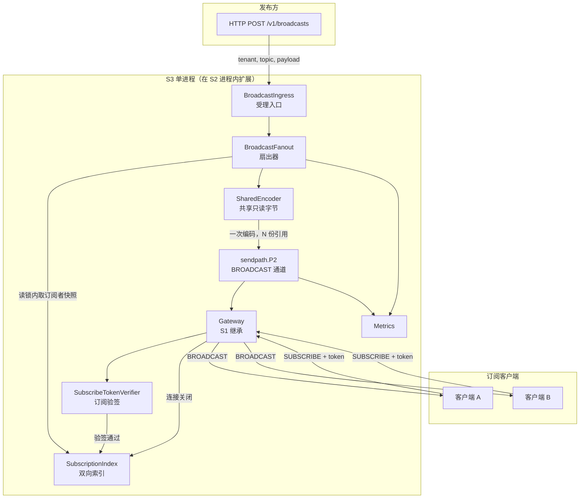
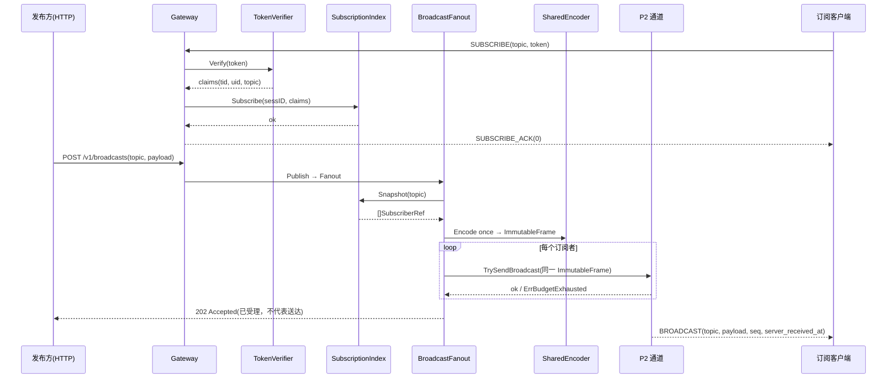
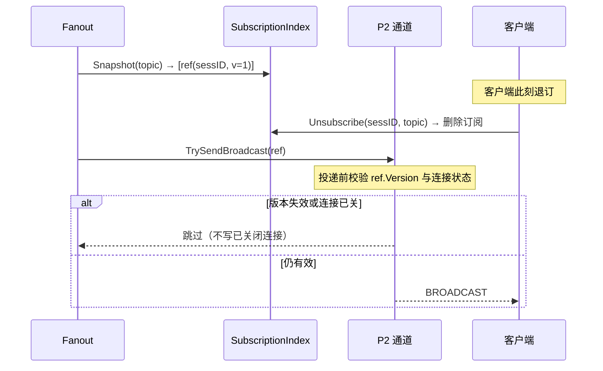
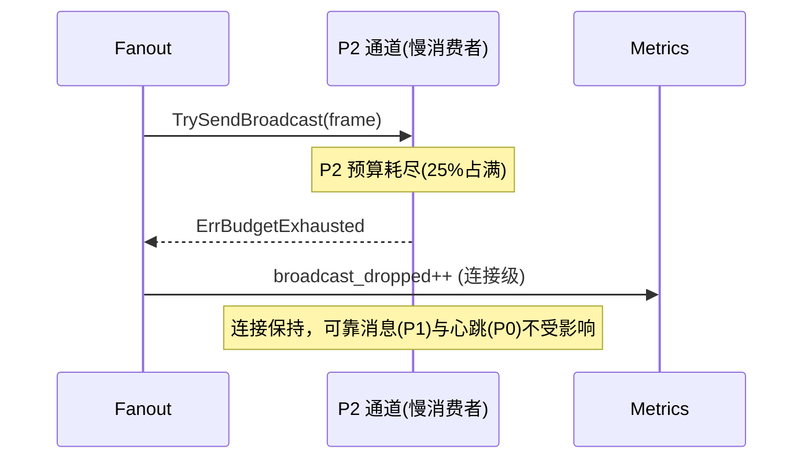

# S3 订阅与广播（Topic Subscribe & Broadcast）
# 详细设计（Low-Level Design）

> 本文是《通用实时消息 Gateway Platform — 架构设计方案 v1》中 **S3 阶段**的实现级展开。
>
> - **上位文档**：`通用实时消息 Gateway Platform - 架构设计方案.md`（架构方案）
> - **前置契约**：本文复用 S2 冻结的语义契约（`semantic-contract-v1.md`），并复用 S1 的统一发送路径四通道模型；不重新定义消息状态机、幂等键或帧号基础段。
> - **阶段定位**：单机、topic 寻址、在线扇出。**广播是 Best-Effort，不进 S2 的可靠状态机、不落库。**
> - **明确不做**：业务成员库、群组/房间生命周期、payload 解析、Exactly-Once、历史回放、离线补发、跨节点广播（S7）、客户端事件（S4）。

| 项 | 内容 |
|---|---|
| 阶段编号 | S3 |
| 依赖阶段 | S1（统一发送路径 P2 通道）、S2（冻结契约：topic 不透明、Best-Effort 语义） |
| 架构增量 | L2 层 topic 寻址；复用 P2 通道 |
| 帧号段 | `0x10`–`0x1F`（订阅与广播域，冻结） |
| 新增进程 | 无（并入 S2 单进程；HTTP `POST /v1/broadcasts` 接入同一进程） |
| 新增存储 | **无持久化表**（订阅索引纯内存） |
| 核心原则 | topic 不透明 · 在线 Best-Effort · 共享编码字节 · 丢弃而非断连 |

---

## 目录

1. [设计目标与契约边界](#1-设计目标与契约边界)
2. [模块划分](#2-模块划分)
3. [协议帧定义](#3-协议帧定义)
4. [订阅鉴权边界](#4-订阅鉴权边界)
5. [订阅索引设计](#5-订阅索引设计)
6. [核心帧序列](#6-核心帧序列)
7. [扇出与共享编码](#7-扇出与共享编码)
8. [背压与 QoS（P2 通道）](#8-背压与-qosp2-通道)
9. [并发控制与竞态](#9-并发控制与竞态)
10. [故障处理矩阵](#10-故障处理矩阵)
11. [可观测性设计](#11-可观测性设计)
12. [测试用例设计](#12-测试用例设计)
13. [验收标准与冻结清单](#13-验收标准与冻结清单)

---

# 1. 设计目标与契约边界

## 1.1 本阶段解决的问题

S1 只解决了「我知道收件人是谁」（user / endpoint）。S3 补齐第二种基础寻址能力：**topic 订阅与在线广播**。

- `topic` 对平台完全不透明：平台不理解直播间、群组、频道的业务含义，只维护「哪些连接订阅了哪些 topic」，并把一条 publish 扇出给当前在线订阅者。
- 直播弹幕、系统公告等场景 = `topic + Best-Effort + 在线 + 单 topic 有序`。

## 1.2 为什么复用 S1 的发送路径而不新造

本方案的设计原则是：新增「寻址 × 语义」组合不得产生新的发送路径。广播直接接入 S1 已定型的 **P2 BROADCAST 通道**：

| 能力 | 由谁提供 | 本阶段职责 |
|---|---|---|
| 单连接单 Writer | S1 | 复用 |
| 四通道优先级与预算隔离 | S1 | 复用 P2 通道；占用发送队列约 25% 预算 |
| 控制帧优先 | S1（P0） | 复用，广播不得拖死心跳 |
| topic 订阅索引 | S3 | **新建**（纯内存） |
| 广播受理与扇出 | S3 | **新建** |
| 共享只读编码字节 | S3 | **新建**（P2 通道接受不可变字节引用 + 引用计数归还） |

## 1.3 契约落地对照

| 冻结契约 | 本阶段落地点 |
|---|---|
| topic 不透明字符串 | §3.2 SUBSCRIBE 帧；§5 索引以原始字符串为键 |
| 在线 Best-Effort，不重试/不补发/不落库 | §7 扇出；§10 故障矩阵 |
| 单 topic 内有序 | §9.3 单 topic 串行化 |
| 丢弃而非断连 | §8 P2 预算耗尽策略 |
| 能力位协商 | §3.3 `CAP_TOPIC_SUBSCRIBE (0x02)` |
| 订阅 token 业务签发，平台只验签 | §4 |

---

# 2. 模块划分

## 2.1 组件视图



## 2.2 目录结构

```text
s3/
├── cmd/gateway/                  # 进程入口（在 S2 基础上装配订阅组件）
├── internal/
│   ├── protocol/                 # 新增 SUBSCRIBE/UNSUBSCRIBE/BROADCAST 帧编解码
│   ├── session/                  # 继承 S1，新增 conn-level 订阅集合引用
│   ├── sendpath/                 # 继承 S1，P2 通道扩展接受不可变 []byte
│   │   └── p2.go
│   ├── broadcast/
│   │   ├── ingress.go            # BroadcastIngress（HTTP 受理）
│   │   ├── verifier.go           # SubscribeTokenVerifier
│   │   ├── index.go              # SubscriptionIndex 双向索引
│   │   ├── fanout.go             # BroadcastFanout
│   │   ├── encoder.go            # SharedEncoder 共享编码
│   │   └── metrics.go
│   └── config/
├── docs/
│   ├── broadcast-protocol.md
│   └── adr/                      # topic 不透明 / 广播不落库 / 丢弃 / 复用 P2
└── test/
    ├── unit/
    ├── integration/
    ├── concurrency/
    └── failure/
```

## 2.3 核心 Go 接口

```go
// ===== 订阅验签 =====
type SubscriptionClaims struct {
    TenantID string
    UserID   string
    Topic    string
    ExpiresAt time.Time
    Kid      string
}

type SubscribeTokenVerifier interface {
    Verify(ctx context.Context, token string) (SubscriptionClaims, error)
    // 只验签：用 tenant 级密钥 + kid 校验，绝不查业务成员库
}

// ===== 订阅索引（纯内存） =====
type SubscriptionIndex interface {
    // Subscribe 返回是否新建；重复订阅幂等
    Subscribe(sessID string, claims SubscriptionClaims) (bool, error)
    Unsubscribe(sessID, topic string) (bool, error)
    // Snapshot 在读锁内复制订阅者快照，释放锁后返回
    Snapshot(topic string) []SubscriberRef
    // RemoveSession 断连清理：移除该会话所有订阅
    RemoveSession(sessID string) []string  // 返回被清理的 topic
    // Stats 容量指标
    Stats() IndexStats
}

type SubscriberRef struct {
    SessionID string
    Sender    P2Sender  // 指向该连接的 P2 通道发送函数
    Version   uint64    // 订阅版本，用于退订竞态校验
}

type P2Sender interface {
    // TrySendBroadcast 非阻塞尝试；预算耗尽返回 ErrBudgetExhausted
    // 必须是 *ImmutableFrame：按值传递会复制引用计数器（见下方"为什么必须是指针"）
    TrySendBroadcast(frame *ImmutableFrame) error
}

// ===== 共享不可变帧（唯一形态：指针传递）=====
type ImmutableFrame struct {
    // buf 不导出：外部无法拿到切片，也就不可能在 Release 之后读它（use-after-put）。
    buf   []byte
    refs  atomic.Int32 // 引用计数：创建 1、入队 +1、Writer 写完 -1、归零归还 pool
    pool  *sync.Pool   // 创建时必定非 nil；归零时的归还目标
}

// WriteTo 唯一写出入口：读字节与持引用绑在一次调用里，调用方拿不到裸切片。
func (f *ImmutableFrame) WriteTo(w io.Writer) (int64, error) {
    n, err := w.Write(f.buf)
    return int64(n), err
}

// Len 只读长度，供指标与日志使用；不暴露内容。
func (f *ImmutableFrame) Len() int { return len(f.buf) }

// NewImmutableFrame 唯一构造入口：pool 与 buf 必须同源，refs 初始为 1
func NewImmutableFrame(pool *sync.Pool, buf []byte) *ImmutableFrame {
    f := &ImmutableFrame{buf: buf, pool: pool}
    f.refs.Store(1)
    return f
}

// Retain 由入队方调用（TrySendBroadcast 内部），成功入队后持有 1 个引用
func (f *ImmutableFrame) Retain() { f.refs.Add(1) }

// Release Writer 写完或无主时调用；最后一位归还 buffer 到池
func (f *ImmutableFrame) Release() {
    n := f.refs.Add(-1)
    if n < 0 {
        panic("broadcast: ImmutableFrame released more times than retained") // double-release 立即暴露
    }
    if n == 0 {
        if f.pool == nil {
            panic("broadcast: ImmutableFrame with nil pool")
        }
        f.pool.Put(f.buf)
        f.buf = nil // 归还后立刻断开引用：即便有人绕过 API 也不会读到别人的数据
    }
}

// ===== 扇出 =====
type BroadcastInput struct {
    TenantID  string
    Topic     string
    Payload   []byte
    IdemKey   string  // 可选，仅用于 HTTP 受理幂等（内存去重窗口）
}

type BroadcastIngress interface {
    Publish(ctx context.Context, in BroadcastInput) (Accepted, error)
    // 返回 202 语义：已进入扇出流程，不代表任何订阅者已收到
}

type BroadcastFanout interface {
    Fanout(ctx context.Context, in BroadcastInput) FanoutResult
    // 返回：目标数/成功入队数/丢弃数/编码字节数
}

// SharedEncoder 每次 publish 只调用一次；返回指针，字节所有权交给 ImmutableFrame
type SharedEncoder interface {
    Encode(topic string, payload []byte, serverReceivedAt time.Time, seq uint64) (*ImmutableFrame, error)
}
```

**为什么必须是指针（不得改为值传递）**

`ImmutableFrame` 含 `atomic.Int32`（内含 `noCopy`）。一旦按值传入 `TrySendBroadcast`，`refs` 会被**复制**成一份独立计数器：

- 队列副本 `Retain` 只作用于副本，扇出方 `Release` 让原计数归零 → `pool.Put(buf)`；
- 队列副本仍持有同一块底层字节，下一轮 publish 从池里取到它并覆盖 → **跨帧串数据**；
- 副本计数永远无法归零 → buffer 永不归还（泄漏），并可能对同一块内存重复 `Put`；
- `go vet` 直接报 `passes lock by value`，阻断 CI。

换成指针后这三个问题同时消失：全链路只有一份计数器，`Release` 的负值与 `pool == nil` 断言把 double-release 与漏设 pool 变成**立即 panic 而不是静默错乱**。

| 规则 | 强制点 |
|---|---|
| 只允许 `*ImmutableFrame` | `P2Sender.TrySendBroadcast`、`SharedEncoder.Encode`、队列元素类型、`Retain/Release` 接收者 |
| 只允许 `NewImmutableFrame` 构造 | 除该构造函数外禁止 `ImmutableFrame{}` 字面量（`refs` 未初始化、`pool` 可能为 nil） |
| 传参不得为 nil | 入队前判空；nil 视为编程错误，`panic` 而非静默丢弃 |
| **生命周期纪律** | `Release` 之后不得再访问该帧；Writer 一律通过 `WriteTo(w)` 写出 |
| 底层字节不导出 | 字段为 `buf`（包内可见），提供 `WriteTo` / `Len`；**不提供** `Bytes() []byte` 之类访问器，避免把裸切片带出持有期 |

> 该接口由 S1 的 P2 通道实现：S1 侧实现必须使用相同的指针签名，不得为"方便"再复制一份值类型。

## 2.4 关键取舍

| 取舍 | 决定 | 理由 |
|---|---|---|
| 订阅索引是否落库 | 否，纯内存 | 广播是连接级语义，断连即失效；落库会引入「谁清理」的分布式问题 |
| 订阅鉴权方式 | 业务签发 token，平台只验签 | 平台不查成员库，保持业务无关 |
| 广播是否产生 delivery 记录 | 否 | 与 S2 可靠链路彻底隔离，不写 PostgreSQL |
| 广播帧编码次数 | 每次 publish 仅一次 | 1 万订阅者不得产生 1 万次编码 |
| 预算耗尽行为 | 丢弃当前帧 + 计数，不关连接 | Best-Effort 语义；可靠连接不受影响 |
| 帧传递形态 | 指针 + 引用计数（不拷贝） | 值传递会复制计数器，等价于回到"提前归还"的原始缺陷 |

---

# 3. 协议帧定义

## 3.1 帧号分配（`0x10`–`0x1F`，冻结）

| 帧号 | 名称 | 方向 | 说明 |
|---|---|---|---|
| `0x10` | SUBSCRIBE | C→S | 订阅 topic，携带业务签名 token |
| `0x11` | SUBSCRIBE_ACK | S→C | 订阅结果（成功/失败原因码） |
| `0x12` | UNSUBSCRIBE | C→S | 退订 topic |
| `0x13` | UNSUBSCRIBE_ACK | S→C | 退订确认 |
| `0x14` | BROADCAST | S→C | 广播帧（Best-Effort） |

> 订阅本身就是能力声明：服务端只向成功订阅的连接发送 `BROADCAST`。旧客户端不发订阅帧，因此不会收到任何新帧，行为完全不变。

## 3.2 帧 Payload

```text
SUBSCRIBE (0x10)
  topic   : string        // 不透明，平台不解析
  token   : string        // 业务签发的订阅凭证（§4）

SUBSCRIBE_ACK (0x11)
  topic      : string
  result     : uint8      // 0=成功, 1=验签失败, 2=超限, 3=重复订阅
  reason     : string

UNSUBSCRIBE (0x12)
  topic   : string

UNSUBSCRIBE_ACK (0x13)
  topic   : string
  result  : uint8         // 0=成功, 1=未订阅

BROADCAST (0x14)
  topic      : string
  payload    : bytes      // 平台不解析；上限 8 KiB
  server_received_at : int64   // 服务端受理时刻（unix ms），用于端到端延迟测量
  seq        : uint64     // 单 topic 单调递增序号，用于有序/丢失检测
```

**部署顺序**：先升级服务端（支持新帧），再升级客户端。避免新客户端向旧服务端发送未知帧类型。旧客户端不设置能力位时，服务端不发送 `BROADCAST`。

## 3.3 能力位

`LOGIN_ACK.capabilities` 追加：

| 位 | 名称 | 含义 |
|---|---|---|
| `0x02` | `CAP_TOPIC_SUBSCRIBE` | 支持订阅与广播；客户端据此决定是否发 SUBSCRIBE |

> 与 S2 的 `CAP_RELIABLE_POLICY (0x04)` 同属 `LOGIN_ACK.capabilities`，各占独立位，互不冲突。

---

# 4. 订阅鉴权边界

## 4.1 设计原则

平台回答「这个 token 是否有权订阅这个 topic」，但**不查业务成员库**。判定依据是业务统一签发的签名 token。

```text
token = base64url(header).base64url(payload).signature
header  : { "alg": "HS256", "kid": "<tenant-key-id>" }
payload : {
    "tid": "<tenant_id>",
    "uid": "<user_id>",
    "topic": "<topic>",
    "exp": <unix_ts>
}
signature = HMAC-SHA256(tenant_secret[kid], header + "." + payload)
```

## 4.2 验签流程

```text
SubscribeTokenVerifier.Verify(token):
  1. 解析 header → kid, alg；alg 非白名单 → 拒绝
  2. 按 kid 取 tenant 密钥（密钥缓存，支持轮转）
  3. 校验签名（常量时间比较）
  4. 校验 exp（用服务端时间；仅此处允许本地钟，因是鉴权窗口非投递判定）
  5. 校验 token.tid == 连接已认证的 tenant_id（防止跨租户订阅）
  6. 校验 token.topic == SUBSCRIBE 帧中的 topic（防止订阅越权 topic）
  7. 返回 claims
```

## 4.3 边界声明

- 平台只验签，**不知道**用户是否真的在直播间/群组中；成员关系由业务在签发 token 时决定。
- token 过期后连接不会被主动断开，但**重新订阅**必须携带新 token。
- 验签失败 → `SUBSCRIBE_ACK(result=1)`，不影响已建立的订阅关系。
- 密钥不落配置文件，支持轮转（与 S8 安全基线一致，此处只实现验签所需的最小能力）。

---

# 5. 订阅索引设计

## 5.1 双向索引结构

```text
SubscriptionIndex
  ├── byTopic : map[topic]map[sessID]SubscriberRef
  └── bySession : map[sessID]map[topic]struct{}

约束：
- 单连接 topic 数上限（如 100）
- 单 topic 订阅者数上限（如 100000）
- topic 长度上限（如 256 字节）
- 全局订阅总数上限
```

双向索引保证：

- 订阅 / 退订 O(1)。
- 断连清理 O(该连接订阅数)：从 `bySession[sessID]` 遍历，逐个从 `byTopic` 删除。
- 扇出 O(该 topic 订阅者数)：从 `byTopic[topic]` 取。

## 5.2 快照式遍历

```go
func (idx *SubscriptionIndex) Snapshot(topic string) []SubscriberRef {
    idx.mu.RLock()
    defer idx.mu.RUnlock()

    m := idx.byTopic[topic]
    out := make([]SubscriberRef, 0, len(m))
    for sessID, ref := range m {
        out = append(out, ref)
    }
    return out  // 复制快照，释放锁后再投递
}
```

**关键约束**：绝不持有索引锁做网络 I/O。快照内的 `SubscriberRef` 携带 `Version`，投递前校验连接仍在线且订阅版本未变（§9.1）。

## 5.3 容量与清理

| 场景 | 行为 |
|---|---|
| 订阅索引满额 | 返回 `SUBSCRIBE_ACK(result=2)`，不影响已有订阅 |
| 单连接订阅数超限 | 拒绝新订阅，返回明确错误 |
| Gateway 重启 | 连接断开 → `RemoveSession` 清理；客户端重连后重新 SUBSCRIBE |
| topic 无订阅者 | 删除 `byTopic[topic]` 空 map，释放内存 |

---

# 6. 核心帧序列

## 6.1 订阅与广播成功路径



## 6.2 退订竞态



## 6.3 慢消费者丢弃



---

# 7. 扇出与共享编码

## 7.1 共享只读编码字节

```text
Fanout.Fanout(in):
  1. 校验 payload ≤ 8 KiB，topic 长度合法
  2. 进入该 topic 的串行区（per-topic 单 goroutine 或锁，§9.3）：
     a. seq   = topicSeq[topic]++                                  // 分配序号
     b. frame = SharedEncoder.Encode(topic, payload, now, seq)      // 返回 *ImmutableFrame，refs=1（扇出方持有）
     c. subs  = index.Snapshot(topic)
     d. for ref in subs:
          if !ref.ConnectionAlive() or ref.VersionChanged(): continue
          err = ref.Sender.TrySendBroadcast(frame)                 // 传指针；成功入队内部 refs+1
          if err == ErrBudgetExhausted: metrics.Dropped(ref)++
     退出串行区
  3. frame.Release()   // 释放扇出方自己那 1 个引用；最后一个引用释放时才归还 buffer
```

**所有权规则（唯一实现，不得并列保留其他写法）**：

| 角色 | 何时 `Retain` | 何时 `Release` |
|---|---|---|
| 扇出方 | `NewImmutableFrame` 时 `refs = 1` | 步骤 3（不再需要该字节） |
| P2 队列 | `TrySendBroadcast` **入队成功**时 +1 | 入队失败（预算耗尽）时立即回退，不额外持有 |
| Writer | —（借用已持有的引用） | `WriteTo(w)` 返回后 -1；之后不得再访问该帧 |

- `refs` 归零 → `pool.Put(f.buf)` 并把 `buf` 置 nil；**不存在"扇出结束就归还"的时刻**。
- 全链路只传 `*ImmutableFrame`：**任何一处按值复制都等于把计数器分家**，等价于回到"提前归还"的原缺陷（§2.3）。
- **只读与生命周期由类型保证**：`buf` 不导出，外部只能 `WriteTo` / `Len`；归零后 `buf=nil`，残留引用最多写出 0 字节，不会读到被复用的内存。
- `Release` 负计数与 `pool == nil` 一律 panic（快速失败优于静默串数据）；测试用 `recover` 断言。
- 如果改用"每连接拷贝入队"，必须写 ADR 记录 N 倍拷贝与 GC 压力，且删除引用计数字段；**两种方案不得在代码里同时存在**。

> 为什么原设计会出错：`TrySendBroadcast` 只是把引用放进有界队列，Writer 异步取帧写 Socket。"所有订阅者已同步入队"时没有任何一帧真正写完；此时归还 buffer，下一轮 publish 会从池里拿到同一块内存并覆盖，已入队的广播帧内容被改写——表现为跨 topic/跨帧串数据，且 `-race` 检测不到（池化天然绕过竞争检测）。
>
> 共享编码的性能收益与这套引用计数是同一条决策的两面：只读共享 + 引用计数，观测点是 S5 性能工程（`BenchmarkFanout` 的 allocs/op 与 P2 队列水位）。

## 7.2 广播不落库

- `POST /v1/broadcasts` 受理后**直接内存扇出**，不写 PostgreSQL，不产生 delivery 记录，不参与 S2 的重试/TTL/ACK。
- 返回 `202` 表示「已进入扇出流程」，协议文档必须明确该语义，避免 S7 接入 Kafka 时语义漂移。
- 可选幂等键仅用于 HTTP 受理层的**内存去重窗口**（防短时间重复 submit），窗口外不保证。

---

# 8. 背压与 QoS（P2 通道）

## 8.1 P2 通道预算

- 继承 S1 的四通道模型，P2 广播通道默认占发送队列约 **25%** 字节/帧预算。
- 与 P1（可靠消息）预算**物理隔离**：广播打满不得挤占可靠投递。
- P0（PING/PONG/CLOSE）优先级最高，广播不得拖死心跳。

## 8.2 慢消费者策略

| 状态 | 行为 |
|---|---|
| P2 预算充足 | 正常入队并广播 |
| P2 预算耗尽 | 丢弃**当前**广播帧并计数，**不关闭连接** |
| 连续丢弃超阈值 | 降级为该连接只保留可靠消息（暂停广播投递），并暴露指标 |
| 连接恢复 | 预算回落后自动恢复广播投递 |

> 与可靠路径的差异：可靠消息在队列满时按 S1 契约处理（背压/断连），广播永远「丢弃 + 计数」，绝不因广播断连。

## 8.3 限流

- 租户级与 topic 级 publish 限流，按**条数与字节**双计量。
- payload 上限 8 KiB，大内容只广播引用（由业务自行处理）。
- 限流拒绝返回明确错误，不影响已建立的订阅关系。

---

# 9. 并发控制与竞态

## 9.1 退订 / 断连竞态

扇出快照生成后，连接可能恰好退订或断开。处理：

- `SubscriberRef.Version` 在订阅时分配，退订/重订阅时递增。
- 投递前校验：连接仍在线 `ConnectionAlive()` 且 `ref.Version == 当前订阅版本`。
- 失效则跳过，保证不写已关闭连接。

## 9.2 断连清理

- 连接关闭 → `RemoveSession(sessID)` 从 `bySession` 与 `byTopic` 双向移除。
- 清理在连接关闭回调中同步执行，避免残留引用导致内存泄漏。
- `-race` 测试覆盖「扇出进行中断连」。

## 9.3 单 topic 有序（临界区定义）

有序性不是"seq 分配有序"就够，而是**"分配 seq + 编码 + 逐订阅者入队"三件事必须在同一个临界区内完成**：

```text
per-topic 串行区：
  ① seq = topicSeq[topic]++
  ② frame = Encode(topic, payload, now, seq)
  ③ for each subscriber: TrySendBroadcast(frame)
  —— 三步原子，出区后才允许下一个 publish 进入
```

| 若只把 ① 放进临界区 | 若只把 ① + ② 放进临界区 |
|---|---|
| 并发 publish 拿到 seq=1、seq=2，却可能按 2、1 的顺序入队 → 订阅者看到 2 后看到 1，`seq` 检测到"乱序"但无法修复 | 编码顺序正确，但两个 publish 的入队仍可交错 → 同一连接内帧顺序与 seq 顺序不一致 |

实现形式二选一（都可满足上述语义，且不得混用）：

- **per-topic 锁**：`topicLocks[topic]`，临界区内完成 ①②③，临界区外做 `frame.Release()`。
- **per-topic 单 goroutine 队列**：publish 投递到该 topic 的 mailbox，由单一 worker 顺序执行 ①②③。

其他约束：

- `seq` 由该串行化点单调递增分配，接收端可用 `seq` 检测乱序/丢失。
- 临界区内**不得做网络 I/O 或阻塞操作**：`TrySendBroadcast` 是非阻塞尝试（预算满立即返回错误），保证临界区时长有界。
- 不同 topic 之间无顺序约束，可并发扇出。

## 9.4 并发风险表

| 风险 | 手段 |
|---|---|
| 索引读写并发 | `RWMutex`：快照用读锁，订阅/退订/清理用写锁 |
| 快照期间修改 | 快照复制 + 释放锁后投递 |
| 退订竞态 | `Version` 校验 + 连接状态校验 |
| 重复订阅 | `Subscribe` 幂等，返回 result=3 或 ok |
| 单 topic 乱序 | per-topic 串行区（seq 分配 + 编码 + 入队同区） |
| buffer 提前归还 / 串数据 | `ImmutableFrame` 引用计数：入队 +1、写完 -1、归零归还 |
| 计数器被复制 | 全链路指针传递；`go vet` 的 `passes lock by value` 作为 CI 门禁 |
| double-release / 漏设 pool | `Release` 负计数与 `pool == nil` 立即 panic |

---

# 10. 故障处理矩阵

| # | 场景 | 行为 | 恢复 | 验收口径 |
|---|---|---|---|---|
| B1 | 订阅索引满额 | 拒绝新订阅，返回明确错误 | 退订后释放 | 已有订阅不受影响 |
| B2 | 单连接 P2 预算耗尽 | 丢弃当前帧 + 计数，连接保持 | 预算回落后自动恢复 | 可靠消息与心跳不受影响 |
| B3 | 慢消费者持续 | 降级为只保留可靠消息 | 消费恢复后回升 | 丢弃可观测，其他订阅者不受影响 |
| B4 | Gateway 重启 | 连接断开，订阅随连接清理 | 客户端重连后重新 SUBSCRIBE | 无残留订阅引用 |
| B5 | token 验签失败 | 拒绝订阅，返回 result=1 | 业务重签 token | 不影响已有订阅关系 |
| B6 | payload 超限 | 拒绝 publish | 业务改发引用 | 无超限帧进入扇出 |
| B7 | 扇出中连接断开 | Version/状态校验跳过 | — | 不写已关闭连接，无 panic |
| B8 | topic 无订阅者 | 直接返回，不编码 | — | 无无效编码开销 |
| B9 | 共享 buffer 被提前归还 | 引用计数保护（不存在的路径：无"扇出结束即归还"） | — | 高并发 + 慢消费者下无帧体串扰 |

---

# 11. 可观测性设计

| 指标 | 类型 | 用途 |
|---|---|---|
| `broadcast_subscribers` | Gauge | 订阅连接数 |
| `broadcast_active_topics` | Gauge | 活跃 topic 数 |
| `broadcast_publish_tps` | Counter | publish 速率（条/字节） |
| `broadcast_fanout_frames` | Counter | 扇出帧数 |
| `broadcast_dropped` | Counter | 丢弃帧数（按连接/topic 标签） |
| `broadcast_slow_consumers` | Gauge | 慢消费者数 |
| `broadcast_fanout_latency` | Histogram | 扇出延迟 P50/P99 |
| `broadcast_index_full` | Counter | 索引触顶次数（S8 告警） |

- 日志：订阅、退订、断连清理、限流、丢弃原因统一携带 `traceID` 与 `tenantID`。
- 丢弃必须记录原因（预算耗尽 / 版本失效 / 连接关闭），便于端侧定位。

---

# 12. 测试用例设计

## 12.1 单元测试

| 用例 | 断言 |
|---|---|
| 双向索引增删 | Subscribe/Unsubscribe 后两个 map 一致 |
| 断连清理 | RemoveSession 后该会话所有订阅移除 |
| 快照隔离 | Snapshot 返回副本，后续修改不影响快照 |
| 共享编码 | N 个订阅者只调用一次 Encode |
| 单 topic seq 单调 | 并发 publish 下 seq 无重复、无乱序 |
| **引用计数生命周期** | 创建 1 → N 次入队 N+1 → N 次写完 + 扇出方释放后归零，`pool.Put` 恰好一次 | 
| **double-release 断言** | 多调一次 `Release` 必 panic（用 `recover` 断言消息） |
| **nil pool 断言** | 构造 `pool == nil` 的帧并释放到 0，必 panic |
| **指针签名静态检查** | **除 `NewImmutableFrame` 外**包内不存在 `ImmutableFrame{` 字面量；`go vet` 无 `passes lock by value` |
| **归零后不可读** | 引用归零后 `buf == nil`：`WriteTo` 写出 0 字节、`Len()` 返回 0，不会读到池中复用数据 |

## 12.2 集成测试（真实协议）

| 用例 | 断言 |
|---|---|
| 订阅后收广播 | 订阅者收到 `BROADCAST`，未订阅者不收到 |
| 重复订阅/退订未订阅 topic | 返回明确 result 码 |
| 断连自动清理 | 断开后该连接不再被计入订阅者 |
| payload 上限 | 超限 publish 被拒 |
| token 验签失败 | 订阅被拒，返回 result=1 |

## 12.3 并发测试（`go test -race`）

| 用例 | 断言 |
|---|---|
| 扇出中断连/退订 | 无 panic、无写已关闭连接 |
| 并发订阅同一 topic | 索引一致，无重复计数 |
| 快照期间并发修改 | 无数据竞争，结果可解释 |

## 12.4 故障测试

| 用例 | 注入 | 断言 |
|---|---|---|
| 慢消费者 | 降低消费速率 | 丢弃可观测、连接不被关闭、可靠消息不受影响 |
| 索引触顶 | 填满索引 | 拒绝新订阅，已有订阅正常 |
| Gateway 重启 | kill -9 | 重连重订阅后广播恢复 |

## 12.5 验收场景（`cmd/live` + S2 交付的 `cmd/scenario` v0）

> `cmd/scenario` 由 S2 阶段交付 v0（仅 IM/可靠消息用例），S3 在其上追加广播用例；S4 扩展为 v1。S3 不依赖尚未交付的工具。

- `topic-fanout`：订阅者全收、未订阅者不收。
- `slow-consumer-drop`：慢消费者丢弃可观测，其他订阅者不受影响。
- `fanout-order`：单 topic 内广播有序（seq 连续、入队顺序与 seq 一致）。
- `unsubscribe-race`：退订竞态无写已关闭连接。
- `compat-old-client`：旧客户端不订阅、行为不变。
- `shared-buffer-integrity`：并发 publish + 慢消费者下，各订阅者收到的帧体与其 `seq` 对应的 payload 完全一致（**专测引用计数，不复现"串台"**）。

---

# 13. 验收标准与冻结清单

## 13.1 验收标准

**功能与正确性**
- 客户端可订阅/退订 topic，断连后订阅自动清理。
- 一条 publish 被全部在线订阅者收到；未订阅连接不收到 `BROADCAST`。
- 重复订阅、退订不存在 topic、超限订阅均返回明确错误。
- 同一 topic 广播在单连接内保持顺序。

**性能与容量**
- 单 Gateway 1 万订阅者、单 topic 每秒 100 条广播时，扇出延迟 P99 满足目标。
- 慢消费者场景下广播丢弃可观测、连接不被关闭、其他订阅者不受影响。
- 广播流量不显著影响点对点可靠转发延迟（P2 与 P1 隔离）。

**工程质量**
- `gofmt`、`go vet`、`go test ./...`、`go test -race ./...` 全部通过。
- 订阅索引、共享编码、背压策略均有单测与并发测试。
- 广播协议与 QoS 边界形成独立文档与 ADR。

## 13.2 冻结清单（S3 验收通过后生效）

| 冻结项 | 值 / 位置 |
|---|---|
| 帧号段 | `0x10`–`0x1F`（SUBSCRIBE / SUBSCRIBE_ACK / UNSUBSCRIBE / UNSUBSCRIBE_ACK / BROADCAST） |
| 能力位 | `CAP_TOPIC_SUBSCRIBE = 0x02` |
| topic 语义 | 不透明字符串，平台不解析 |
| 广播语义 | 在线、Best-Effort、不重试、不补发、不落库、单 topic 有序 |
| 订阅鉴权边界 | 业务签发 token，平台只验签、不查成员库 |
| P2 通道预算 | 约 25% 发送队列，预算耗尽丢弃而非断连 |
| 共享编码 | 每次 publish 一次编码，订阅者共享只读字节；字节所有权归引用计数（入队 +1 / 写完 -1 / 归零归还），**禁止"扇出结束即归还"** |
| 帧传递形态 | **只传 `*ImmutableFrame`**（接口、编码器返回值、队列元素、方法接收者）；禁止值传递与 `ImmutableFrame{}` 字面量 |
| 帧生命周期 | `Release` 后不得访问该帧；写出统一走 `WriteTo(w)`；底层字节字段不导出、不提供 `Bytes()` 访问器 |
| 失败断言 | `Release` 见负计数或 `nil` pool 必须 panic；`go vet` 无 `passes lock by value` |
| 单 topic 有序 | §9.3：seq 分配 + 编码 + 逐订阅者入队在同一 per-topic 临界区内 |
| `POST /v1/broadcasts` | 返回 202 = 已进入扇出，不代表送达 |

> **冻结后纪律**：S4–S8 只复用上述语义，S7 跨节点广播仅把「谁产生 broadcast」从 HTTP 直连换成 Kafka 消费者，**扇出逻辑与订阅索引零改动**；若需重构语义，须回退到单机阶段重做。

---

> **结语**：S3 的全部设计都围绕一个目标——**把扇出原语在单机、无分布式协调的条件下验证透**。订阅索引、共享编码、丢弃策略与单 topic 有序全部在内存中定型；S7 只更换广播消息的来源，不改这里冻结的任何一行语义。
