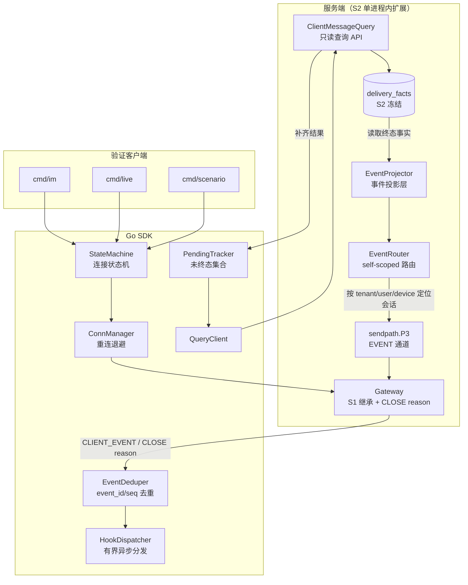
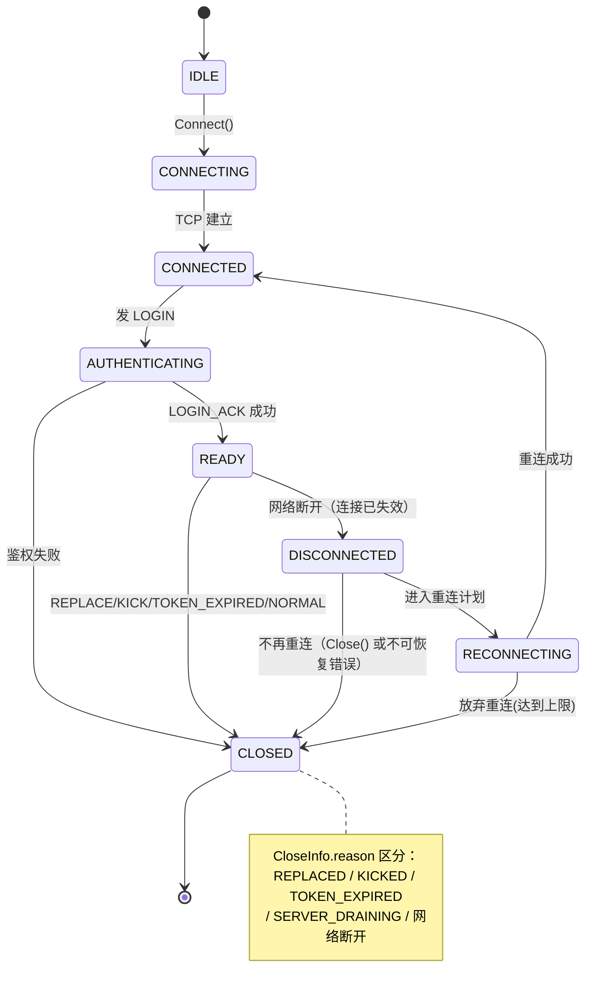
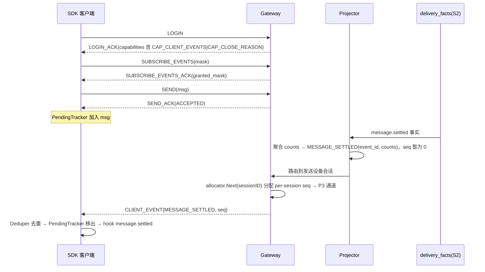
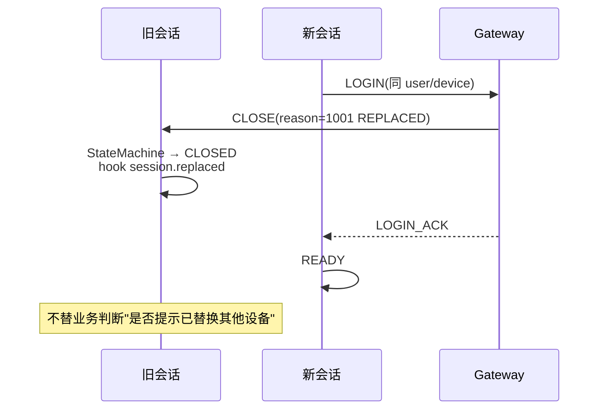
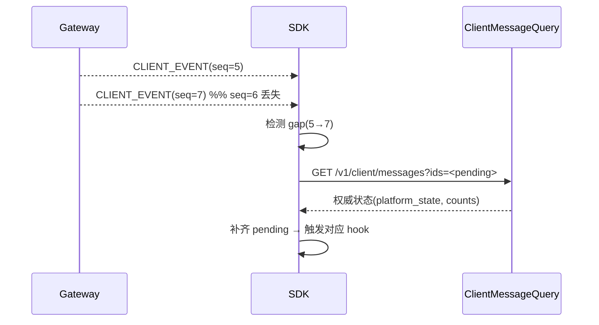

# S4 Go 客户端 SDK 与生命周期事件
# 详细设计（Low-Level Design）

> 本文是《通用实时消息 Gateway Platform — 架构设计方案 v1》中 **S4 阶段**的实现级展开。
>
> - **上位文档**：`通用实时消息 Gateway Platform - 架构设计方案.md`（架构方案）
> - **前置契约**：消费 S2 冻结的 `delivery_facts` 语义（不重新定义事实）；复用 S3 的订阅门控模式；复用 S1 的 P3 EVENT 通道。
> - **阶段定位**：单机、端侧可观测契约成型。客户端不再依赖 Business ACK 也能还原自己发送消息的传输结果。
> - **明确不做**：跨用户 presence / 已读 / 正在输入、事件持久化与重放、多语言 SDK、跨节点事件转发（S7）、广播语义变更（S3 冻结）。

| 项 | 内容 |
|---|---|
| 阶段编号 | S4 |
| 依赖阶段 | S1（P3 通道）、S2（delivery_facts 契约）、S3（订阅门控模式） |
| 架构增量 | L4 事件层；进程内事件投影 |
| 帧号段 | `0x20`–`0x2F`（客户端事件域，冻结） |
| 新增进程 | 无（事件投影在 S2 单进程内实现；S7 换成独立 router 进程） |
| 核心原则 | self-scoped · 只推聚合终态 · best-effort + 查询兜底 · 不进状态机 |

---

## 目录

1. [设计目标与契约边界](#1-设计目标与契约边界)
2. [模块划分](#2-模块划分)
3. [协议帧定义](#3-协议帧定义)
4. [SDK 状态机与 hooks 契约](#4-sdk-状态机与-hooks-契约)
5. [事件投影层](#5-事件投影层)
6. [事件放大约束](#6-事件放大约束)
7. [事件分发与 P3 通道](#7-事件分发与-p3-通道)
8. [查询与补齐](#8-查询与补齐)
9. [顺序与幂等](#9-顺序与幂等)
10. [核心帧序列](#10-核心帧序列)
11. [兼容矩阵](#11-兼容矩阵)
12. [故障处理矩阵](#12-故障处理矩阵)
13. [可观测性设计](#13-可观测性设计)
14. [测试用例设计](#14-测试用例设计)
15. [验收标准与冻结清单](#15-验收标准与冻结清单)

---

# 1. 设计目标与契约边界

## 1.1 本阶段解决的问题

S2 解决了业务后端的事实出口，但端侧仍只能看到「发送受理」和「收到消息」两个点：连接被替换拿不到原因，消息受理后不知道最终结算结果，SDK 没有稳定的生命周期回调契约。

S4 补齐端侧可观测性，并落成可复用的 Go SDK：

- SDK 提供稳定的连接、会话、发送、接收、订阅 hooks。
- 服务端只推送与当前认证主体相关的**自有事件**（self-scoped）。
- 客户端事件是在线 **Best-Effort**，不保证离线不丢；权威结果通过查询 API 获取。
- 权威事实仍来自 S2 的 `delivery_facts`，本阶段只做**投影与推送**，不改事实语义。

判定标准：客户端不依赖 Business ACK，也能通过 hooks + 查询还原自己发送消息的传输结果，并能区分断线/被替换/被踢/令牌过期/服务端排空等原因。

## 1.2 契约落地对照

| 冻结契约来源 | 本阶段落地点 |
|---|---|
| S2 `message.settled` / `message.expired` 事实 | §5 事件投影层消费，投影为 `MESSAGE_SETTLED` / `MESSAGE_EXPIRED` |
| S2 事实 `event_id` 确定性派生 | §9 客户端去重键 |
| **S2 `messages.source_device_id`（来源设备）** | §5.3 路由键的唯一来源；不再依赖进程内连接上下文 |
| S2 `platform_state`（非业务成功） | §4.3 事件命名只表达传输结算 |
| S3 订阅门控模式 | §3.3 `SUBSCRIBE_EVENTS` 门控，旧客户端不订阅则不推送 |
| S1 P3 通道 | §7 事件走独立预算，不占用 P1/P2 |
| SETTLED 不代表业务成功 | §6 不输出 `read` / `completed` / `business_acked` 事件 |

---

# 2. 模块划分

## 2.1 组件视图



## 2.2 目录结构

```text
s4/
├── cmd/
│   ├── gateway/                  # 进程入口（装配事件投影与查询 API）
│   ├── im/                       # 改用 SDK 的终端 IM
│   ├── live/                     # 改用 SDK 的弹幕客户端
│   └── scenario/                 # 场景运行器 v1
├── protocol/
│   ├── frames.go                 # 新增 CLIENT_EVENT / SUBSCRIBE_EVENTS
│   └── close_reason.go           # CLOSE 原因码表（冻结）
├── sdk/                          # Go SDK（可独立 import）
│   ├── client.go
│   ├── statemachine.go
│   ├── hooks.go
│   ├── connmanager.go
│   ├── deduper.go
│   ├── pending.go
│   ├── query.go
│   └── events.go                 # 事件类型定义
├── internal/
│   ├── projector/
│   │   ├── projector.go          # EventProjector（游标轮询 facts）
│   │   ├── cursor.go             # EventCursor（projection_cursor 表）
│   │   ├── aggregator.go         # 消息级聚合
│   │   └── router.go             # self-scoped 路由
│   ├── query/
│   │   └── service.go            # ClientMessageQuery（只读）
│   └── config/
├── migrations/
│   └── 0003_projection_cursor.sql
├── docs/
│   ├── sdk-api.md
│   ├── client-events.md
│   └── adr/
└── test/
    ├── unit/
    ├── integration/
    ├── compat/                   # 兼容矩阵
    └── failure/
```

## 2.3 核心 Go 接口

```go
// ===== 服务端：事件投影 =====
type ClientEvent struct {
    EventID      string            // 确定性，来自事实或投影派生（投影阶段生成）
    Seq          uint64            // per-session 单调：**只在路由到会话时分配**，投影阶段为 0
    Type         ClientEventType
    TenantID     string
    MessageID    string
    StateVersion int
    Counts       *DeliveryCounts   // 仅聚合终态事件携带
    OccurredAt   time.Time
}

// SessionSeqAllocator 唯一分配点：在 P3 通道入队前调用（投影器不分配）
type SessionSeqAllocator interface {
    Next(sessionID string) uint64  // 每会话独立计数器，从 1 起单调；会话结束即销毁
}

type DeliveryCounts struct {
    Total         int
    ReceiptAcked  int
    Failed        int
    Expired       int
}

type ClientEventType string
const (
    EvMessageSettled  ClientEventType = "MESSAGE_SETTLED"
    EvMessageExpired  ClientEventType = "MESSAGE_EXPIRED"
    // 可选高体积事件（默认关闭）
    EvDeliveryReceipt ClientEventType = "DELIVERY_RECEIPT_ACKED"
    EvDeliveryFailed  ClientEventType = "DELIVERY_FAILED"
    EvDeliveryExpired ClientEventType = "DELIVERY_EXPIRED"
    EvMessagePartial  ClientEventType = "MESSAGE_PARTIAL"
)

type EventProjector interface {
    // Project 投影单条事实；事实由 Cursor 驱动的轮询提供（见 §5.4）
    Project(ctx context.Context, fact Fact) ([]ClientEvent, error)
    // Run 轮询 delivery_facts（按 occurred_at, event_id 游标），是 S4 的唯一触发源
    Run(ctx context.Context) error
}

type EventCursor interface {
    // Load 返回 (last_occurred_at, last_event_id)；首次运行返回零值
    Load(ctx context.Context, projector string) (time.Time, string, error)
    // Save 与事件分发同事务推进游标；重复读取由 event_id 幂等吸收
    Save(ctx context.Context, projector string, at time.Time, eventID string) error
}

type EventRouter interface {
    // 按 (tenant_id, producer_id, source_device_id) 定位发送设备会话
    // source_device_id 来自 messages.source_device_id / 事实 payload_summary，
    // 不再从进程内连接上下文读取
    Route(ctx context.Context, ev ClientEvent) error
    // 设备离线直接丢弃，不重试不落库
}

// ===== 服务端：查询 API =====
type ClientMessageQuery interface {
    GetForSender(ctx context.Context, tenant, producerID, messageID string) (*ClientMessageView, error)
    GetBatch(ctx context.Context, tenant, producerID string, ids []string) ([]ClientMessageView, error)
}

type ClientMessageView struct {
    MessageID    string
    PlatformState string          // ACCEPTED / SETTLED / EXPIRED
    Counts       DeliveryCounts
    SettledAt    *time.Time
    // 不返回 payload
}

// ===== SDK：状态机与 hooks =====
type ConnState string
const (
    StateIdle           ConnState = "IDLE"
    StateConnecting     ConnState = "CONNECTING"
    StateConnected      ConnState = "CONNECTED"
    StateAuthenticating ConnState = "AUTHENTICATING"
    StateReady          ConnState = "READY"
    StateReconnecting   ConnState = "RECONNECTING"
    StateDisconnected   ConnState = "DISCONNECTED"
    StateClosed         ConnState = "CLOSED"
)

type Hooks struct {
    Connecting      func(ConnectingInfo)
    Connected       func(ConnectedInfo)
    Authenticated   func(AuthenticatedInfo)
    Ready           func()
    Reconnecting    func(ReconnectInfo)
    Disconnected    func(DisconnectInfo)
    Closed          func(CloseInfo)      // 携带 reason code
    AuthFailed      func(AuthFailedInfo)
    HeartbeatTimeout func()

    MessageAccepted func(MessageAcceptedInfo)
    MessageSettled  func(MessageSettledInfo)
    MessageExpired  func(MessageExpiredInfo)
    Delivered       func(DeliveredInfo)   // 接收方本地 hook
    ReceiptAckSent  func(ReceiptAckInfo)

    EventDropped    func(DropInfo)
}

type SDKClient interface {
    Connect(ctx context.Context) error
    Close() error
    Send(ctx context.Context, to string, payload []byte, opts ...SendOption) (string, error)
    Subscribe(ctx context.Context, topic, token string) error
    QueryMessage(ctx context.Context, id string) (*ClientMessageView, error)
    State() ConnState
}
```

## 2.4 关键取舍

| 取舍 | 决定 | 理由 |
|---|---|---|
| 连接生命周期由谁维护 | SDK 本地状态机 | 服务端只能在断开前补原因，无法推送「你已断线」 |
| 事件是否持久化 | 否，best-effort + 查询兜底 | 事件是加速通知，权威结果在事实与查询 API |
| 事件推送粒度 | 默认消息级聚合 | 逐 endpoint 推送在 fanout 下产生 `2N+1` 条，打满端侧与链路 |
| 事件是否含 payload | 否 | 防泄漏；且不改变 S2「平台不解析 payload」 |
| 投影在哪个进程 | S4 进程内；S7 独立 router | 单机阶段无需独立进程，协议与 schema 先定型 |
| CLOSE 原因码如何演进 | 只追加不改语义 | 冻结后旧客户端忽略 body，新客户端按码表解释 |

---

# 3. 协议帧定义

## 3.1 帧号分配（`0x20`–`0x2F`，冻结）

| 帧号 | 名称 | 方向 | 说明 |
|---|---|---|---|
| `0x20` | SUBSCRIBE_EVENTS | C→S | 订阅客户端自有事件 |
| `0x21` | SUBSCRIBE_EVENTS_ACK | S→C | 订阅确认 + 能力声明 |
| `0x22` | CLIENT_EVENT | S→C | 客户端事件推送（self-scoped） |

> `CLOSE (0x0A)` 帧**不新增号段**，在 body 中追加稳定原因码；旧客户端忽略 body。这是 S4 对 S1 已定义帧的扩展，而非新造帧。

## 3.2 帧 Payload

```text
SUBSCRIBE_EVENTS (0x20)
  event_types : uint32      // 位掩码，客户端声明感兴趣的事件类型
  // 不订阅则服务端不发送任何 CLIENT_EVENT

SUBSCRIBE_EVENTS_ACK (0x21)
  result      : uint8
  granted_mask: uint32      // 服务端实际授予的类型（可小于请求）

CLIENT_EVENT (0x22)
  event_id      : string
  seq           : uint64    // per-session 单调连续；由服务端在路由到该会话时分配（§5.3）
  type          : string
  tenant_id     : string
  message_id    : string
  state_version : int32
  counts        : struct?   // 仅聚合终态事件携带
      total / receipt_acked / failed / expired
  occurred_at   : int64

CLOSE (0x0A) body 扩展
  reason_code : uint16
  reason_text : string
  // 旧客户端忽略 body，行为与 S1 一致
```

### 3.2.1 事件类型位分配表（冻结，只追加）

`SUBSCRIBE_EVENTS.event_types` 与 `SUBSCRIBE_EVENTS_ACK.granted_mask` 是 **uint32 位掩码**，位分配如下：

| 位 | 掩码 | 事件类型 | 默认推送 | 引入 |
|---|---|---|---|---|
| bit0 | `0x00000001` | `MESSAGE_SETTLED` | 开 | S4 |
| bit1 | `0x00000002` | `MESSAGE_EXPIRED` | 关（可选） | S4 |
| bit2 | `0x00000004` | `DELIVERY_RECEIPT_ACKED` | 关（高体积） | S4 |
| bit3 | `0x00000008` | `DELIVERY_FAILED` | 关（高体积） | S4 |
| bit4 | `0x00000010` | `DELIVERY_EXPIRED` | 关（高体积） | S4 |
| bit5 | `0x00000020` | `MESSAGE_PARTIAL` | 关 | S4 |
| bit6–bit31 | — | 预留未分配 | — | 后续只追加 |

规则：

- 客户端请求的位 ∩ 服务端授予的位 = 实际推送集合；未分配位一律忽略（不报错），保证旧服务端遇到新客户端不失败。
- 服务端**必须**回 `granted_mask`，客户端不得假定"请求即授予"。
- **这套掩码与 `LOGIN_ACK.capabilities` 是两套独立的位空间**：能力位（`0x02/0x04/0x08/0x10`）表示"服务端支持哪些帧"，事件位表示"客户端想收哪些事件"。数值巧合重叠不代表同义，代码中必须是两套常量类型，不得混用。
- `MESSAGE_SETTLED` 的位不可被服务端拒绝（默认必推），否则 SDK 的"每条消息最多一次终态 hook"失去保证。

## 3.3 能力位与门控

`LOGIN_ACK.capabilities` 追加（与 S2 `0x04`、S3 `0x02` 不冲突）：

| 位 | 名称 | 含义 |
|---|---|---|
| `0x08` | `CAP_CLIENT_EVENTS` | 支持 `CLIENT_EVENT` / `SUBSCRIBE_EVENTS` |
| `0x10` | `CAP_CLOSE_REASON` | CLOSE 帧携带原因码 |

门控规则：

- 服务端仅在 `CAP_CLIENT_EVENTS` 且客户端已发 `SUBSCRIBE_EVENTS` 时推送事件。
- 旧客户端不订阅 → 不收 `CLIENT_EVENT`，行为不变。
- 部署顺序与 S3 一致：先服务端、后客户端。

## 3.4 CLOSE 原因码表（冻结，只追加）

| 码 | 名称 | 场景 | SDK hook |
|---|---|---|---|
| `1000` | NORMAL | 正常关闭 | `closed` |
| `1001` | REPLACED | 新登录替换旧会话 | `session.replaced` |
| `1002` | KICKED | 被踢 | `session.kicked` |
| `1003` | TOKEN_EXPIRED | 令牌过期 | `session.token_expired` |
| `1004` | AUTH_FAILED | 鉴权失败 | `auth_failed` |
| `1005` | SERVER_DRAINING | 服务端排空/优雅停机 | `server.draining` |
| `1006` | HEARTBEAT_TIMEOUT | 心跳超时 | `heartbeat_timeout` |
| `1007` | POLICY_VIOLATION | 违反策略（超频/超限） | `closed` |
| `1008` | INTERNAL_ERROR | 内部错误 | `closed` |

> 新登录替换旧会话：旧会话收到 `REPLACED`（`1001`）；「是否提示已替换其他设备」留给业务，平台不替业务判断。
>
> **编号空间声明**：本表是 `CLOSE` 帧的原因码空间（1000–1008），与 S2 §5.3 的 `ERROR` 帧错误码空间（1001–1005）**相互独立**。两者数值重叠（1001–1005）纯属巧合，`ERROR 1004` 与 `CLOSE 1004` 含义完全不同。SDK 必须按帧类型分派解析，不得用同一张码表。

---

# 4. SDK 状态机与 hooks 契约

## 4.1 连接状态机



### 4.1.1 重连退避契约（SDK 侧定义，S8 只引用）

| 项 | 取值 | 说明 |
|---|---|---|
| 初始退避 | 500 ms | 首次失败后等待 |
| 退避增长 | ×2 | 500ms → 1s → 2s → 4s → 8s → 16s → 30s |
| 上限 | **30 s（固定，不得无限增长）** | 超过上限后按 30s 恒定重试 |
| 抖动 | 每轮在 `[0.5×delay, 1.5×delay]` 内随机 | 必须有；否则节点重启后所有客户端同时重连（惊群） |
| 放弃条件 | ① `Close()` 被调用；② 收到不可恢复的 CLOSE 码（1001/1002/1003/1004/1007）；③ 业务设置 `MaxReconnectAttempts` 且已耗尽 | ②③ 进入 `CLOSED`，不再自动重连 |
| 不放弃条件 | `SERVER_DRAINING(1005)`、`HEARTBEAT_TIMEOUT(1006)`、网络错误 | 服务端排空是预期行为，必须重连 |

- 重连成功后**退避计数归零**；`READY` 保持 60s 以上才归零的"保险丝"版本不采用（会让正常抖动也缓慢恢复）。
- 该契约是 S8 §7.6「重连风暴保护」的客户端半边；服务端半边（建连限速、`/readyz` 摘流）在 S8 实现。

## 4.2 hooks 触发契约

| 事件 | 触发时机 | 顺序保证 |
|---|---|---|
| `connecting` | 发起连接前 | 首个 |
| `connected` | TCP 建立后 | 在 authenticated 前 |
| `authenticated` | LOGIN_ACK 成功 | 在 ready 前 |
| `ready` | 能力协商完成、可收发 | 稳定后触发 |
| `reconnecting` | 断线且计划重连 | 每次重连触发 |
| `disconnected` | 连接断开（可恢复） | 在 reconnecting 前 |
| `closed` | 终态关闭 | 携带 reason code |
| `session.replaced` | 收到 CLOSE 1001 | 关联 closed |
| `session.kicked` | 收到 CLOSE 1002 | 关联 closed |
| `session.token_expired` | 收到 CLOSE 1003 | 关联 closed |
| `server.draining` | 收到 CLOSE 1005 | 关联 closed |
| `heartbeat_timeout` | 心跳超时 | — |
| `message.accepted` | 收到 SEND_ACK | — |
| `message.settled` | 收到 MESSAGE_SETTLED | 每条消息最多一次 |
| `message.expired` | 收到 MESSAGE_EXPIRED | 每条消息最多一次 |
| `delivered` | 接收方收到 DELIVER | 本地 hook |
| `receipt.ack_sent` | 接收方发出 RECEIPT_ACK | 本地 hook |

## 4.3 hook 安全约束

- hook **不得阻塞 I/O**：有界队列 + 异步分发 + 丢弃策略。
- 队列满时丢弃低优先级 hook（如 `broadcast.received`），**绝不丢弃** `closed` / `session.*` / `message.settled`。
- hook 回调 panic 必须被 recover，不能拖垮连接 goroutine。
- 事件命名只表达传输结算：`MESSAGE_SETTLED` 不是「业务完成」，SDK 文档中必须写明。

---

# 5. 事件投影层

## 5.1 数据来源与语义边界

投影层读取 S2 冻结的 `delivery_facts`，只消费终态事实：

| 事实（S2 冻结） | 投影为 | 默认推送 |
|---|---|---|
| `message.settled` | `MESSAGE_SETTLED`（携带聚合计数） | 是 |
| `message.expired` | `MESSAGE_EXPIRED`（携带聚合计数） | 否（可选开启） |
| `delivery.receipt_acked` | `DELIVERY_RECEIPT_ACKED` | 否（高体积） |
| `delivery.failed` | `DELIVERY_FAILED` | 否（高体积） |
| `delivery.expired` | `DELIVERY_EXPIRED` | 否（高体积） |

> `business_ack` 不是 S2 事实，投影层不消费、不产生对应事件。

## 5.2 聚合逻辑

```text
Project(message.settled):
  1. counts = fact.payload_summary.counts          // S2 FactWriter 在结算事务内算好并写入
     {total, receipt_acked, failed, expired}
     —— S7 起禁止回查 deliveries：router 是独立进程，回查等于把业务库变成它的运行时依赖
     —— S4 单机阶段允许回查（同进程、同库），但必须产出与 payload_summary 完全一致的数值，
        一致性由 §14.1 的"counts 双源比对"用例守住
  2. 生成 MESSAGE_SETTLED，event_id = fact.event_id（复用 S2 确定性 ID）
  3. state_version = fact.state_version

Project(message.expired):
  同上，生成 MESSAGE_EXPIRED

注意：
- MESSAGE_SETTLED 每条消息最多一条（由 message 级事实唯一性保证）。
- counts 的唯一权威来源是 `delivery_facts.payload_summary`；回查只是单机阶段的等价实现，
  不是第二套定义。
- 不新增状态写入，不改变 S2 状态机。
```

## 5.3 self-scoped 路由

```text
EventRouter.Route(ev):
  1. 取路由键 key = (tenant_id, producer_id, source_device_id)
     - S4（单机同进程）：读 messages.source_device_id
     - S7 起（独立 router 进程）：读事实 payload_summary.source_device_id（不回查业务库）
  2. source_device_id 为空（HTTP 提交、令牌未绑定设备）→ 无设备可路由：
     丢弃 + 计 client_event_no_route_total，不降级为"推给全部设备"
  3. 定位该端点的当前会话（单机查 S1 EndpointRegistry，分布式查 S6 EndpointRouter）
  4. 在线 → **allocator.Next(sessionID) 分配 seq** → 写入该会话 P3 通道
     离线 → 直接丢弃，不重试、不落库
  5. 事件不含 payload、接收方设备 ID、业务状态
```

**为什么 seq 必须在路由时分配（不能由投影器分配）**：投影器是全局单线程/单消费者，若在此处递增 seq，得到的是**全局序号**；单个 session 只收到属于自己的事件，客户端看到的 seq 会是 1、7、13 这种跳跃——每次跳跃都被误判为丢事件并触发一次查询（查询风暴），而真实丢事件反而淹没在噪声里。路由阶段按 session 分配后，每个会话看到的 seq 严格连续，gap 才真正等价于"丢了一条事件"。

| 阶段 | 产出 | 是否分配 seq |
|---|---|---|
| `Project(fact)` | `ClientEvent`（`Seq = 0`） | 否 |
| `Route(ev)` → 会话确认在线 | `ev.Seq = SessionSeqAllocator.Next(sessionID)` | **是（唯一分配点）** |
| P3 入队 | 帧写出 | 否（只读） |

**为什么不能用"连接上下文"**：连接上下文是进程内对象——S4 单机阶段进程重启即丢失；S7 的 `client-event-router` 是独立进程，根本拿不到发起 SEND 的那条连接。`endpoint_id` 是**收件人**端点，不能冒充发送设备。因此来源设备必须在受理时落成持久事实（`messages.source_device_id` + 事实 `payload_summary`，见 S2 §3.4），路由只读事实。

**安全约束**：事件只推给发送者自己；跨租户路由返回拒绝且不暴露存在性。

## 5.4 投影的触发机制（轮询 + 游标）

"进程内投影层消费 facts"必须给出**触发源**，否则单机阶段也无从感知新事实。本阶段固定为「游标轮询」：

```text
EventProjector.Run(ctx):
  每 interval（默认 100ms，可配）执行一轮：
    1. (at, id) = cursor.Load("client_event")           // 首次为零值
    2. rows = SELECT * FROM delivery_facts
              WHERE fact_type IN ('message.settled','message.expired', ...已订阅类型)
                AND (occurred_at, event_id) > (at, id)     -- 键集分页，不用 OFFSET
              ORDER BY occurred_at, event_id
              LIMIT batch（默认 500）
    3. for fact in rows: Project(fact) → Route(ev)      // Project 不分配 seq（§5.3）
    4. cursor.Save("client_event", 最后一行的 occurred_at, event_id)
```

四条约束：

| 约束 | 做法 | 目的 |
|---|---|---|
| 不漏读 | **先 Route，再 Save**：Route 全部成功后才推进游标；Route 失败则本批不推进、下一轮重放 | 崩溃只导致重复，不导致漏读 |
| 重复可控 | 投影出的 `event_id` 复用事实 `event_id`（S2 §3.4 确定性派生） | 重复投影得到同一 `event_id`，端侧去重吸收 |
| 重启恢复 | 游标存 `projection_cursor` 表（A §8.1.3），随进程重启保留 | 重启后从断点继续，不从头重放 |
| 顺序 | 严格按 `(occurred_at, event_id)` 升序 | 同一消息的 settled 与 expired 不会倒序 |

> 低延迟可选优化（不改变正确性）：S2 的 `FactWriter` 在事务提交后向进程内 listener 发一个"有新事实"的信号，投影循环被唤醒立即扫。**这只是加速触发**，正确性仍由游标轮询保证——S7 换成 Kafka 消费后，游标被 consumer offset 取代，信号机制随之删除，帧与事件 schema 零改动。

---

# 6. 事件放大约束

## 6.1 放大问题分析

朴素的「按 endpoint 推送」在 fanout 场景会产生 `2N+1` 条事件：

```text
1 条消息 → N 个 endpoint
朴素推送：N×DELIVERY_SENT + N×DELIVERY_RECEIPT_ACKED + 1×MESSAGE_SETTLED = 2N+1
```

N=1000 时端侧与链路都被打满。因此默认必须聚合。

## 6.2 推送策略

事件与 `SUBSCRIBE_EVENTS.event_types` 的位对应关系见 §3.2.1（本表的"默认"列即该位表的默认位）。

| 事件 | 默认 | 说明 |
|---|---|---|
| `MESSAGE_SETTLED` | **开** | 消息级聚合，携带 counts |
| `MESSAGE_EXPIRED` | 关（可选） | 消息级聚合 |
| `DELIVERY_RECEIPT_ACKED` | 关（高体积） | 需要时按配置开启 |
| `DELIVERY_FAILED` | 关（高体积） | 需要时按配置开启 |
| `DELIVERY_EXPIRED` | 关（高体积） | 需要时按配置开启 |
| `MESSAGE_PARTIAL` | 关 | 每次投递触发，默认关闭避免放大 |

## 6.3 明确不输出

平台不输出以下事件——它们是业务语义，不属于传输事实：

- `read`（已读）
- `completed`（业务完成）
- `business_acked`（业务回执）

> 这是 S2「Business ACK 退场」在端侧的延续：SDK 不得把这些事件重新引入。

---

# 7. 事件分发与 P3 通道

## 7.1 P3 通道预算

- 继承 S1 四通道模型，P3 EVENT 使用**独立预算**，与 P1（可靠）、P2（广播）互不占用。
- 事件洪峰不得阻塞 ACK 与消息投递。

## 7.2 有界队列与丢弃

| 状态 | 行为 |
|---|---|
| 队列未满 | 按优先级入队 |
| 队列满 | 丢弃低优先级事件并计数 |
| 关键事件 | `closed` / `session.*` / `message.settled` 优先保留 |
| 丢弃原因 | 记录到日志与指标：队列满 / 设备离线 / 版本过期 |

## 7.3 事件不入可靠写路径

- 事件生产不写 PostgreSQL、不计入受理/ACK 写放大。
- 事件丢弃可观测，但不触发重试。

---

# 8. 查询与补齐

## 8.1 查询 API

```text
GET /v1/client/messages/{id}
  权限：仅发送者（producer_id 匹配）或服务令牌；跨租户返回 404
  返回：MessageID, PlatformState, Counts, SettledAt
  不返回：payload

GET /v1/client/messages?ids=a,b,c
  批量查询，用于重连后补齐
```

> 与 S2 的 `GET /v1/messages/{id}/deliveries`（业务对账用）区别：本 API 是**端侧专用**，只查自己的消息、不返回 payload、字段命名面向端侧（`platform_state` 而非业务词）。

## 8.2 PendingTracker

```text
前置条件：CAP_CLIENT_EVENTS 已授予 且 查询 API 可用（§11 降级规则），否则不启用追踪

SDK 维护「已发送未终态」集合：
  - Send 成功且 SEND_ACK.platform_state = ACCEPTED → 加入 pending（message_id, client_msg_id）
  - Send 返回 SETTLED（目标无端点，S2 已同事务结算）→ **不加入 pending**，
    直接触发 message.settled hook，并在本地按 message_id 记"已终态"；
    随后到达的 MESSAGE_SETTLED 事件按 message_id 去重丢弃（保证 hook 每条消息最多一次）
  - 收到 MESSAGE_SETTLED / MESSAGE_EXPIRED → 移出 pending
  - 重连成功 → 批量 QueryMessage(pending ids) → 补齐终态
  - 事件 seq 出现 gap → 触发 QueryMessage
  - pending 有上限（默认 10000）：超出时按 FIFO 淘汰并计 pending_evicted_total，
    淘汰项不再承诺 hook 触发（防止长跑进程无界增长）
```

## 8.3 事件 gap 检测

- 每条 CLIENT_EVENT 携带 `seq`，语义固定为 **per-session 单调连续**（服务端在路由到该会话时分配，§5.3）。
- 客户端发现 `seq != lastSeq + 1` → 判定可能丢事件 → 对 pending 集合发起批量查询。
- 首次收到事件时 `lastSeq` 取该值，不做 gap 判定（客户端可能在中途才订阅）。
- 重连后 `seq` 从新会话的 1 重新开始：SDK 必须**先 `ResetSeq()` 再接收**，否则会被判成 gap。
- 查询 API 只读，不触发状态变化。

> 若 `seq` 是全局分配（投影器递增），单会话看到的序号必然跳跃，gap 检测退化为"每次都报警"——即"永远误报等于永不报警"。因此 per-session 分配不是优化，是 gap 检测能否成立的前提。

---

# 9. 顺序与幂等

## 9.1 去重键

| 层级 | 键 | 用途 |
|---|---|---|
| 事件级 | `event_id`（复用 S2 确定性派生） | 客户端去重，重复事件直接丢弃 |
| 消息级 | `(message_id, state_version)` | 丢弃 stale 事件（旧版本状态） |
| 会话级 | `seq` | 检测 gap，触发查询补齐 |
| 投递级 | `(tenant, message_id, user, device)`（S2 冻结） | 不变量，本阶段不改 |

## 9.2 stale 事件处理

```text
EventDeduper.OnEvent(ev):
  if ev.event_id in seen: return          // 重复
  if ev.state_version < localVersion[ev.message_id]: return  // stale
  localVersion[ev.message_id] = ev.state_version
  if ev.seq != lastSeq + 1: triggerGapQuery()
  lastSeq = ev.seq
  dispatch(ev)
```

## 9.3 顺序保证

- 事件按投影顺序进入 P3 队列，per-session `seq` 单调。
- 客户端按 `seq` 排序后分发 hook，保证 hook 顺序与事件顺序一致。

---

# 10. 核心帧序列

## 10.1 订阅事件与消息结算



## 10.2 会话替换与原因码



## 10.3 事件 gap 与查询补齐



---

# 11. 兼容矩阵

| 组合 | 行为 | 验证方式 |
|---|---|---|
| 旧客户端 + 新服务端 | 不订阅事件、不收 `CLIENT_EVENT`；CLOSE body 被忽略 | 场景用例 |
| 新客户端 + 旧服务端 | 能力位未置 → SDK 降级为无事件模式，**仅基础 hooks，不启用 `PendingTracker`**（见下） | 场景用例 |
| 新客户端 + 新服务端 | 完整 hooks + 事件 + 查询补齐 | 场景用例 |

**降级判定的硬规则**：`PendingTracker` 只在「`CAP_CLIENT_EVENTS` 已授予 **且** 查询 API 探测可用」时启用。

- 两者缺一 → 不记录 pending 集合，`Send()` 返回后即认为"平台已受理"，终态只能由业务自行查询。
- 理由：pending 集合的唯一清空途径是「收到终态事件」或「查询补齐」。若能力位未置（旧服务端不推事件）且查询 API 不可用，则 pending **永不清空**，会持续泄漏内存并让 `message.settled` hook 永不触发——这比"没有 pending 追踪"更糟。
- 探测方式：`Connect` 成功后发一次 `GET /v1/client/messages?ids=` 空批量，2xx 视为可用；失败则在本次连接生命周期内保持关闭，重连时重试。

- 兼容矩阵由 `cmd/scenario` 自动化覆盖，作为发布检查项。
- 协议升级遵循「先服务端、后客户端」，保留回退开关。

---

# 12. 故障处理矩阵

| # | 场景 | 行为 | 恢复 | 验收口径 |
|---|---|---|---|---|
| E1 | 发送设备离线 | 事件直接丢弃，不重试不落库 | 查询 API 兜底 | 无事件积压、无状态变更 |
| E2 | 事件队列满 | 丢弃低优先级事件并计数 | 队列回落后恢复 | 不影响 ACK 与可靠消息 |
| E3 | 事件重复 | `event_id` 去重 | — | hook 最多触发一次 |
| E4 | stale 事件 | `state_version` 比较丢弃 | — | 状态回退不发生 |
| E5 | 事件 gap | 检测 seq 不连续 | 批量查询补齐 | pending 最终结算 |
| E6 | hook 阻塞/panic | 有界队列 + recover | — | 不拖垮连接 goroutine |
| E7 | CLOSE 原因码未知 | SDK 按 NORMAL 处理并记录 | — | 不崩溃 |
| E8 | 跨租户查询 | 返回 404 | — | 不暴露存在性 |

---

# 13. 可观测性设计

| 指标 | 类型 | 用途 |
|---|---|---|
| `client_event_produced` | Counter | 事件生产数（按 type） |
| `client_event_dropped` | Counter | 丢弃数（按原因：队列满/离线/stale） |
| `client_event_queue_depth` | Gauge | 事件队列深度 |
| `client_event_route_failed` | Counter | 路由失败数（含 `no_route`：`source_device_id` 为空或设备无会话） |
| `client_query_latency` | Histogram | 查询 API 延迟 |
| `reconnect_reason` | Counter | 重连原因分布（按 reason code） |

- 日志：事件丢弃必须记录原因，便于端侧问题定位。
- traceID：客户端日志携带与服务端一致的 traceID，可跨端串联。

---

# 14. 测试用例设计

## 14.1 单元测试

| 用例 | 断言 |
|---|---|
| 状态机转换表 | 每个 `(from, event)` 产出正确 `to` |
| 原因码映射 | 每个 reason code 映射到正确 hook |
| 聚合 counts | 从 facts 计算 total/receipt_acked/failed/expired 正确 |
| 去重逻辑 | 重复 event_id 与 stale version 被丢弃 |
| seq gap 检测 | 不连续 seq 触发查询 |
| 事件位掩码 | 请求位 ∩ 授予位 = 推送集合；未分配位被忽略；`MESSAGE_SETTLED` 不可被拒 |
| 路由键来源 | `source_device_id` 取自 messages/事实摘要；为空时 `no_route` 计数且不放大到全设备 |
| 游标轮询 | 键集分页顺序正确；(occurred_at, event_id) 相同不重不漏 |
| **seq 分配点** | `Project` 返回的 `Seq == 0`；同一 session 连续收到的事件 seq 从 1 开始严格 +1；两个 session 各自独立计数 |
| **seq 与 gap** | 人为丢弃 1 条事件 → 客户端恰好触发 1 次 gap 查询；不丢时不触发 |
| **counts 双源比对** | 同一消息分别用 `payload_summary.counts` 与回查 `deliveries` 计算 → 四个数值完全一致（守住"回查只是等价实现"） |
| **重连 seq 重置** | 重连后首个事件 seq=1 且不触发 gap 查询 |

## 14.2 集成测试（真实 SDK + 服务端）

| 用例 | 断言 |
|---|---|
| 消息结算事件 | 发送方收到 MESSAGE_SETTLED，counts 正确 |
| 会话替换原因码 | 旧会话收到 REPLACED，hook 触发 |
| 事件去重 | 重复推送 hook 只触发一次 |
| 查询补齐 | pending 消息通过查询 API 补齐终态 |
| 跨租户查询 | 返回 404 |

## 14.3 兼容测试

| 用例 | 断言 |
|---|---|
| 旧客户端 + 新服务端 | 不收 CLIENT_EVENT，行为不变 |
| 新客户端 + 旧服务端 | SDK 降级，不崩溃 |

## 14.4 故障测试

| 用例 | 注入 | 断言 |
|---|---|---|
| 设备离线 | 发送后断开 | 事件丢弃、查询可补齐 |
| 队列满 | 高频事件 | 低优先级丢弃、ACK 不受影响 |
| hook panic | hook 抛异常 | 连接存活、其他 hook 正常 |

## 14.5 验收场景（`cmd/scenario`）

- `lifecycle-hooks`：连接/登录/重连/断开/关闭按序触发。
- `close-reasons`：区分 REPLACED / KICKED / TOKEN_EXPIRED / SERVER_DRAINING。
- `message-settled-event`：发送方每条消息最多一条聚合终态事件。
- `event-gap-query`：事件 gap 后查询补齐。
- `compat-matrix`：两种兼容组合通过。

---

# 15. 验收标准与冻结清单

## 15.1 验收标准

**功能与正确性**
- 连接状态 hooks 按序触发；客户端可区分各 CLOSE 原因。
- 发送方每条消息最多收到一条聚合终态事件；事件可去重。
- 客户端事件不改变消息状态、重试计划与 Business ACK 语义。
- 接收方 `RECEIPT_ACK` 能触发发送方 `MESSAGE_SETTLED` 或计数更新。
- 旧客户端、旧请求行为不变。

**兼容性与安全**
- 兼容矩阵两种组合通过。
- 客户端只能查询/接收自己的事件；跨租户 404。
- 事件不含 payload、接收方设备 ID 或业务状态。
- 事件队列满时丢弃可观测，不影响可靠消息与广播。

**性能与可靠性**
- 客户端事件不进入可靠写入关键路径。
- 单连接事件队列有界，P99 事件分发延迟满足目标。
- `-race`、故障注入、兼容矩阵测试全部通过。

**工程质量**
- `gofmt`、`go vet`、`go test ./...`、`go test -race ./...` 全部通过。
- 协议、事件 schema、SDK API、查询 API 形成独立文档。
- 两客户端改用 SDK 驱动；`cmd/scenario` v1 交付首批可断言场景。

## 15.2 冻结清单（S4 验收通过后生效）

| 冻结项 | 值 / 位置 |
|---|---|
| 帧号段 | `0x20`–`0x2F`（SUBSCRIBE_EVENTS / SUBSCRIBE_EVENTS_ACK / CLIENT_EVENT） |
| 能力位 | `CAP_CLIENT_EVENTS = 0x08`、`CAP_CLOSE_REASON = 0x10` |
| **事件类型位分配表** | §3.2.1（bit0–bit5 → `0x01`/`0x02`/`0x04`/`0x08`/`0x10`/`0x20`，只追加；与能力位是两套空间） |
| CLOSE 原因码表 | §3.4（1000–1008，只追加不改语义；与 ERROR 码空间独立） |
| 事件类型枚举 | §5.1 / §2.3 `ClientEventType`，只增不改 |
| 事件语义 | self-scoped、best-effort、默认只推聚合终态、不持久化 |
| **路由键** | `(tenant_id, producer_id, source_device_id)`，来源为 S2 持久字段/事实摘要，不得改为连接上下文 |
| **投影触发** | §5.4 游标轮询（`projection_cursor`），键集顺序 `(occurred_at, event_id)` |
| 不输出事件 | `read` / `completed` / `business_acked` 永久禁止 |
| 去重键 | `event_id`（复用 S2）+ `(message_id, state_version)` + per-session `seq` |
| **seq 分配点** | §5.3：`SessionSeqAllocator.Next(sessionID)`，在路由到会话、P3 入队前；投影器不分配（投影阶段 `Seq=0`） |
| 查询 API | `GET /v1/client/messages/{id}`，只读、仅自己、不含 payload |
| 降级规则 | §11：能力位与查询 API 缺一即不启用 `PendingTracker` |

> **冻结后纪律**：S7 的 `client-event-router` 必须复用本阶段帧定义与事件 schema，只把投影层从「进程内读 facts」换成「消费 Kafka facts 总线」，协议与 SDK API 零改动。

---

> **结语**：S4 把端侧可观测性收敛为一份稳定契约——SDK 状态机、原因码、事件 schema、查询 API 全部在单机阶段定型。客户端从此不依赖 Business ACK，也能还原传输结果；S7 只换事件来源，不改这里冻结的任何一行。
