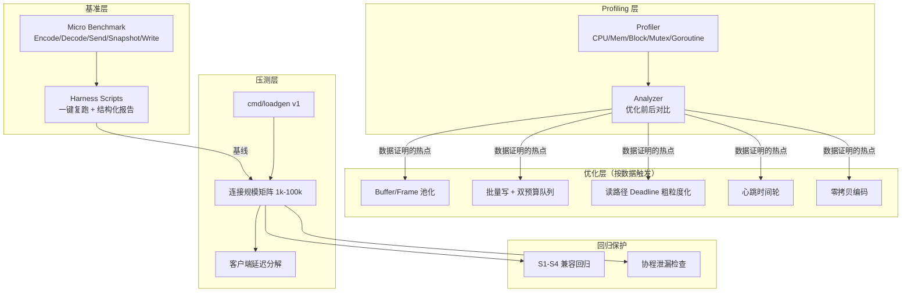

# S5 单机性能工程
# 详细设计（Low-Level Design）

> 本文是《通用实时消息 Gateway Platform — 架构设计方案 v1》中 **S5 阶段**的实现级展开。
>
> - **上位文档**：`通用实时消息 Gateway Platform - 架构设计方案.md`（架构方案）
> - **前置契约**：S1（四通道）、S2（可靠语义 + facts）、S3（广播语义）、S4（事件语义）全部冻结。本阶段**只改实现效率，不改任何语义**。
> - **阶段定位**：单机功能齐备（S1–S4）之后、分布式（S6/S7）之前，**唯一的性能工程窗口**。
> - **明确不做**：不引入 Redis / Kafka / 数据库分片、不改协议帧/状态机/幂等键、不为跑分改语义、不做 CPU 绑核/多 Reactor/GC 硬调（除非 Profiling 证明并写 ADR）。

| 项 | 内容 |
|---|---|
| 阶段编号 | S5 |
| 依赖阶段 | S1–S4（功能冻结） |
| 核心纪律 | 先测量、后优化；无数据不替换组件 |
| 产物 | 基准/Profiling 报告、压测矩阵、网络模型选型结论、容量初算模型、`cmd/loadgen` v1 |
| 硬约束 | S1–S4 兼容性不破；四通道隔离不退化；协程泄漏偏差 ≤5 |

---

## 目录

1. [设计目标与约束边界](#1-设计目标与约束边界)
2. [模块划分](#2-模块划分)
3. [基线建立：Benchmark 与 Profiling](#3-基线建立benchmark-与-profiling)
4. [分层优化设计](#4-分层优化设计)
5. [四通道隔离验证](#5-四通道隔离验证)
6. [网络模型选型决策框架](#6-网络模型选型决策框架)
7. [系统级压测矩阵](#7-系统级压测矩阵)
8. [容量初算模型](#8-容量初算模型)
9. [cmd/loadgen v1 与延迟分解](#9-cmdloadgen-v1-与延迟分解)
10. [WebSocket 可选承载](#10-websocket-可选承载)
11. [回归保护](#11-回归保护)
12. [验收标准与交付清单](#12-验收标准与交付清单)

---

# 1. 设计目标与约束边界

## 1.1 本阶段要回答的问题

用可重复的 Benchmark 与 Profiling 找出真实开销，把内存分配、系统调用、定时器与协程模型优化到当前架构的合理上限，并用压测数据回答：**是否值得更换网络模型**。

## 1.2 位置唯一的理由

- 优化需要稳定的负载形态。S1–S4 功能已全部就位且冻结，压测结论不会被后续重构覆盖。
- S5 位于分布式之前，容量结论可直接作为 S6/S7 的容量输入。
- 本阶段只做一次，不做渐进式反复调参。

## 1.3 冻结契约保护清单（绝对不可改）

| 冻结资产 | 来源 | 本阶段约束 |
|---|---|---|
| 状态机 / 幂等键 / facts schema | S2 §12.2 | 不改 |
| 帧号 / 能力位 / 帧语义 | S2/S3/S4 | 不改 |
| 广播 Best-Effort / 不落库 | S3 §13.2 | 不改 |
| 事件 self-scoped / 聚合终态 | S4 §15.2 | 不改 |
| 四通道隔离模型 | S1 | 可优化实现，不可改变隔离语义 |

> 任何优化若需要改动上表任一项，必须停止并写入「需重开冻结线」的 ADR——这视为设计错误，不是性能工程。

---

# 2. 模块划分

## 2.1 组件视图



## 2.2 目录结构

```text
s5/
├── benchmark/
│   ├── codec_bench_test.go        # Encode/Decode（-benchmem）
│   ├── send_bench_test.go         # 写循环、批量写
│   ├── fanout_bench_test.go       # 订阅快照 + P2 扇出
│   ├── facts_bench_test.go        # S2 事实写入
│   └── harness.sh                 # 一键复跑，输出 JSON 报告
├── profiling/
│   ├── profiles/                  # 归档的 pprof 文件
│   ├── collect.go                 # 采集入口
│   └── compare.go                 # 前后对比表生成
├── internal/
│   ├── pool/                      # 分级 buffer / Frame 池
│   ├── sendpath/                  # 批量写、双预算队列（继承 S1）
│   ├── readloop/                  # 粗粒度 Deadline 扫描
│   └── heartbeat/                 # 全局时间轮
├── cmd/loadgen/                   # 负载生成器 v1
│   ├── main.go
│   ├── curve.go                   # 爬坡/稳定/下降负载曲线
│   ├── mixer.go                   # 混合流量比例
│   └── latbreak.go                # 延迟分解
├── docs/
│   ├── benchmark-report.md        # 含优化前后对比表
│   ├── loadtest-report.md         # 1k-100k 矩阵
│   ├── model-selection-adr.md     # 网络模型选型
│   └── capacity-model.md          # 容量初算
└── test/
    └── regression/                # S1-S4 兼容回归
```

## 2.3 核心接口

```go
// 基准报告结构（结构化，可归档对比）
type BenchReport struct {
    Name        string
    NsPerOp     float64
    BytesPerOp  int64
    AllocsPerOp int64
    Syscalls    int64
    RSSBytes    int64
    P50, P99    time.Duration
    Commit      string   // git commit，保证可复现
    Timestamp   time.Time
}

// 优化项记录：必须有数据支撑
type Optimization struct {
    Hotspot      string        // 来自 Profiling
    Evidence     string        // pprof 文件 / 指标
    Before       BenchReport
    After        BenchReport
    AllocsDelta  float64       // 必须可量化
    ADR          string        // 若涉及架构变更
}

// 负载生成器配置
type LoadConfig struct {
    Phases       []Phase       // 爬坡/稳定/下降
    Mix          TrafficMix    // 单播/广播/ACK/心跳比例
    Connections  int
    Injection    Injection     // 慢消费者/集中断线/大 payload
    OutputFormat string
}
```

---

# 3. 基线建立：Benchmark 与 Profiling

## 3.1 基准清单（先建基线，禁止未测量就优化）

| 基准 | 观测指标 | 对应瓶颈 |
|---|---|---|
| `BenchmarkEncode` / `BenchmarkDecode` | ns/op, B/op, allocs/op | 编码开销 |
| `BenchmarkSend` | ns/op, allocs/op | 写循环 |
| `BenchmarkWriteBatch` | 系统调用次数, ns/op | 批量 I/O 收益 |
| `BenchmarkFanout` | ns/op, allocs/op（1 万订阅者） | S3 快照扇出 |
| `BenchmarkFactsWrite` | ns/op, 事务耗时 | S2 事实写放大 |
| `BenchmarkIdleConn` | 每连接字节、goroutine 数 | 空闲内存占用 |

全部带 `-benchmem`；一键脚本 `harness.sh` 固定 GOOS/GOARCH/GOMAXPROCS，输出结构化 JSON（含 git commit）。

## 3.2 Profiling 管线

- 接入 CPU、Memory、Block、Mutex、Goroutine 五类 pprof。
- 每个优化项记录前后：ns/op、B/op、allocs/op、系统调用次数、RSS、P99。
- pprof 文件归档到 `profiling/profiles/`，与报告 commit 对应。
- 分析规则：**只有 Profiling 指向的热点才允许优化**；「我觉得这里慢」不构成依据。

## 3.3 基线冻结

基线报告在优化前冻结一次，作为所有后续对比的唯一参照；优化不得重写基线数据。

---

# 4. 分层优化设计

> 以下均为「候选优化」，是否执行取决于 §3 的数据。每项都标注触发条件与验收口径。

## 4.1 内存池化

| 优化 | 触发条件 | 做法 | 验收 |
|---|---|---|---|
| 编码 buffer 分级池 | `BenchmarkEncode` 的 B/op 高 | 按大小分级池化，明确归还时机 | allocs/op 下降 |
| 解码 Body 池 | `BenchmarkDecode` allocs 高 | Frame 对象池 | allocs/op 下降 |
| 大帧保留上限 | RSS 持续上涨 | 限制池中单 buffer 上限 | 常驻内存稳定 |

- 只对 Profiling 证明的热点池化；池化后 `allocs/op` 必须下降，否则回滚。
- `bufio.Reader/Writer` 大小按连接数带来的内存放大实测调整。

## 4.2 写路径

- 批量写：Writer 一次取出多条帧合并写出，减少系统调用。
- 「帧数 + 字节预算」双上限**是 S1 §4.2 已冻结的语义**；本阶段只做实现细化（阈值标定、批量取值大小、按通道的预算切分），不重新定义语义，也不新增上限维度。
- 控制帧（P0）优先，广播（P2）低于可靠（P1）——隔离语义来自 S1，不改。
- 增加写 Deadline，防止对端不读导致 Writer 永久阻塞。

## 4.3 读路径

- 读 Deadline 从「每帧刷新」改为「粗粒度空闲扫描」，降低 timer 开销。
- 合并每帧多次时间读取，减少临时对象。
- 调整读缓冲区大小，用压测验证系统调用与内存的取舍。

## 4.4 协议与并发

- 编码避免 `bytes.Buffer` 与接口调用，header/body 直接写出，减少 Body 拷贝。
- 心跳循环并入 Writer 或改用全局时间轮，降低协程与 timer 数量。
- 仅在 Profiling 显示锁/channel 竞争时，再评估分片注册表或替代队列；**订阅索引读锁粒度（S3）是重点观察对象**。

## 4.5 系统参数

- TCP Keepalive、监听 backlog、Socket 缓冲区按实测调整。
- 基准测试在 Linux 容器执行，避免 Windows IOCP 与 Linux epoll 数据混用。

---

# 5. 四通道隔离验证

## 5.1 验证目标

证明 S1 定义的 P0/P1/P2/P3 四通道**物理隔离**在优化后未退化：一类流量打满不影响其他类。

## 5.2 验证矩阵

| 场景 | 打满通道 | 观测 |
|---|---|---|
| 广播打满 | P2 | P1 可靠投递 P99、心跳 P99 不受显著影响 |
| 事件洪峰 | P3 | ACK 延迟、P1 投递不受影响 |
| 可靠洪峰 | P1 | P2 广播丢弃率符合策略，心跳存活 |
| 四通道同时打满 | 全部 | 各自 P99 在预算内，无饿死 |

## 5.3 判定口径

- 两类流量并发时，各自 P99 相对单独运行劣化不超过设定阈值（建议 ≤20%）。
- 心跳（P0）在任何场景下不被拖死。
- 该验证是 S5 验收硬项，失败则回滚相关优化。

---

# 6. 网络模型选型决策框架

## 6.1 决策原则

不预设某项技术更好。用「标准库优化后的数据」与「替代模型的实测收益」对比，若差距不足以抵消可维护性成本，则记录「本阶段不替换」。

## 6.2 候选与评估维度

| 候选 | 评估维度 | 数据来源 |
|---|---|---|
| Go 标准库 `net`（基线） | 连接数、吞吐、内存、协程数、可维护性 | Benchmark + 压测 |
| gnet | 同上 | 同等负载实测 |
| netpoll | 同上 | 同等负载实测 |
| 更高效协议编码 | ns/op, allocs/op | Micro Benchmark |

## 6.3 决策门槛

```text
若 (替代模型吞吐增益 < 20%) 或 (内存/协程收益不足以抵消引入复杂度)
则 不替换，记录 ADR：标准库在本阶段足够
否则 替换，并附：迁移成本、风险、回滚方案
```

## 6.4 明确不做

- 不做 CPU 绑核、多 Reactor、GC 参数硬调——除非 Profiling 数据证明必要并写入 ADR。
- 服务端不做「连接池」（长连接本身即复用）；连接池只属于客户端与后续 RPC 场景。

---

# 7. 系统级压测矩阵

## 7.1 连接规模阶梯

逐步测试：1,000 → 10,000 → 50,000 → 100,000 并发连接。

## 7.2 每规模测试维度

| 维度 | 说明 |
|---|---|
| 空闲连接 | 内存占用、协程数 |
| 心跳 | timer 开销、P99 |
| 低频消息 | 基线延迟 |
| 高频消息 | 吞吐、P99 |
| 慢消费者 | 丢弃可观测、连接稳定 |
| 大 Payload | 内存放大、批量写收益 |
| 集中断线重连 | 重连风暴下的稳定性 |
| 广播扇出 | 单 topic 1 万订阅者 |
| 混合打满 | 可靠 + 广播 + 事件 + 控制同时（验证四通道 P0–P3 隔离） |

## 7.3 环境一致性

- 固定硬件、内核参数、GOGC、GOMAXPROCS，报告记录完整环境。
- 每轮测试可重复执行，结果写入 `loadtest-report.md`。

---

# 8. 容量初算模型

## 8.1 目的

产出可交付给 S6/S7 的容量输入：单机能力边界与横向扩展的换算依据。

## 8.2 模型变量

| 变量 | 来源 |
|---|---|
| 单机最大连接数 | §7 压测矩阵 |
| 每连接内存 | `BenchmarkIdleConn` |
| 单连接吞吐 | 高频消息压测 |
| 编解码 CPU 成本 | Micro Benchmark ns/op |
| 广播扇出上限 | 1 万订阅者压测 |
| DB 连接与写入上限 | `BenchmarkFactsWrite` |

## 8.3 输出

```text
单机容量 ≈ f(连接数, 每连接内存, 吞吐, 编解码 CPU, 扇出上限, DB 写入)
集群容量 ≈ 单机容量 × 节点数 × 扩展效率(需 S6/S7 实测)
```

容量报告给出「多少节点支撑多少连接 / TPS」的换算表，作为**终局阶段**规模规划的种子。

---

# 9. cmd/loadgen v1 与延迟分解

## 9.1 负载曲线

三阶段：爬坡 → 稳定 → 下降。避免瞬时冲击导致的误判。

## 9.2 混合流量

按可配比例注入：点对点发送、广播 publish、订阅接收、ACK、心跳。

## 9.3 故障注入

慢消费者、集中断线、重连风暴、大 payload。

## 9.4 延迟分解（关键交付）

客户端侧把端到端延迟拆为：

```text
端到端延迟 = 编解码 + 排队 + 网络 + 渲染
```

- 发送时间戳由客户端编码进 payload（符合 S3「平台不解析 payload」）。
- 订阅端解析并分段统计，定位瓶颈在服务端还是客户端。
- 输出格式与 S8 容量报告一致，可直接横向对比。

## 9.5 目标

单机 loadgen 先做到 10 万连接；S7 起支持多机分布式发起。

---

# 10. WebSocket 可选承载

## 10.1 定位

若需要浏览器形态的 IM / 弹幕，浏览器无法承载自定义 TCP 协议，服务端增加 WebSocket 接入，把同一套 Frame 编码承载在 WS 二进制消息上。

## 10.2 一致性约束

- 不阻塞主线：终端客户端足以完成全部验证，Web 不是验收前置。
- 并入 S5 作为可选扩展，不影响既定性能验收项。
- WS 必须复用同一 Frame 编解码与能力位协商，**不允许出现第二套协议**。
- 不推荐本地 sidecar 做 TCP↔WS 转换（引入额外进程与不可控延迟，性能验证会失真）。

---

# 11. 回归保护

## 11.1 兼容性回归

| 检查项 | 方法 |
|---|---|
| S2 可靠流程 | 场景用例全绿 |
| S3 广播语义 | 扇出/丢弃/有序用例全绿 |
| S4 事件与 hooks | 事件去重/补齐/兼容矩阵全绿 |
| 协议帧与能力位 | 帧号/能力位冻结表比对 |

## 11.2 协程与资源

- `go test -race ./...` 通过。
- 协程泄漏检查维持基线偏差 ≤5。
- 优化引入的池化不得造成内存泄漏（长跑测试验证 RSS 稳定）。

## 11.3 回滚机制

每个优化项独立提交，可单独回滚；若回归检查失败，回滚到最后一次全绿的 commit。

---

# 12. 验收标准与交付清单

## 12.1 验收标准

- 存在可重复执行的一键 Benchmark 与 Profiling 流程，报告可归档复现。
- 找到至少**三个**由数据证明的真实瓶颈。
- 至少**两轮**优化有前后对比数据。
- 优化后每消息的内存分配与系统调用数量有量化下降。
- 空闲连接内存占用与协程数量达到设定目标。
- 广播扇出与可靠消息并发时，两类流量 P99 互不显著影响（四通道 P0–P3 隔离）。
- `go test -race ./...` 通过，协程泄漏偏差 ≤5。
- S1–S4 功能与协议兼容性不被破坏。

## 12.2 交付清单

| 交付物 | 位置 |
|---|---|
| 基准与 Profiling 报告（含前后对比表） | `docs/benchmark-report.md` |
| 系统级压测报告（1k–100k 矩阵） | `docs/loadtest-report.md` |
| 网络模型选型结论与依据 | `docs/model-selection-adr.md` |
| 容量初算模型（S6/S7 输入） | `docs/capacity-model.md` |
| `cmd/loadgen` v1 与客户端侧延迟分解报告 | `cmd/loadgen/` |
| 相应 ADR | `docs/adr/` |

---

> **结语**：S5 的产物不是「更花哨的实现」，而是**一组可复现的数字和一份有据可依的选型结论**。它严守冻结契约——所有优化都发生在实现层；一旦某项优化需要改动语义，正确的动作是停止并承认「该语义应在冻结线之前定死」，而不是在这里偷偷改。这正是把性能工程设为唯一窗口的原因。
