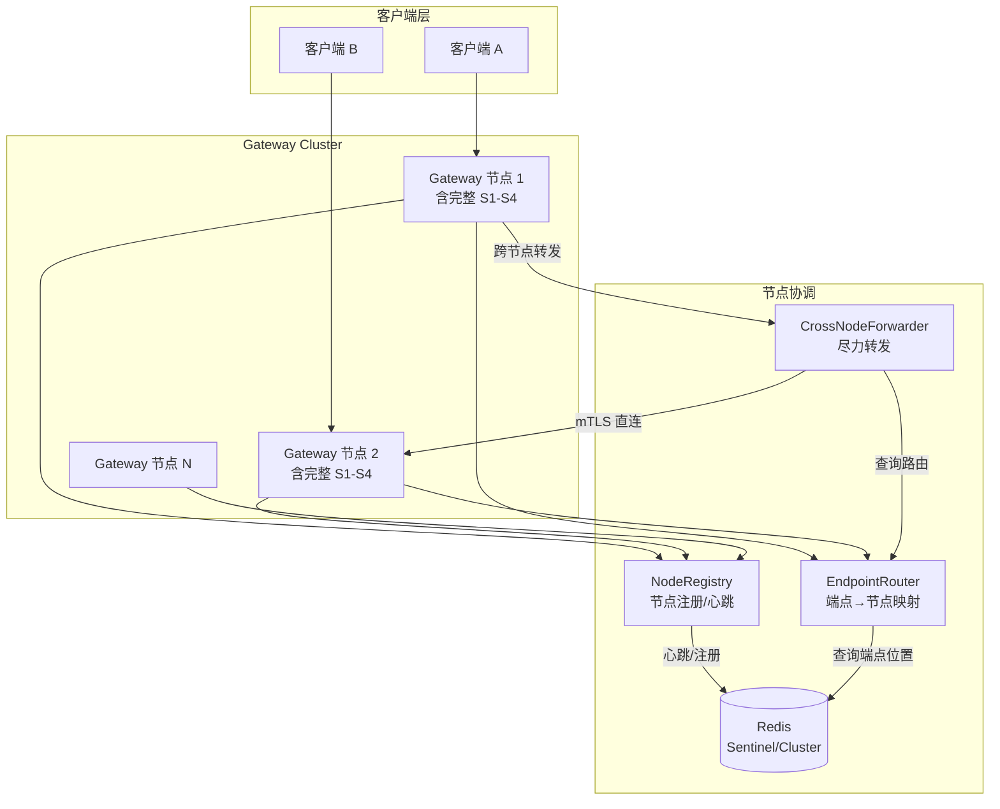
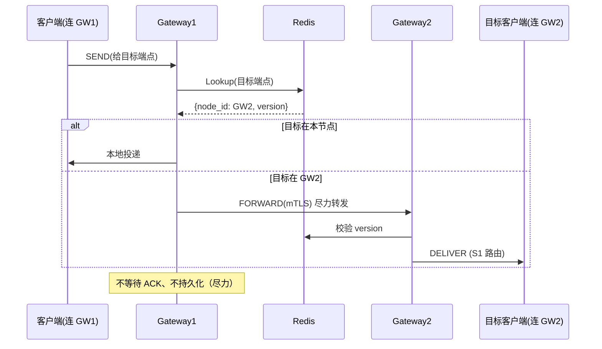
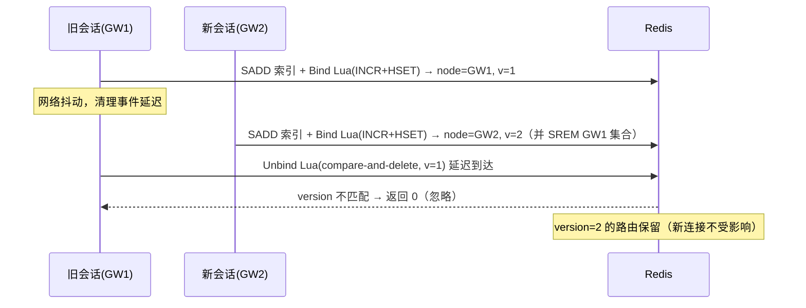
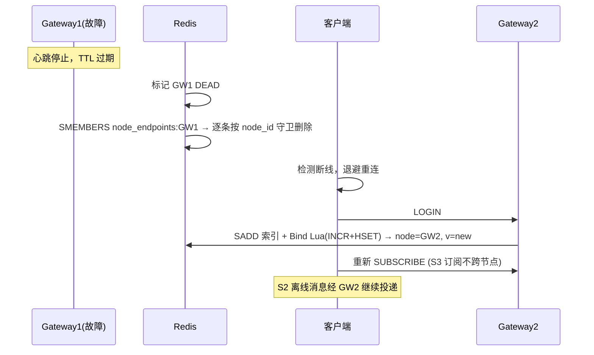

# S6 分布式 Gateway
# 详细设计（Low-Level Design）

> 本文是《通用实时消息 Gateway Platform — 架构设计方案 v1》中 **S6 阶段**的实现级展开。
>
> - **上位文档**：`通用实时消息 Gateway Platform - 架构设计方案.md`（架构方案）
> - **前置契约**：S2（可靠语义）、S3（广播语义）、S4（事件语义）、S5（容量模型）全部冻结。本阶段**只解决「连接在哪」，不解决「消息如何可靠分发」**。
> - **阶段定位**：从单机进入多节点，引入 Redis 在线路由、跨节点尽力转发、节点间 mTLS。**不改任何冻结语义**。
> - **明确不做**：Kafka / Outbox / 租约 / 分片（S7）、跨节点广播（S7）、跨节点可靠投递与重试、事件跨节点路由（S7）、全局限流（S8）。

| 项 | 内容 |
|---|---|
| 阶段编号 | S6 |
| 依赖阶段 | S1–S5（功能与性能冻结） |
| 核心问题 | 客户端连接在哪一个 Gateway 节点 |
| 新增基础设施 | Redis（Sentinel/Cluster 起步） |
| 广播现状 | 本阶段仍为**单节点扇出**；协议明确「订阅只在本地节点生效」 |
| 安全 | 节点间 **mTLS**（无明文临时方案，I3） |
| 硬约束 | 冻结语义零变更；旧会话不误清理新连接 |

---

## 目录

1. [设计目标与契约边界](#1-设计目标与契约边界)
2. [模块划分](#2-模块划分)
3. [Redis 在线路由数据模型](#3-redis-在线路由数据模型)
4. [跨节点尽力转发](#4-跨节点尽力转发)
5. [Connection Version 与竞态](#5-connection-version-与竞态)
6. [故障检测与路由恢复](#6-故障检测与路由恢复)
7. [Redis 降级矩阵](#7-redis-降级矩阵)
8. [节点间 mTLS 安全基线](#8-节点间-mtls-安全基线)
9. [核心帧序列](#9-核心帧序列)
10. [语义零变更约束](#10-语义零变更约束)
11. [故障处理矩阵](#11-故障处理矩阵)
12. [可观测性设计](#12-可观测性设计)
13. [测试用例设计](#13-测试用例设计)
14. [验收标准与冻结清单](#14-验收标准与冻结清单)

---

# 1. 设计目标与契约边界

## 1.1 本阶段要解决的唯一问题

从单机架构进入多节点架构，本阶段**只回答一个问题：客户端连接在哪个 Gateway 节点**。

- 不解决「消息如何可靠分发」——那是 S7 的职责。
- 跨节点消息投递是**尽力转发**，不含持久化重试。
- 广播在 S6 **仍是单节点扇出**；协议文档必须明确「当前订阅只在本地节点生效」，跨节点广播留到 S7。

## 1.2 为什么这样切分

「分布式 Gateway」（S6）与「分布式投递引擎」（S7）按职责分开——两者解决的是不同问题。本方案在该切分基础上强调两点：

1. **安全前移**：S6 起节点间即 mTLS，不留「明文临时方案」窗口（I3）。
2. **语义零变更**：S6 只是把「端点→节点」的映射外置到 Redis，所有 S2/S3/S4 的语义原样运行在每个节点内。

## 1.3 契约落地对照

| 冻结契约 | 本阶段处理 |
|---|---|
| S2 可靠语义 | **不变**：仍在本节点内运行；跨节点转发是尽力，不产生新状态机 |
| S3 广播语义 | **不变**：仅本地扇出；文档声明订阅不跨节点 |
| S4 事件语义 | **不变**：self-scoped 事件仍由本节点投影（S7 才跨节点路由） |
| S5 容量模型 | 作为节点规模规划输入 |
| I1 语义先于传输 | S6 只换「连接位置」的寻址，不动语义 |

---

# 2. 模块划分

## 2.1 组件视图



## 2.2 目录结构

```text
s6/
├── cmd/gateway/                  # 进程入口（含节点身份配置）
├── internal/
│   ├── node/
│   │   ├── registry.go           # 节点注册/心跳
│   │   └── identity.go           # node_id 生成
│   ├── route/
│   │   ├── router.go             # EndpointRouter
│   │   ├── redis_store.go        # Redis 路由存储（HASH）
│   │   ├── redis_lua.go          # 绑定/解绑 Lua 脚本（EVALSHA，原子）
│   │   └── version.go            # Connection Version
│   ├── forward/
│   │   ├── forwarder.go          # CrossNodeForwarder（尽力转发）
│   │   └── mtls_client.go        # mTLS 拨号
│   ├── session/                  # 继承 S1，新增 version 字段
│   ├── sendpath/                 # 继承 S1
│   └── config/
├── docs/
│   ├── distributed-routing.md
│   ├── redis-degradation.md
│   └── adr/
└── test/
    ├── integration/              # 多节点
    ├── failure/                  # 故障切换
    └── compat/
```

## 2.3 核心 Go 接口

```go
// ===== 节点注册 =====
type NodeRegistry interface {
    Register(ctx context.Context, node NodeInfo) error
    Heartbeat(ctx context.Context, nodeID string, ttl time.Duration) error
    Deregister(ctx context.Context, nodeID string) error
    ListNodes(ctx context.Context) ([]NodeInfo, error)
    // Lookup 按 nodeID 取单个节点（转发前解析 mTLS 地址，§4.1 步骤 1）
    Lookup(ctx context.Context, nodeID string) (NodeInfo, bool, error)
}

type NodeInfo struct {
    NodeID    string
    Addr      string            // mTLS 地址
    LastHeart time.Time
    Status    string            // ALIVE / SUSPECT / DEAD
}

// ===== 端点路由 =====
type EndpointRouter interface {
    // 绑定端点→当前节点，带版本号（防旧连接误清理）
    Bind(ctx context.Context, key EndpointKey, bind NodeBinding) error
    Lookup(ctx context.Context, key EndpointKey) (NodeBinding, bool, error)
    Unbind(ctx context.Context, key EndpointKey, version uint64) error
    // 本地缓存（Redis 不可用时的降级）
    SetLocalCache(key EndpointKey, bind NodeBinding)
    GetLocalCache(key EndpointKey) (NodeBinding, bool)
}

type EndpointKey struct {
    TenantID string
    UserID   string
    DeviceID string
}

type NodeBinding struct {
    NodeID  string
    Version uint64            // Connection Version，单调递增
    BoundAt time.Time
}

// ===== 跨节点转发 =====
type CrossNodeForwarder interface {
    // 尽力转发：成功入队即返回，不等待 ACK、不持久化
    Forward(ctx context.Context, nodeID string, frame Frame) error
}
```

## 2.4 关键取舍

| 取舍 | 决定 | 理由 |
|---|---|---|
| 路由存储 | Redis（Sentinel/Cluster 起步） | HA 从引入即具备，不留单点（I3） |
| 跨节点通信 | 直连 TCP + mTLS | 简单、低延迟；不引入消息总线（S7 才引入） |
| 转发语义 | 尽力，不重试不落库 | 可靠分发是 S7 职责，本阶段不混 |
| 广播 | 仍单节点 | 订阅索引是连接级、不跨节点同步；跨节点广播留 S7 |
| 路由一致性 | 用 Connection Version 解决旧连接清理新连接 | 避免版本回退 |

---

# 3. Redis 在线路由数据模型

## 3.1 键设计

```text
# 节点注册（心跳保活）
gateway:node:<node_id>           = HASH{addr, last_heartbeat, status}   EX <ttl>

# 端点路由与版本分配器共用 hash tag：保证同一端点的两个键落在同一 slot
# （Cluster 模式下，一段 Lua 只能操作同 slot 的键，否则 CROSSSLOT 报错）
gateway:{ep:<tenant>:<user>:<device>}:endpoint = HASH{
    node_id  : <string>,
    version  : <uint64，HASH 字段，参与 Lua 比较>,
    bound_at : <unix ms>
}
gateway:{ep:<tenant>:<user>:<device>}:seq      = uint64

# 节点活跃集合（SET，用于故障检测）
gateway:nodes                    = {node_id, ...}

# 反向索引：某节点上承载了哪些端点（SET，用于节点死亡时批量清理）
# 注意：它与端点键不同 slot，因此**不能**放进同一段 Lua
gateway:node_endpoints:<node_id> = {tenant:user:device, ...}

# 说明：
# - 端点路由不设 TTL，由「连接关闭的解绑」「节点死亡的批量清理」两条路径显式删除
# - 节点注册键设 TTL，心跳续期；过期视为节点死亡
# - 版本必须是独立 HASH 字段（数值），不能藏在 JSON 字符串里：Lua 内要做整数比较，
#   字符串比较会出现 "10" < "9" 的字典序错误
# - `{ep:...}` 是 Redis hash tag：`gateway:{ep:t:u:d}:endpoint` 按 `ep:t:u:d` 计算 slot
```

## 3.2 绑定流程（SADD 先行 + 单 slot Lua）

```text
客户端登录成功（S1 Session 建立）：
  1. 生成本地 sessionID 与 nodeID
  2. SADD gateway:node_endpoints:<nodeID> <ep_id>       -- ① 先记索引（幂等）
  3. EVALSHA（KEYS = [ep_key, seq_key]，同 slot；一次往返原子完成）：
       local old = redis.call('HGET', KEYS[1], 'node_id')   -- 记录旧归属，供 ④ 清理
       local v   = redis.call('INCR', KEYS[2])
       redis.call('HSET', KEYS[1], 'node_id', nodeID,
                                  'version', v,
                                  'bound_at', now_ms)
       -- 不设 TTL：HSET 不继承旧键 TTL，端点路由一律依赖显式 DEL 清理
       return {v, old or ''}
  4. 若 old ~= "" 且 old ~= nodeID：
       SREM gateway:node_endpoints:<old> <ep_id>          -- ④ 尽力而为，失败只记日志
  5. 写本地缓存 SetLocalCache(key, {nodeID, v, boundAt})
  6. 后续该端点的投递由本节点处理
```

| 设计点 | 为什么这样 | 反例 |
|---|---|---|
| INCR 与 HSET 必须同一脚本 | 两次往返之间可能被另一节点插入，后写者版本更小 | 版本回退 → 旧连接的清理事件"匹配成功"，误删新路由 |
| **SADD 必须早于 HSET** | 失败序只允许"多余索引成员"（无害，回收时被 `node_id` 守卫跳过），不允许"有 binding 但无索引" | 顺序反了且 SADD 失败 → 该 binding 在节点死亡后**永不回收** |
| **SREM 旧集合不放进脚本** | `node_endpoints:<old>` 与端点键不同 slot，跨 slot 的 Lua 在 Cluster 下直接失败 | 强行合并 → 绑定整体失败，登录不可用 |
| 残留成员的代价 | 仅在旧节点死亡回收时多一次 `HGET` 判断，随后被清 | 不会导致误删或误投 |

> 这是"失败序优先于原子性"的典型例子：把不可原子的跨 slot 清理降级为**尽力而为**，换来的是"任何单步失败都不会产生无法回收的绑定"。

## 3.3 解绑与绑定回收（Lua compare-and-delete）

```lua
-- KEYS[1] = gateway:{ep:<tenant>:<user>:<device>}:endpoint
-- ARGV[1] = 本连接持有的 version
local v = redis.call('HGET', KEYS[1], 'version')
if v and tonumber(v) == tonumber(ARGV[1]) then
  return redis.call('DEL', KEYS[1])      -- 只有版本匹配才删；返回 1
end
return 0                                  -- 已被新连接覆盖，什么都不做
```

```text
连接关闭 / 会话替换：
  1. 执行上述 Lua（单键、单次往返、服务端原子执行）
  2. 返回 1 → 继续执行 SREM gateway:node_endpoints:<nodeID> <ep_id>（尽力而为）
     返回 0 → 计 stale_unbind_ignored_total，不报错、不做 SREM
  3. 无论删除是否命中，都清本地缓存
```

**节点死亡时的批量清理（第三条删除路径，不可省）**：

```text
NodeRegistry 判定 node_id 为 DEAD（心跳 TTL 过期 / Deregister）：
  1. members = SMEMBERS gateway:node_endpoints:<node_id>
  2. 逐条执行"归属守卫删除"（每次单键 Lua，可 pipeline）：
       if HGET ep_key 'node_id' == 死节点 → DEL ep_key，返回 1
       否则跳过（该端点已重绑到活节点）
  3. DEL gateway:node_endpoints:<node_id>
  4. 计 endpoint_binding_reclaimed_total
```

| 不清理会怎样 | 后果 |
|---|---|
| 残留 binding 永久指向死节点 | 每次投递先走 3 次转发尝试（S6 §4.4 D 类）才回落离线；延迟被放大、日志噪声 |
| Redis 键无界增长 | 客户端再也不回来的端点永不回收 |
| 误删活节点路由 | 若不加 `binding.node_id == 死节点` 判定，节点抖动会把重绑后的路由删掉——与 §3.3 的版本守卫同理 |

> **不能用 GET 后再 DEL**：两次独立往返之间，新连接可以 `INCR` 得 `v2` 并写入路由，随后旧连接的 `DEL` 会把 `v2` 的路由删掉——这正是 Version 机制要防止的场景。"Redis 是原子的"只保证单条命令原子，不保证"读—比较—删"这个组合原子。
>
> 这也是 Connection Version 的核心用途：**避免旧连接的延迟清理事件删除新连接的路由**。

## 3.4 路由查询

```text
投递消息给端点 X：
  1. binding, ok = Lookup(X)  // 先查 Redis，失败查本地缓存
  2. if binding.NodeID == 当前节点: 本地投递（S1 路由）
  3. else: CrossNodeForwarder.Forward(binding.NodeID, frame)  // 尽力
  4. if 未找到 binding: 走 S2 离线投递路径（持久化等待重连）
```

---

# 4. 跨节点尽力转发

## 4.1 转发流程

```text
CrossNodeForwarder.Forward(nodeID, frame):
  1. Lookup(nodeID) → 目标节点 mTLS 地址（来自 NodeRegistry）
  2. 若目标节点不在 ALIVE 集合 → 返回 ErrNodeUnavailable
  3. mTLS 拨号（连接池，长连接复用）
  4. 发送 FORWARD 内部帧（封装原始业务帧 + 目标端点 + version_hint）
  5. 对端收到后：按 S1 路由在本节点投递
  6. 写入连接即返回，**不同步等待任何 ACK**；对端若判定路由已失效，可异步回 `FORWARD_NACK`
  7. 收到 NACK 只置 `last_error` 与 `next_attempt_at`（§4.4 C），不改变投递状态、不写事实
```

## 4.2 内部帧（仅节点间，不对外暴露）

| 类型 | 方向 | 字段 | 说明 |
|---|---|---|---|
| `FORWARD` | 源节点 → 目标节点 | `target_endpoint` / `inner_frame` / `version_hint` | 尽力转发；`inner_frame` 为原始业务帧（DELIVER 等） |
| `FORWARD_NACK` | 目标节点 → 源节点 | `target_endpoint` / `reason`(`NO_SESSION`/`VERSION_MISMATCH`/`ENQUEUE_FULL`) / `version_hint` | **异步可选**：对端确认无法投递时回一条；源节点不等它、也不因它重试 |

> `FORWARD_NACK` 的价值只在于把"路由已过期"从"静默失败"变成"可观测失败"：源节点据此刷新本地缓存并让 S2 的下一次重试重新查路由（§4.4 C）。它不是可靠投递的确认机制——确认由 S2 的 `RECEIPT_ACK` 负责。

> 内部帧使用 `0x30`–`0x3F` 段（架构方案 §8.2，**S6 起启用**；S0 §3.2 与本表必须同标），对外帧语义不变。

## 4.3 尽力语义边界

- 转发失败（节点不可达、mTLS 失败、对端拒绝）→ 返回错误给调用方，**S6 本身不重试、不落库**。
- 可靠消息的跨节点最终一致性由 S7 的 Kafka 分发解决；S6 的尽力转发只覆盖「两端都在线」的场景。
- 协议文档明确：S6 跨节点投递是 best-effort，不承诺可靠。

## 4.4 转发失败 → S2 投递状态的映射（不得由实现者自由决定）

转发失败**绝不等于投递失败**。映射规则固定为：

```text
Dispatch 在跨节点场景的结果：
  A. Forward 成功入队（对端已接收 FORWARD 帧）
       → 与本地投递成功同义：delivery → SENT，attempts+1，写 delivery.sent 事实
  B. Forward 失败（ErrNodeUnavailable / mTLS 失败 / 拨号超时）
       → delivery 状态不变（保持 PENDING 或 SENT）
       → 写 last_error（错误分类），next_attempt_at = now() + backoff(attempts)
       → 本次失败不消耗投递尝试预算（不增 attempts），由调度重试
  C. 对端接收后本节点投递失败（对端无该端点会话）
       → 对端回 FORWARD_NACK，本节点按 B 处理（路由已过期，下一次重试会重新查路由）
  D. 连续 NODE_UNREACHABLE_LIMIT(=3) 次节点不可达
       → 判定路由失效：DEL 本节点的本地缓存（不删 Redis，交由 endpoint 重绑）
       → 回落 S2 离线路径：delivery 保持 PENDING，next_attempt_at = NULL，等端点重连
  E. attempts 达到 max_attempts（仅由 A 类真正尝试累计）
       → delivery → FAILED，写 delivery.failed 事实
```

三条不可协商的结论：

| 结论 | 理由 |
|---|---|
| 转发失败不改变 `delivery_state` | 否则"节点暂时不可达"会被写成终态 `FAILED`，At-Least-Once 直接破功 |
| 转发失败不增 `attempts` | 否则路由抖动会耗尽重试预算，消息在端点其实在线时被判死 |
| 只有"对端已接收 FORWARD"才算一次真正的投递尝试 | `attempts` 的语义必须与"是否可能已到达客户端"一致，否则重试上限失去意义 |

> 这套映射是 S6 与 S2 之间唯一的语义接缝：S6 只决定"能不能把帧送到那个节点"，S2 决定"这次没送到该怎么记账"。两者混在一起写，会让 `FAILED` 同时表示"端点真的收不到"与"刚好那个节点挂了"。

---

# 5. Connection Version 与竞态

## 5.1 要解决的竞态

```text
场景：
  T1: 旧连接在 GW1 建立，绑定 version=1
  T2: 网络抖动，旧连接被认为断开，清理事件延迟
  T3: 新连接在 GW2 建立，绑定 version=2
  T4: 旧连接的延迟清理事件到达 → 若直接 DEL，会删除 version=2 的路由

解决：清理事件携带 version，只有 version 匹配才删除（§3.3）
```

## 5.2 Version 单调性

- Version 由 Redis `INCR gateway:{ep:<tenant>:<user>:<device>}:seq` 分配，**per-endpoint 单调**（不是全局单一序列），避免多节点各自生成导致冲突；不同端点之间无大小关系，也不需要有。
- 每次端点重绑（新登录）递增；旧清理事件因 version 不匹配而失效。

## 5.3 相关竞态表

| 竞态 | 手段 |
|---|---|
| 旧连接清理新连接 | 解绑走 Lua compare-and-delete（§3.3），比较与删除在一次原子执行内 |
| 并发登录同端点 | 绑定走单 slot Lua `INCR + HSET`（§3.2），后到者 version 必然更大且写入原子；反向索引 SADD 先行、旧集合 SREM 尽力而为（失败序保证不会出现无法回收的绑定） |
| 路由查询与绑定并发 | 查询可能读到旧 binding（读后立即失效）→ 对端用 `version_hint` 校验，不匹配则回 `FORWARD_NACK`，本节点重新查路由（§4.4 C） |
| 节点故障与重绑 | 节点 TTL 过期 + 客户端重连重绑 |

> "Redis 是原子的"只对单条命令成立。凡是"读—判断—写"的组合（解绑、绑定、限流扣减）都必须下沉为 Lua 脚本，否则就是 TOCTOU。

---

# 6. 故障检测与路由恢复

## 6.1 节点故障检测

- Gateway 节点定期心跳（TTL 续期）。
- 心跳过期 → 节点标记 DEAD → 从活跃集合移除。
- 其他节点在转发前检查目标节点状态，DEAD 则不转发。
- **DEAD 判定必须触发绑定回收**（§3.3 第三条删除路径）：`SMEMBERS gateway:node_endpoints:{node_id}` → 逐条按 `binding.node_id == 死节点` 守卫删除 → 删除反向索引集合。

## 6.2 路由恢复

| 场景 | 恢复方式 | 绑定清理 |
|---|---|---|
| 节点宕机 | 客户端重连到存活节点，重新绑定 | 反向索引批量回收（§3.3），不等客户端回来 |
| 网络分区 | 分区内节点视为 DEAD；客户端重连触发重绑 | 同上（分区恢复后若节点"复活"，其路由已删，客户端重连会重绑） |
| Redis 短暂不可用 | 本地缓存兜底（§7），恢复后重新同步 | 不需要（未发生 DEAD） |
| 路由数据丢失 | 客户端心跳/重连时重新绑定 | — |
| 客户端不再回来 | 无（不回连就没有新绑定） | **由节点死亡回收兜底**，否则键永久残留 |

## 6.3 会话恢复语义

- 客户端断线后按 S1 的重连退避重连，可连到任意节点。
- 重连后重新 LOGIN → 重新绑定路由 → 重新订阅（S3 订阅不跨节点）。
- S2 离线消息通过重连后的节点继续投递（可靠语义不变）。

---

# 7. Redis 降级矩阵

## 7.1 设计原则

Redis 从引入即具备 HA（Sentinel/Cluster），但仍需定义不可用时的各路径行为——**哪些降级、哪些拒绝**。

## 7.2 降级矩阵

| 路径 | Redis 不可用行为 | 理由 |
|---|---|---|
| 已有会话消息收发 | 继续服务（本地会话态 + 本地缓存） | 不中断在线用户 |
| 新登录 | **拒绝**，返回明确错误 | 无法绑定路由，避免路由不一致 |
| 消息受理（HTTP） | 继续受理：**只写共享 PostgreSQL，不碰 Redis** | 受理不需要路由；路由只在投递时才查，Redis 不可用时走本地缓存或离线路径 |
| 跨节点投递 | 走本地缓存；无缓存则按离线处理 | 尽力语义 |
| 路由读取 | 本地 TTL 缓存兜底 | 避免每次都依赖 Redis |
| **限流/配额（S8 引入）** | **本地桶放行（fail-open）**，计 `ratelimit_degraded` | 见 §7.3：限流 Redis 必须与路由 Redis **独立实例**，故障域隔离 |
| Redis 恢复 | 自动回到正常路径，重新同步绑定 | 无需人工干预 |

## 7.3 与 S8 限流降级的一致性（避免两条相反承诺）

本阶段承诺「Redis 不可用时已有会话继续收发」，而 S8 §4.4 的配额策略是「读取失败按零配额」。两者若共用同一个 Redis，会得到：**Redis 一挂 → 配额读不到 → 按零配额拒绝 → 全部会话被限流**，与本节承诺直接矛盾。

解决方式（S8 落地，本阶段先固定架构约束）：

1. **物理隔离**：路由 Redis（`gateway:*`）与限流 Redis（`ratelimit:*`）使用不同实例/不同集群，故障域不重叠。
2. **独立降级**：限流 Redis 不可用 → **本地桶放行**（fail-open）+ 计数 + 告警；不得 fail-close。
3. **优先级明确**：路由 Redis 故障 = 降级但不停服；限流 Redis 故障 = 暂时放开配额但可观测。二者互不触发对方的降级分支。

## 7.4 验收口径

- 路由 Redis 全停：已有会话消息仍可送达，新登录被拒，受理仍返回，恢复后自动正常。
- 限流 Redis 全停（S8 阶段验证）：受理与投递不被限流拒绝（fail-open），`ratelimit_degraded` 有计数与告警。
- 两者同时全停：业务继续降级运行，不出现"因依赖故障而全量拒绝"的组合行为。

---

# 8. 节点间 mTLS 安全基线

## 8.1 设计原则

I3（横切关注点在引入点落地）：节点间通信第一次出现就启用 mTLS，**不存在明文临时方案**。

## 8.2 实施内容

- 每个 Gateway 节点持双向证书（客户端证书 + 服务端证书）。
- 节点间连接双向校验证书；证书由内部 CA 签发。
- 证书热加载（与 S8 密钥轮转能力对接）。
- 密钥不落配置文件，从环境变量或密钥文件读取。
- 证书校验失败 → 拒绝连接并审计日志。

## 8.3 与 S8 的关系

S6 实现 mTLS 的最小可用能力；S8 补齐证书轮转流程、审计细化与全链路 TLS。本阶段不留「待补的安全债务」。

---

# 9. 核心帧序列

## 9.1 跨节点投递



## 9.2 会话替换与 Version 守卫



## 9.3 节点故障与重连



---

# 10. 语义零变更约束

## 10.1 本阶段不得改动

| 冻结资产 | 本阶段处理 | 检查 |
|---|---|---|
| S2 状态机 / 幂等键 / facts | 原样运行在每个节点 | 场景回归 |
| S3 广播语义 | 单节点扇出；文档声明不跨节点 | 协议文档 |
| S4 事件语义 | 本节点投影；跨节点路由留 S7 | 事件用例 |
| 对外帧号 / 能力位 | 不改；内部帧用 `0x30` 预留段 | 冻结表比对 |

## 10.2 允许新增

- 内部节点间帧（`0x30`–`0x3F`）。
- Redis 键结构与节点注册机制。
- mTLS 节点间通道。
- 这些都属于「传输与协调机制」，不触碰冻结语义（I1）。

---

# 11. 故障处理矩阵

| # | 场景 | 行为 | 恢复 | 验收口径 |
|---|---|---|---|---|
| N1 | 节点宕机 | 心跳 TTL 过期，标记 DEAD | 客户端重连重绑 | 消息经新节点继续投递 |
| N2 | 旧连接清理新连接 | Version 守卫忽略 | — | 新连接路由保留 |
| N3 | Redis 不可用 | 按 §7 降级矩阵 | 恢复后重新同步 | 已有会话可用，新登录被拒 |
| N4 | 跨节点转发失败 | 按 §4.4 映射：状态不变、不增 attempts、`next_attempt_at` 退避 | S2 调度重试；连续 3 次不可达回落离线路径 | 不产生静默丢失，也不会被误记为 FAILED |
| N5 | mTLS 校验失败 | 拒绝连接 + 审计 | — | 无明文回退 |
| N6 | 路由不一致 | 本地缓存兜底 + 客户端重绑 | 最终一致 | 短暂不一致不丢消息 |
| N7 | 网络分区 | 分区节点视为 DEAD | 重连触发重绑 | 分区恢复后自动收敛 |

---

# 12. 可观测性设计

| 指标 | 类型 | 用途 |
|---|---|---|
| `gateway_nodes_alive` | Gauge | 存活节点数 |
| `endpoint_bindings` | Gauge | 活跃端点绑定数 |
| `cross_node_forwards` | Counter | 跨节点转发数 |
| `cross_node_forward_failures` | Counter | 转发失败数 |
| `route_lookup_latency` | Histogram | 路由查询延迟 |
| `stale_unbind_ignored` | Counter | Version 守卫拦截数 |
| `endpoint_binding_reclaimed` | Counter | 节点死亡后回收的绑定数 |
| `forward_nack` | Counter | 对端 NACK 数（按 reason 标签） |
| `redis_degraded` | Gauge | Redis 降级状态 |

- 日志携带 nodeID、endpoint、traceID，可跨节点串联。
- 节点心跳失败、路由不一致、降级切换必须告警（S8 完善规则）。

---

# 13. 测试用例设计

## 13.1 集成测试（多节点）

| 用例 | 断言 |
|---|---|
| 多节点并存 | 多个 Gateway 同时工作 |
| 任意节点接入 | 客户端连任意节点均可 |
| 跨节点转发 | 跨节点消息正确投递（尽力） |
| 本地订阅 | 广播只在本节点扇出 |

## 13.2 故障测试

| 用例 | 注入 | 断言 |
|---|---|---|
| 节点故障切换 | kill 节点 | 客户端重连后消息继续 |
| Version 守卫（顺序） | 构造旧清理事件晚到 | 新连接路由不被删除 |
| **Version 守卫（并发竞态）** | 旧连接 `DEL` 与新连接 `INCR+HSET` 同时执行（100 轮） | 新连接路由始终存在；`stale_unbind_ignored_total` 增长；不出现"路由被删" |
| **节点死亡绑定回收** | kill 节点（不主动 Deregister） | TTL 过期后其端点 binding 全部被删；`gateway:node_endpoints:{node}` 为空；`endpoint_binding_reclaimed_total` 增长 |
| **回收不误删重绑** | 节点 A 死后客户端已重绑到 B，再执行回收 | A 的回收脚本跳过（`binding.node_id != A`），B 的路由保留 |
| **重绑清理旧索引** | 同一端点从 A 重绑到 B | `node_endpoints:A` 不再含该端点、`node_endpoints:B` 含；人为让 SREM 失败也不影响正确性（A 死亡回收时被守卫跳过） |
| **Cluster slot 一致性** | Cluster 模式执行绑定/解绑脚本 | 无 `CROSSSLOT` 错误；`CLUSTER KEYSLOT` 对端点键与版本键返回同一 slot |
| **FORWARD_NACK 不放大** | 对端无会话时回 NACK | 源节点只刷新缓存与 `last_error`，无额外转发、无状态变更 |
| Redis 全停 | 停 Redis | 降级矩阵行为符合 §7.4 |
| mTLS 负向 | 错误证书 | 连接被拒，无明文回退 |
| 转发失败不误判终态 | 目标节点不可达 | delivery 保持 PENDING/SENT，`attempts` 不变，重试后成功 |

## 13.3 兼容与语义回归

| 用例 | 断言 |
|---|---|
| S2 可靠流程 | 场景全绿，状态机不变 |
| S3 广播 | 单节点扇出语义不变 |
| S4 事件 | self-scoped 事件不变 |
| 协议冻结表 | 对外帧号/能力位无改动 |

## 13.4 验收场景（`cmd/scenario`）

- `multi-node-delivery`：跨节点尽力投递。
- `node-failover`：节点故障后客户端重连。
- `version-guard`：旧清理事件不误删新路由。
- `redis-degradation`：Redis 全停降级行为。

---

# 14. 验收标准与冻结清单

## 14.1 验收标准

**功能与正确性**
- 多个 Gateway 可同时工作；客户端可连任意节点。
- 跨节点消息能正确投递（尽力转发）。
- Gateway 故障后客户端可重连；旧连接不会错误清理新连接。
- 路由数据可恢复。

**安全**
- 节点间 mTLS 启用，错误证书被拒，无明文临时方案。

**语义零变更**
- S2/S3/S4 场景回归全绿；对外帧号/能力位冻结表无改动。
- 协议文档明确「订阅只在本地节点生效」「跨节点投递是 best-effort」。

**工程质量**
- `gofmt`、`go vet`、`go test ./...`、`go test -race ./...` 通过。
- 多节点故障切换场景落成自动化用例。

## 14.2 冻结清单（S6 验收通过后生效）

| 冻结项 | 值 / 位置 |
|---|---|
| Redis 键结构 | §3.1（节点注册、端点绑定 HASH、版本分配器、活跃集合、**反向索引 `node_endpoints`**） |
| Connection Version 机制 | §3.2 绑定：`SADD`（索引先行，幂等）→ **单 slot Lua**（`INCR + HSET`，返回旧 `node_id`）→ 旧集合 `SREM`（尽力而为）；§3.3 解绑：单键 Lua compare-and-delete + `SREM`。版本号为 HASH 数值字段，**语义为 per-endpoint 单调** |
| **Redis Cluster 约束** | 端点键与版本键共用 hash tag `{ep:<tenant>:<user>:<device>}`（同 slot，Lua 可同时操作）；反向索引独立 slot，**不得**并入同一脚本（CROSSSLOT） |
| **绑定回收** | §3.3 / §6.1：节点 DEAD → 按反向索引批量删除，且必须带 `binding.node_id == 死节点` 守卫 |
| 内部帧 | §4.2：`FORWARD` / `FORWARD_NACK`（异步可选回执，不参与重试决策） |
| 跨节点转发语义 | 尽力、不重试、不落库；内部帧用 `0x30`–`0x3F`（S6 起启用） |
| **转发失败映射** | §4.4（状态不变、不增 attempts、连续 3 次不可达回落离线） |
| 广播边界 | S6 单节点扇出，订阅不跨节点（S7 才改） |
| mTLS | 节点间强制 mTLS，无明文回退 |
| Redis 降级矩阵 | §7.2；限流 Redis 与路由 Redis 物理隔离（§7.3） |

> **冻结后纪律**：S7 的跨节点广播与事件路由复用 S6 的节点路由与 mTLS 通道，只新增 Kafka 分发机制；本阶段定义的「连接在哪」的寻址语义不再改变。

---

> **结语**：S6 的全部复杂度都服务于一个边界清晰的承诺——**只告诉你连接在哪，不改变消息代表什么**。Redis 路由、Version 守卫、mTLS 都是传输与协调机制；S2/S3/S4 冻结的语义在每个节点内原样运行。这条边界让 S7 可以放心地把消息来源换成 Kafka，而无需回头审计任何语义。
