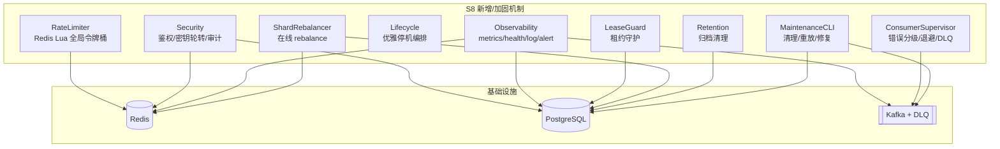

# S8 生产就绪加固（Production Readiness）
# 详细设计（Low-Level Design）

> 本文是《通用实时消息 Gateway Platform — 架构设计方案 v1》中 **S8 阶段**的实现级展开。
>
> - **上位文档**：`通用实时消息 Gateway Platform - 架构设计方案.md`（架构方案）
> - **前置契约**：S2–S7 全部冻结。本阶段**不以增加功能为目标**，只消除前序阶段的正确性缺陷与运维盲区。
> - **阶段定位**：唯一一次生产就绪门禁。完成的判定不是「代码写完」，而是**通过 Production Readiness Gate**。
> - **明确不做**：不新增协议帧、表或业务入口；不改 S2–S7 冻结语义；不做分库分表/多机房/跨地域容灾/千万级容量验证（终局）。

| 项 | 内容 |
|---|---|
| 阶段编号 | S8 |
| 依赖阶段 | S2–S7（全部能力与机制冻结） |
| 核心目标 | 消除全部已知正确性缺陷与运维盲区 |
| 门禁项 | 正确性、安全性、可靠性、可观测性、可运维性、容量、文档、质量 |
| 覆盖能力面 | 可靠消息、广播、客户端事件三条链路**全部纳入**，Best-Effort 无例外 |
| 硬约束 | 不再引入新功能面；只修缺陷与调优 |

---

## 目录

1. [设计目标与门禁边界](#1-设计目标与门禁边界)
2. [模块划分](#2-模块划分)
3. [S7 遗留问题闭环对照表](#3-s7-遗留问题闭环对照表)
4. [全局限流与多租户隔离](#4-全局限流与多租户隔离)
5. [安全基线](#5-安全基线)
6. [可观测性四件套](#6-可观测性四件套)
7. [可靠性加固](#7-可靠性加固)
8. [优雅停机与生命周期](#8-优雅停机与生命周期)
9. [数据生命周期与维护 CLI](#9-数据生命周期与维护-cli)
10. [生产就绪门禁](#10-生产就绪门禁)
11. [故障演练设计](#11-故障演练设计)
12. [验收标准与交付清单](#12-验收标准与交付清单)

---

# 1. 设计目标与门禁边界

## 1.1 本阶段要消除的七类盲区

S7 完成了分布式主干，但只验证了「功能正确」与「单点故障恢复」，缺少生产环境必须的七个方面（逐条对应 §3.2 的真实遗留）：

1. 全局限流正确性（集群口径，而非每进程）。
2. 消费者容错与 DLQ 重放。
3. 在线扩缩容（rebalance 的可观测与安全阀）。
4. 安全基线（吊销、轮转、审计）。
5. 可观测性四件套（端点、告警、容量口径）。
6. 数据生命周期（保留、归档、清理）。
7. 集群容量基线（S5 只覆盖单机）。

## 1.2 三条边界

- **承接 S7**：不推翻 Outbox、Kafka、租约、分片机制，只修正其缺陷与边界。
- **覆盖全部能力面**：三条链路都纳入加固；不接受「广播是 Best-Effort 所以不管」的例外。
- **最后一次功能面变更**：S8 之后（终局规模扩展）只做容量与架构演进，不再新增协议帧与业务入口。

## 1.3 不在本表范围（前序已闭环，仅审计复核）

下列能力在前序阶段已实现，本阶段**只做审计复核，不重复建设**（完整对照见 §3.1）：

- 幂等键规范（S2）。
- 业务语义与完成判定 SETTLED（S2）。
- 时间仲裁 SQL `now()`（S2）。
- 事实 schema（S2/S7）。
- 广播语义与扇出逻辑（S3/S7）。
- 事件 schema 与帧定义（S4）。
- 客户端鉴权与节点间 mTLS（S1/S6）。
- 虚拟分片与租约续期（S7）。

---

# 2. 模块划分

## 2.1 组件视图



## 2.2 目录结构

```text
s8/
├── cmd/
│   ├── maintenance/           # 清理/DLQ重放/租约修复/配额管理
│   └── all-processes/         # 统一生命周期与运维端点装配
├── internal/
│   ├── ratelimit/
│   │   ├── global.go          # Redis Lua 全局令牌桶
│   │   ├── lua/               # 原子脚本
│   │   └── config.go          # 配额热更新
│   ├── security/
│   │   ├── auth.go            # 令牌签发/校验/吊销
│   │   ├── tls.go             # TLS/mTLS + 证书热加载
│   │   └── audit.go
│   ├── observability/
│   │   ├── metrics.go
│   │   ├── health.go
│   │   ├── log.go
│   │   └── alerts/
│   ├── lifecycle/
│   │   └── shutdown.go        # 统一优雅停机
│   ├── consumer/
│   │   ├── supervisor.go
│   │   ├── errors.go          # 错误分级
│   │   └── dlq.go             # DLQ + 重放
│   ├── worker/
│   │   ├── leaseguard.go
│   │   ├── pipeline.go        # 并行 Pipeline
│   │   └── rebalancer.go
│   ├── retention/
│   │   └── cleanup.go
│   └── config/
├── docs/
│   ├── deployment.md
│   ├── operations.md
│   ├── incident-response.md
│   ├── capacity-report.md
│   ├── readiness-checklist.md
│   └── adr/
└── test/
    ├── fault/                 # 故障演练
    ├── security/              # 负向测试
    └── capacity/
```

## 2.3 核心接口

```go
// ===== 全局限流 =====
type GlobalRateLimiter interface {
    Acquire(ctx context.Context, tenantID string, tokens int) (bool, error)
    // Lua 原子：检查 + 批量扣减 + 发放
    SetQuota(ctx context.Context, tenantID string, q Quota) error  // 热更新
}

type Quota struct {
    RatePerSec int
    Burst      int
    Version    int
}

// ===== 安全 =====
type TokenManager interface {
    Issue(ctx context.Context, sub Subject) (string, error)
    Verify(ctx context.Context, token string) (Subject, error)
    Revoke(ctx context.Context, tokenID string) error
    RotateKey(ctx context.Context) error
}

type CertManager interface {
    Load() error
    HotReload(ctx context.Context) error   // 不中断服务
}

// ===== 生命周期 =====
type Lifecycle interface {
    Register(name string, closer func(ctx context.Context) error)
    Shutdown(ctx context.Context) error
    // 顺序：停止领取 → 释放租约 → 排空在途 → 提交 offset → 关闭资源
}

// ===== 消费容错 =====
type ConsumerSupervisor interface {
    Run(ctx context.Context, subject Subject, h Handler) error
    // panic 捕获、连接重建、指数退避重连(100ms→30s, jitter)
}
```

---

# 3. 遗留问题与门禁基线

> 这是 S8 的**核心交付物**。门禁必须建立在真实遗留之上：把前序已闭环的能力写成"从未建设"，会让真风险被"已闭环"掩盖，同时让已实现项被重复计费。

## 3.1 前序已闭环项（只审计复核，不重复建设）

| 能力 | 已落地位置 | S8 的动作 |
|---|---|---|
| 客户端令牌鉴权（握手强制、过期校验） | S1 §5 | 复核 + 补吊销/轮转/审计（§5） |
| 节点间 mTLS | S6 §8 | 复核 + 补证书轮转流程（§5.3） |
| 节点路由 Redis HA（Sentinel/Cluster） | S6 §2.4 / §3 | 复核 + 补全路径降级（§4.5） |
| Connection Version 守卫（Lua 原子） | S6 §3.2 / §3.3 | 复核 |
| 虚拟分片 + 租约续期 | S7 §5.2 / §5.3（已按 `lease_ttl/3` 续期） | 补租约守护与停机释放（§7.3） |
| Kafka 消费者基础重连与退避 | S7 §3.3（基础版） | 升级为 supervisor + 错误分级（§7.1） |
| 广播扇出 / 共享编码 / P2 预算 | S3 §7 / §8 | 纳入全局配额（§4.3） |
| 客户端事件 schema 与指标 | S4 §13 | 补告警与容量观测（§6） |
| 结构化日志字段约定 | S1 §2.2 telemetry | 扩展为全进程统一（§6.3） |

## 3.2 真实遗留（本阶段必须逐条闭环）

| # | 遗留问题（引入阶段） | 根因 | 解决方案 | 验收口径 |
|---|---|---|---|---|
| 1 | 限流是**每进程**令牌桶，集群总速率 ≈ rate × N（S7 §5.2） | 桶状态在 Worker 本地 | Redis Lua 全局桶 + 批量分摊（§4.2） | 4 Worker 并发总速率 ≤ rate（误差 ≤10%），租户互不影响 |
| 2 | DLQ 只有写入，无重放、无错误分类落库（S7 §3.3） | 只做了"不阻塞分区"的最小分支 | `dead_letters` 落库 + 重放 CLI（§7.2） | 毒丸入 DLQ 不阻塞；按租户/时间重放后完成投递 |
| 3 | 无集群吞吐/延迟/规模基线（S5 只覆盖单机） | 未做集群级压测 | 集群容量基线与模型（§12.2） | 容量报告交付：受理/投递 TPS、P50/P99、lag、接管延迟 |
| 4 | 核心表无保留策略（S2/S7 建表但无清理） | 生命周期未落地 | 保留窗口 + 分批清理 + 维护 CLI（§9） | 保留期外数据清理，磁盘水位稳定 |
| 5 | 事件链路的**容量与放大**观测缺失（S4 §13 只有计数） | Best-Effort 被视为次要 | 投影放大比、丢弃率、路由失败率的告警（§6.4） | 默认配置下放大比 ≈1；丢弃率超阈值告警 |
| 6 | 无统一的跨进程停机编排（S0/S1 只处理连接级关闭，S7 各进程各自退出） | 各阶段只做本进程的 close | 统一 Lifecycle 契约（§8） | 滚动发布零丢失；租约立即释放，不等 TTL |
| 7 | Redis 降级未覆盖限流路径（S6 §7.2 只覆盖路由） | 未区分两条 Redis 用途 | 路由/限流 Redis 物理隔离 + 限流 fail-open（§4.5） | 限流 Redis 停机时不出现"全量拒绝" |
| 8 | 安全只到"最小能力"：令牌吊销、密钥轮转、审计缺失（S1 §5.3 / S6 §8.3 明确留待 S8） | 阶段只做引入点最小集 | 吊销名单 + 轮转 + 审计日志 + 脱敏（§5） | 负向测试全通过；轮转不中断服务 |
| 9 | 重连风暴只有客户端退避，**服务端无建连保护**（S4 §4.1.1 已定义退避上限与 jitter） | 端侧有退避，服务端 accept 不限速、无摘流 | 服务端建连限速 + 每 IP/租户上限 + `/readyz` 摘流（§7.6）；客户端契约直接引用 S4 §4.1.1 | 节点重启风暴下建连成功率 ≥99%，退避波形符合契约 |
| 10 | `outbox` 表已定义但 `attempts` 语义未定、已发布行不清理（A §8.1.2 建表；命令类 outbox 的语义一直空缺） | 只定义了列，未定义语义 | `attempts` 只计失败 + `last_error` 语义化 + 按 `published_at` 清理（§7.7） | 行数在窗口内稳定；成功发布不增 attempts |
| 11 | 过期扫描仍单 goroutine（S2 §8.6 保留单实例） | 过期是消息级、量级小 | 时间桶并行（§7.5） | 大量过期堆积时投递 P99 不受显著影响 |
| 12 | 订阅索引容量只有单节点指标，缺集群口径（S3 §11） | 内存索引无全局视角 | 集群聚合 + 阈值告警 + 迁移语义文档（§6.4） | 触顶前告警；运维文档明确"重启丢订阅"的语义 |

---

# 4. 全局限流与多租户隔离

## 4.1 分层设计

```text
租户请求
  ↓
本地桶（零 IO 快速拒绝）
  ↓
批量申请令牌（周期触发 / 攒够 N 个）
  ↓
Redis Lua 原子扣减（检查 + 扣减 + 发放）
  ↓
放行 / 拒绝
```

## 4.2 Redis Lua 原子脚本

```lua
-- KEYS[1]=令牌桶 key, ARGV=速率/容量/申请量/当前时间
-- 原子：补充令牌 → 检查余额 → 扣减 → 返回是否放行
local tokens = refill_and_get(...)
if tokens >= requested then
    deduct(requested)
    return 1
end
return 0
```

## 4.3 覆盖路径

- 租户接入侧：Message Service 按 tenant 限流受理 API。
- 投递侧：Delivery Worker 批量申请令牌。
- 广播侧：publish 纳入全局配额，按条数与字节双计量。

## 4.4 配额一致性

- 热更新：租户配置变更后无需重启（缓存 TTL + 版本号）。
- **配置缺失**（从未配置过配额）：按租户默认配额处理，不按零配额。
- **依赖故障**（Redis 读不到/超时）：见 §4.5 的降级规则——**不按零配额**。

## 4.5 降级规则：限流 Redis 故障时 fail-open（修正 S6 承诺冲突）

S6 §7.2 承诺"Redis 不可用时已有会话继续收发"，本阶段如果一律按"零配额"处理，会得到**依赖故障 → 全量拒绝**，两条承诺直接矛盾。因此分三种情况：

| 情况 | 行为 | 理由 |
|---|---|---|
| 配额**配置**不存在 | 用租户默认配额 | 配置缺失是部署问题，不该惩罚业务流量 |
| 限流 Redis **读失败/超时** | **本地桶放行（fail-open）**，计 `ratelimit_degraded_total` 并告警 | 可用性优先：限流是保护机制，不是准入控制；故障期放开比全站拒绝代价小 |
| 限流 Redis 明确返回"拒绝" | 正常拒绝：HTTP 侧 `429 Too Many Requests` + `Retry-After`；TCP 侧 `CLOSE(1007 POLICY_VIOLATION)` | 判定可信，照常生效；**不复用 `ERROR 1001`**（其语义是"策略超上限"，与"限流拒绝"不同），也不新增 ERROR 码 |

**架构前提（必须同时满足，否则 fail-open 会变成"永不限流"）**：

1. **物理隔离**：限流 Redis 与路由 Redis 是不同实例/集群（S6 §7.3），避免一次故障同时打掉路由与配额；
2. **本地兜底桶**：每进程保留一个粗粒度本地桶（按租户），故障期用它做最低限度的保护（例如全局配额的 50%）；
3. **降级可观测**：`ratelimit_degraded_total` 必须告警，且门禁期间要求该指标在非故障演练窗口为 0。

## 4.6 验收

- 正常场景：4 个 Worker 并发投递同一租户，总速率 ≤ 配置 rate（误差 ≤10%），其他租户不受影响。
- 降级场景：停掉限流 Redis 后，受理与投递不被限流拒绝，`ratelimit_degraded_total` 增长并触发告警；恢复后自动回到全局配额。
- 组合场景：路由 Redis 与限流 Redis 同时停机，业务降级运行且不出现"全量拒绝"。

---

# 5. 安全基线

## 5.1 客户端鉴权

- 令牌签发/校验（HMAC/JWT），绑定 tenant 与 user。
- 过期校验、吊销名单（Redis）、令牌版本号支持轮转。
- 握手鉴权纳入连接建立流程；未通过鉴权不得进入任何业务路径。

## 5.2 TLS / mTLS

- Gateway 与 Message Service 支持 TLS 1.2+/1.3，证书热加载。
- 节点间 mTLS（S6 已实现，本阶段补齐轮转与审计）。
- TLS 由网关自身终结；卸载留给部署侧。

## 5.3 密钥与配置

- 敏感项只从环境变量或密钥文件读取，启动日志脱敏。
- 密钥轮转流程（不中断服务）。

## 5.4 审计

受理、鉴权失败、踢人、DLQ、重放等管理动作写审计日志，带操作者与来源。

## 5.5 负向测试

无令牌、过期令牌、错误证书全部被拒；证书轮转无中断；敏感配置不出现在日志与进程参数。

---

# 6. 可观测性四件套

## 6.1 指标（Prometheus `/metrics`）

覆盖全部进程（Gateway / Message Service / Worker / Event Router / Rebalancer）：

- 连接数、活跃会话、收发帧数、队列水位。
- 受理 TPS、投递 TPS、ACK 延迟。
- Outbox 积压深度、Kafka lag。
- 租约持有数与接管次数、重试次数分布。
- 限流次数与**降级次数**、DLQ 数量、DB 连接池水位、goroutine 数。
- 订阅连接数、活跃 topic 数、广播丢弃数、客户端事件丢弃数、**事件投影放大比**（`事件数 / 消息数`）、**事件路由失败数**。

## 6.2 健康检查

- `/healthz`（存活）、`/readyz`（就绪，按 PostgreSQL/Redis/Kafka 三依赖分态）、`/version`。
- 依赖故障时 readiness 正确置失败并暴露明细。

## 6.3 结构化日志

统一 JSON，注入 traceID / tenantID / messageID / workerID / shardID / sessionID / topic。

## 6.4 告警规则

Outbox 积压、Kafka lag、投递失败率上升、租约接管频次异常、限流占比过高、**限流降级触发（`ratelimit_degraded_total` > 0）**、就绪失败、DLQ 增长、广播丢弃率、**事件投影放大比异常**、**事件路由失败率上升**、订阅索引集群触顶。

## 6.5 验收演练

人为制造 Outbox 积压与 Kafka lag，可靠链路与广播链路各触发至少一条预设告警。

---

# 7. 可靠性加固

## 7.1 消费容错（在 S7 基础版上升级）

- **supervisor**：panic 捕获后重建 consumer；连接失败指数退避重连（100ms→30s 封顶 + jitter）。
- **错误分级**：可重试（超时、连接中断、依赖不可用）vs 不可重试（反序列化失败、参数非法、幂等冲突）。
- 不可重试错误写 DLQ 后提交 offset，不阻塞分区。
- 与 S7 §3.3 的关系：S7 已有"基础指数退避 + 基础 DLQ 写入"，本阶段补的是**panic 后重建、错误分类落库、重连上限与熔断、offset 提交时机校验**。

## 7.2 DLQ 与重放（遗留 #2）

- DLQ 主题 + `dead_letters` 表：落库原始事件、错误分类、首次/最近发生时间、重放次数。
- 重放 CLI：从 DLQ 重新投递到原 subject，支持按时间范围与租户筛选；幂等由投递唯一键保证。
- 重放不重置 `error_class`，便于区分"原始错误"与"重放后再次失败"。

## 7.3 租约守护（复核 + 加固，遗留见 §3.1）

- S7 已按 `lease_ttl/3` 续期；本阶段补**守护协程**（续期失败告警、租约丢失后自我摘除）、批量 `RenewLeases`、停机主动释放。
- 模拟 60s 慢投递，租约不丢；worker 退出后租约立即释放（不等 TTL）。

## 7.4 在线 rebalance（复核 + 加固）

- S7 已实现虚拟分片劈裂/合并与逐段迁移；本阶段补**rebalance 的可观测与安全阀**：迁移进度指标、最大并行迁移段数、迁移中崩溃的恢复流程。
- Worker 在劈裂中崩溃的窗口由租约 + 唯一约束兜底。

## 7.5 并行 Pipeline 与过期扫描并行化（遗留 #11）

- 领取、续期、消费、过期清理、outbox relay 各自独立 goroutine + context，有界 channel 背压。
- **过期扫描从单 goroutine 改为按时间桶分片并行**，避免全表扫与单点瓶颈；每桶仍是幂等 CAS。

**时间桶的定义与补偿（不能只写"10 分钟桶"）**：

```text
bucket(ts)       = floor(unix_seconds(ts) / 600)      // 10 分钟一个桶
current_bucket   = bucket(now())
sealed_bucket    = current_bucket - 1                  // 已"结束"的桶（其时间窗已走完）

每轮：
  步骤 1（积压）：并行处理 [cursor_bucket, sealed_bucket] 的全部桶
        每个桶：WHERE expires_at >= bucket_start AND expires_at < bucket_end AND expires_at <= now()
        全部成功后 cursor.Save(sealed_bucket + 1)      -- 只推进到已封桶
  步骤 2（当前桶）：单独扫一次 WHERE expires_at <= now() AND expires_at >= bucket_start(current)
        不推进 cursor（该桶还在接收新行）
```

| 关键点 | 规则 |
|---|---|
| 桶边界 | `floor(unix_seconds(expires_at) / 600)`；只用于分组与并行，**不参与是否到期的判定** |
| 是否到期 | 仍由 SQL `expires_at <= now()` 判定（S2 时间仲裁不变） |
| **为什么只推进到"已封桶"** | 若在同一轮把未结束的当前桶也标记为已完成，则该桶内"扫描时还没到期"的行会在桶结束后永不再被扫到（例如 10:05:00 扫描时 `expires_at=10:05:30` 的行还没到期，游标却已越过 10:00–10:10 桶）。封桶后才能安全越过的前提，正是"桶内不再出现新的到期时间点" |
| 延迟补偿 | 桶处理慢或进程重启 → `cursor_bucket` 未推进 → **下一轮重扫该桶**，不漏 |
| 空桶 | 直接跳过并推进（不产生查询） |
| 并行度 | 桶之间可并行；**同一桶只允许一个 goroutine 处理**（`expire_message` 本身幂等，但并发扫同桶会产生无效写与锁竞争） |
| 状态持久化 | `cursor_bucket` 与投影游标同表（A §8.1.3 `projection_cursor`，`projector='expiry'`） |

- 验收：堆积 100 万条过期消息时，正常投递 P99 劣化 ≤20%；kill 进程后重启，未完成的桶被重扫且无重复事实。

## 7.6 重连风暴保护（遗留 #9）

- 客户端侧：**上限与 jitter 由 S4 §4.1.1 定义**（初始 500ms、×2、**封顶 30s**、`[0.5×, 1.5×]` 抖动、五类放弃条件）。本阶段不做客户端改动，只引用该契约。
- 服务端侧：节点级建连速率限制（accept 限速 + 每 IP/租户连接数上限），拒绝时回 `CLOSE(1007 POLICY_VIOLATION)` 而不是直接断 TCP；
- 就绪保护：`/readyz` 在进入"风暴保护"时置 false，让负载均衡停止继续导流。
- 验收：单节点 30s 内 10 万客户端同时重连，建连成功率 ≥99%，P99 建连延迟不出现雪崩；客户端退避波形符合 S4 §4.1.1（抓包验证间隔不集中在同一时刻）。

## 7.7 outbox 语义修正（遗留 #10）

- `attempts` **只计失败次数**，成功发布不递增；`last_error` 保存最近一次发布/消费错误（`last_error_class` 便于聚合）。
- 按 `published_at` 保留窗口分批小事务删除已发布行；`attempts` 超阈值的行转 DLQ 后清理。
- `delivery_facts` 的发布水位由 S7 §4.5 定义，本阶段只负责其保留与清理，不改变语义。

---

# 8. 优雅停机与生命周期

## 8.1 统一契约

所有进程实现同一停机序列：

```text
SIGTERM
  → readiness 立即置 false（配合 preStop）
  → 停止领取新任务
  → 释放租约
  → 排空在途（带超时）
  → 提交 Kafka offset            // 仅 Kafka 消费者执行
  → 关闭连接与资源
  → 退出
```

广播消费者与事件 router 同样纳入停机序列。

**逐进程的"落地判据"（不能统一写 offset）**：

| 进程 | 是否有 Kafka offset | 停机时的落地判据 |
|---|---|---|
| `fanout-worker` | 有 | offset 提交成功 = 本轮展开已落库 |
| `broadcast` 消费者（每个 Gateway） | 有 | offset 提交（广播本身 Best-Effort，允许丢弃积压） |
| `client-event-router` | 有 | offset 提交；投影游标（S4 单机形态）随进程持久化 |
| **`delivery-worker`** | **没有** | **`delivery.sent` 事实与状态更新的事务已提交**；未提交则在途行随租约释放被重扫 |
| `outbox-relay` | 没有 | `published_at` 的 UPDATE 已提交；未提交则本批重发（`event_id` 幂等） |

> 通用序列里写一句"提交 offset"会让 DW/Relay 的实现者去造一个不存在的 offset——它们的"已落地"由**数据库事务提交**表达。这也是"统一契约 + 分进程落地判据"必须成对出现的原因。

## 8.2 与 At-Least-Once 的配合

- 退出前确认在途消息安全落地（Kafka 消费者看 offset，DW/Relay 看事务提交，见 §8.1 表）。
- 配合租约立即释放，接管延迟小于一个扫描周期（不再等 TTL 超时）。
- **"零重复"不是可达目标**：排空之后、提交 offset 之前崩溃，重放必然发生（S7 §8.1 已声明 At-Least-Once，不实现 Exactly-Once）。可承诺的是「**零丢失** + 重复有上界且被幂等吸收"。

## 8.3 验收（按"有状态资源"分别定义上界）

重复上界必须按**每种资源各自的模型**给出——Kafka 消费者有 offset，`delivery-worker` 没有（它是 DB 扫描者，S7 §2.2.1）。混用一个口径会导致门禁项无法执行。

| 资源 | 重复窗口 | 上界 | 兜底 |
|---|---|---|---|
| Kafka 消费者（fanout / broadcast / event-router） | 排空后、提交 offset 前崩溃 | 每分区每次故障 ≤ 1 个未提交批次（≤ batch_size 条） | `event_id` / `fanout_done_at` 幂等 |
| **`delivery-worker`（DB 扫描）** | **已回推 DELIVER、未提交 `delivery.sent` 事务** | **每次崩溃 ≤ 崩溃时在途 batch 行数（≤ `batch_size`）** | 客户端按 `message_id` 去重；`Transition` CAS 防重复推进 |
| `outbox-relay` | 发布后、提交 `published_at` 前崩溃 | 每批 ≤ n 条重复发布 | `event_id` 幂等 |
| 投递行本身 | — | **0 重复行**（DB 唯一约束） | — |

| 指标 | 目标 | 对账方法 |
|---|---|---|
| 消息丢失 | **0** | 受理数 = 终态数 + 未终态数 |
| 重复投递行 | **0** | `deliveries` 唯一键计数 |
| 重复对外投递 | 见上表（按资源分列） | 注入"排空后 kill"；`delivery.sent` 事实数 − 客户端去重后收到数 = 重复量 |
| 客户端重复渲染 | **0** | 客户端按 `message_id` / `event_id` 去重后的渲染计数 |
| 租约接管延迟 | ≤ 1 个扫描周期 | 停机后新 Worker 首次领取时间 |

> 把"零重复"改成"零丢失 + 有界重复 + 幂等吸收"，是因为前者无法被测试证明；而"上界"必须落到具体资源上，否则"每分区 1 批"对一个没有分区的 DB 扫描者是没有意义的表述。

---

# 9. 数据生命周期与维护 CLI

## 9.1 保留策略

- `messages` / `deliveries` / `delivery_facts` / `outbox` / `dead_letters` 各自保留窗口配置化。
- 分批小事务清理，避免长事务与锁表；清理任务可限速、可暂停。
- 清理 `endpoints` 僵尸设备。

## 9.2 维护 CLI

- 手动清理（指定表/时间范围）。
- 按租户重放 DLQ。
- 租约修复（释放僵尸租约）。
- 配额查看与调整。

## 9.3 启动校验

缺失或非法配置在启动时立即失败并给出明确原因，避免带病上线。

---

# 10. 生产就绪门禁

## 10.1 门禁表（全部通过方可判定生产可用）

| 门禁项 | 判定标准 |
|---|---|
| 正确性 | 无已知 P0/P1 缺陷；§3.2 的 12 项遗留全部闭环；§3.1 的已闭环项复核通过且未被重复计费 |
| 安全性 | 鉴权/TLS/mTLS/密钥/审计落地并通过负向测试 |
| 可靠性 | 进程/网络/依赖/时钟故障注入全覆盖后自动恢复；零丢失与有界重复达标（§8.3） |
| 可观测性 | 指标/健康检查/日志/告警四件套齐备并演练，覆盖三条链路 |
| 可运维性 | 优雅停机、滚动升级、扩缩容、清理维护有实测记录 |
| 容量 | 容量报告与模型交付，终局规划有据 |
| 文档 | 部署/运维/故障处置手册齐备 |
| 质量门禁 | 格式化/静态检查/单测/竞态检查全部通过 |

## 10.2 §3 基线的审计复核

S8 结束时逐条复核：

- **§3.2（12 项）**：每项必须同时满足"有机制实现、有验收口径、有测试证据"，缺一视为门禁失败。
- **§3.1（已闭环项）**：必须能在前序文档中指出落点章节，且本阶段没有把它当成"新建能力"重复建设。若发现某项其实并未落地（例如只有接口没有实现），必须降级移入 §3.2 重新闭环——门禁表的价值在于真实，不在于好看。

## 10.3 缺陷分级定义（门禁"无 P0/P1"的判定依据）

门禁里的"无 P0/P1 缺陷"必须先定义什么是 P0/P1，否则永远有争议。

| 级别 | 定义 | 判定人 | 典型例子 |
|---|---|---|---|
| **P0** | 按文档实现必然得到**错误结果或不可用**：内存安全、数据错乱、契约自相矛盾、状态机允许非法转换、静态检查直接阻断 | 架构负责人 + 模块 owner 双签 | `ImmutableFrame` 按值传递使引用计数失效；投递状态多出 `SETTLED` |
| **P1** | 在**特定但现实的时序/规模**下出错，或体系性缺失（无守卫、无水位、无上界、单→多演进未同步） | 模块 owner 提出，架构负责人确认 | 过期路径无 CAS；DW 扫描无分片过滤 |
| **P2** | 文档表述含糊、命名不一致、引用错位；不改变实现正确性但会误导读者 | 模块 owner 自判 | `settled_at` 命名歧义；章节引用错位 |

判定规则：

1. 级别按**后果**定，不按**改动量**定：改一行能修的也可能是 P0（只要改错方向就会数据错乱）。
2. 同一问题若同时命中两级，取高级。
3. 门禁只拦 P0/P1；P2 允许进入待办清单，但**必须登记责任人与关闭版本**，不得口头带过。

---

# 11. 故障演练设计

| 演练 | 注入 | 断言 |
|---|---|---|
| 毒丸消息 | 注入不可反序列化消息 | 入 DLQ、进程不退出、分区不阻塞、重放成功 |
| Kafka 停机 | 停 Kafka 后恢复 | 自动重连、不丢 offset |
| 全局限流 | 4 Worker 并发同租户 | 总速率达标、租户隔离 |
| **限流 Redis 停机** | 只停限流 Redis | 不被限流拒绝、`ratelimit_degraded_total` 告警、恢复后回全局配额 |
| 在线扩容 | 4→8 Worker | 无停顿、无重复/遗漏 |
| 租约守护 | 60s 慢投递 | 租约不丢、退出即释放 |
| 路由 Redis 全停 | 停路由 Redis | 降级矩阵行为符合预期（S6 §7.4） |
| 优雅停机 | 滚动发布 | 0 丢失；重复上界按资源分别达标（§8.3：Kafka 分区 ≤1 批 / DW ≤ `batch_size` 行），且被幂等吸收 |
| 依赖告警 | 制造 Outbox 积压 + Kafka lag | 告警触发 |
| 重连风暴 | 节点重启 | 事件链路不拖垮建连 |
| 鉴权负向 | 无令牌/过期/错误证书 | 全被拒、无中断 |

---

# 12. 验收标准与交付清单

## 12.1 验收标准

**功能与正确性**

- S7 全部功能与协议兼容，无破坏性变更。
- 鉴权、TLS、mTLS 启用且负向测试通过；全局限流多 Worker 达标；广播 publish 纳入配额。

**可靠性**

- 毒丸入 DLQ 可重放；Kafka 停机自动恢复；租约退出立即释放；4→8 在线扩容无重复/遗漏。
- 优雅停机 **零丢失**；重复投递有界（按资源分列：Kafka 消费者每分区 ≤ 1 个未提交批次、`delivery-worker` ≤ `batch_size` 行）且被幂等键/客户端 `message_id` 去重吸收，**不承诺"零重复"**（§8.3 给出可验证口径）。

**安全**

- 未授权连接被拒且不影响其他连接；证书轮转无中断；敏感配置不出现在日志与参数。

**可观测性**

- 全进程暴露 `/metrics` `/healthz` `/readyz`；依赖故障时 readiness 正确失败；可靠与广播链路各触发一条告警。

**性能与容量**

- 容量报告交付（受理/投递 TPS、P50/P99、Kafka lag、租约接管延迟、广播扇出上限、事件延迟）；S7 场景在 S8 下全部通过。

**工程质量**

- `gofmt`、`go vet`、`go test ./...`、`go test -race ./...` 通过；每个新机制有单测与故障注入；新增决策记录 ADR。

## 12.2 交付清单

| 交付物 | 位置 |
|---|---|
| 生产部署手册 | `docs/deployment.md` |
| 运维手册 | `docs/operations.md` |
| 故障处置手册 | `docs/incident-response.md` |
| 容量报告与模型 | `docs/capacity-report.md` |
| 生产就绪门禁自查表 | `docs/readiness-checklist.md` |
| 架构决策记录 | `docs/adr/` |

---

> **结语**：S8 是整个项目从「可运行的分布式引擎」到「可上生产、可被运维、可被审计」的收敛点。它的价值不在新增多少机制，而在于**把 S7 的每一条遗留问题用机制和证据逐条闭环**。S8 之后的能力（千万级规模扩展）不再新增功能面——这正是一次性门禁的意义：把功能面在某个点彻底冻结，之后只在冻结的语义上放大规模。
