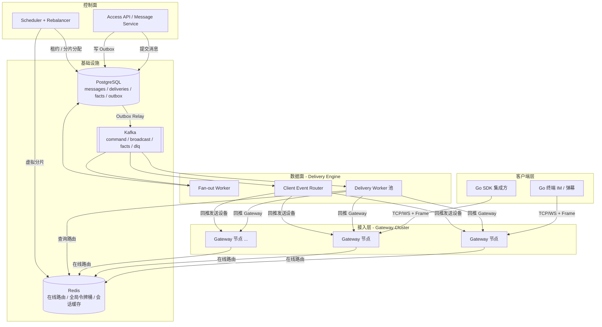
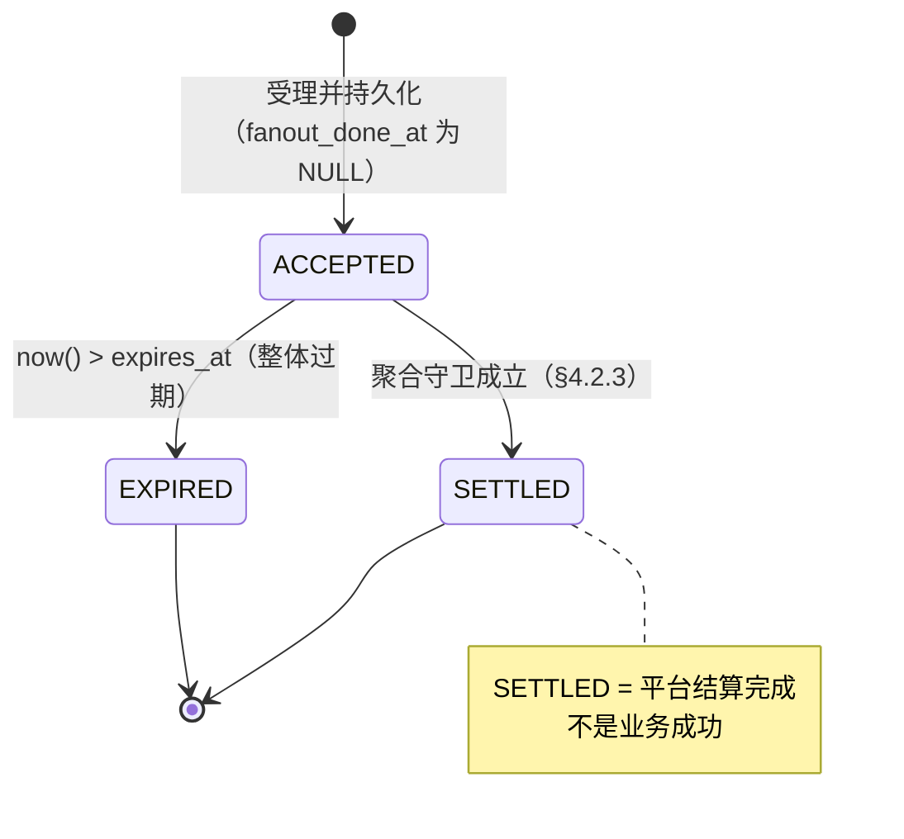
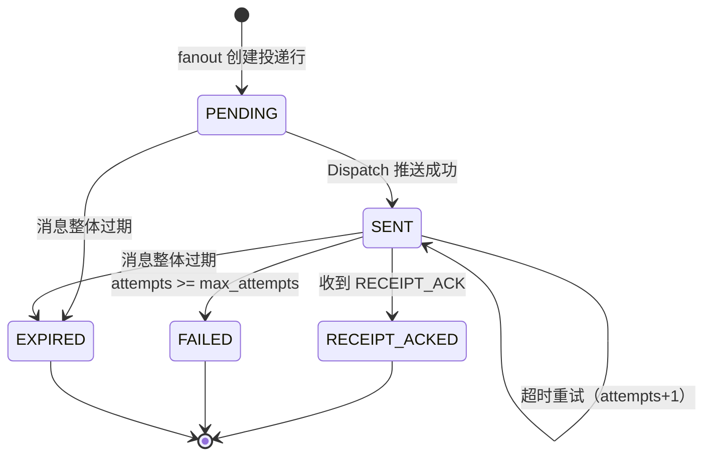
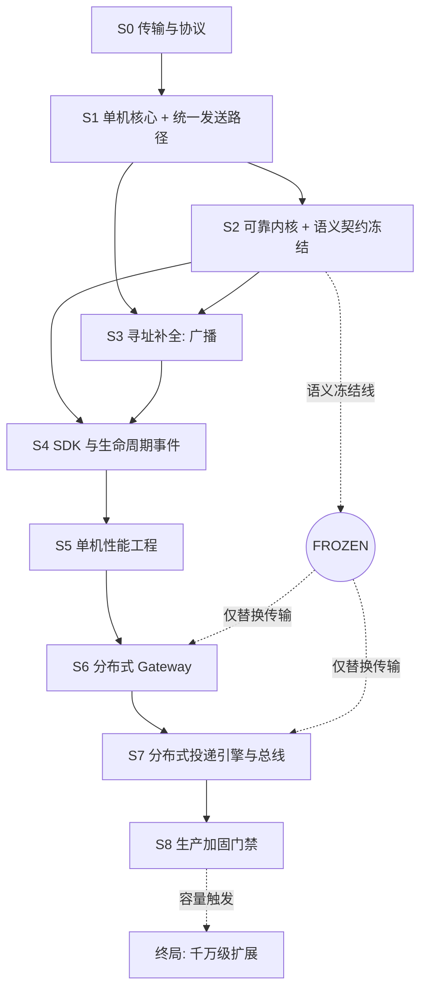

# 通用实时消息 Gateway Platform
# 架构设计方案（Architecture Design v1）

> 本套 10 份文档（架构方案 + S0–S8 各阶段 LLD）构成项目完整的架构设计基线。
>
> 设计范围：**技术架构、阶段划分、阶段依赖、技术选型、系统边界**。
> 不包含：具体代码、逐帧字段级协议定义（交由各阶段 LLD 完成）。

| 项 | 内容 |
|---|---|
| 项目定位 | 个人技术成长型工程项目（竞技场式能力训练，非商业交付） |
| 核心资产 | 一份**一次性冻结的语义契约** + 一套**按能力位渐进启用的单一代码库** |
| 阶段数 | **9 个阶段（S0–S8）** |
| 核心设计原则 | 语义一次成型并冻结；横切关注点在引入点落地；单一代码库 + 能力位渐进启用 |
| 技术栈 | Go、TCP/WebSocket、PostgreSQL、Redis、Kafka |
| 规模目标 | 千万级扩展**能力**（终局目标，非阶段性能承诺） |

---

## 目录

- [第一部分 设计摘要](#第一部分-设计摘要)
- [第二部分 架构第一性原理](#第二部分-架构第一性原理)
- [第三部分 北极星架构](#第三部分-北极星架构)
- [第四部分 语义契约：单一事实来源](#第四部分-语义契约单一事实来源)
- [第五部分 阶段划分](#第五部分-阶段划分)
- [第六部分 技术选型与引入时机](#第六部分-技术选型与引入时机)
- [第七部分 各阶段架构设计](#第七部分-各阶段架构设计)
- [第八部分 数据模型与全局分配表](#第八部分-数据模型与全局分配表)
- [第九部分 端到端验证体系](#第九部分-端到端验证体系)
- [第十部分 工程纪律与质量门禁](#第十部分-工程纪律与质量门禁)
- [第十一部分 设计决策总表](#第十一部分-设计决策总表)

---

# 第一部分 设计摘要

## 1.1 三个结构性设计取舍

本方案在三个结构性维度上做出明确取舍，它们决定了后续全部阶段的实现方式：

| # | 设计取舍 | 本方案的形态 | 收益 |
|---|---|---|---|
| C1 | 语义一次成型 | 可靠语义在单机、单库阶段一次性建对并冻结 | 无迁移、双写与回填成本；分布式阶段零语义变更 |
| C2 | 横切关注点前置 | TLS / 鉴权 / 原因码 / mTLS 随各自接口的首次出现落地 | 无全链路返工，无「临时明文」窗口 |
| C3 | 单一代码库 | 能力位 + 配置开关控制阶段功能，阶段快照用 Git Tag | 一次修复全局生效，无代码副本漂移 |

## 1.2 六项核心设计决策

| # | 决策 | 类型 | 收益 |
|---|---|---|---|
| D1 | 新增**语义契约（Semantic Contract v1）**并在单机阶段一次性冻结 | 架构资产 | 语义只定义一次；分布式阶段零语义变更 |
| D2 | 可靠消息内核（正确语义一次成型）置于 **S2** | 阶段设计 | 无双写、回填、兼容开关 |
| D3 | 横切关注点**在引入点落地**：鉴权与 TLS 随首个外部接口出现，mTLS 随多节点出现 | 依赖设计 | 无「临时明文」窗口 |
| D4 | **单一代码库 + 能力位 + 配置开关**，阶段快照用 Git Tag | 工程结构 | 一次修复全局生效 |
| D5 | 广播与客户端事件复用**统一发送路径与四通道（P0–P3）隔离模型**，在 S1 定型 | 抽象收敛 | 慢消费者策略、QoS 预算一次定义，三个阶段复用 |
| D6 | 阶段设计为 **9 个（S0–S8）**，生产加固门禁只做一次 | 阶段设计 | 主线更短，功能面更早冻结 |

## 1.3 一句话总结

> **本项目回答的是「这套系统正确的架构应该长什么样，以及按什么顺序把它长出来」。**
> 能力范围与核心洞察（语义先于传输、平台只做事实提供者、端到端验证优先）贯穿全部阶段。

---

# 第二部分 架构第一性原理

## 2.1 平台本质

平台是**传输事实提供者（Transport Fact Provider）**，不是业务系统。

- 输入：业务通过标准 API 提交「把这段不透明字节送给谁」，客户端通过统一协议连接。
- 输出：**传输事实**（受理、推送、回执、失败、过期、结算），不是业务结论。
- 不做：身份注册、好友/群组/会话、业务权限、payload 解析、已读判定、完成判定、通知聚合。

由此推出一条判定准则：**任何会让平台替业务回答「这条消息在业务上算不算成功」的功能，都不进入平台。**

## 2.2 三条不变量

| 不变量 | 含义 | 违反的代价 |
|---|---|---|
| **I1 语义先于传输** | 数据模型、状态机、协议帧语义、幂等键在单机阶段冻结；分布式只替换「消息从哪来」 | 语义变更需穿越 Outbox / Kafka / Worker / 租约 / 分片，成本上升一个数量级 |
| **I2 正确构造，不做已知错误的实现** | 若某语义已被判定为最终形态，则首次实现即为该形态 | 迁就「先跑通再改」会产生双写、回填、兼容开关与长期语义分叉 |
| **I3 横切关注点在引入点落地** | 某接口/链路第一次出现时，其鉴权、加密、可观测、生命周期契约同时到位 | 后置统一加固必然全链路返工，且阶段间留下「临时不安全」窗口 |

**I3 的适用范围（避免无限膨胀）**：

- **安全类**（鉴权、TLS、mTLS、令牌校验）**无例外**：随首个对应接口出现即落地，S1 客户端鉴权、S6 节点间 mTLS 都是硬约束。
- **可观测类**分两层：**最小集**（进程级 `/metrics`、`/healthz`、结构化日志字段约定）自 **S1** 起随进程出现；**全量集**（`/readyz` 分依赖态、告警规则、容量报告、trace 贯穿）统一在 S8 收敛为四件套。
- **限流与数据生命周期**属于「有容量前提才有意义」的机制，统一在 S8 落地，但 S7 必须显式声明其缺失（不留隐性假设）。

## 2.3 正交能力矩阵

系统能力可拆为三个**正交维度**，阶段填充的是矩阵的不同格子，而不是一条功能清单：

| 维度 | 取值 | 语义保证 | 持久化 |
|---|---|---|---|
| **寻址（Addressing）** | user / endpoint（单播）、topic（广播） | — | — |
| **投递语义（Delivery）** | Best-Effort、At-Least-Once | 尽力 / 可靠 | 否 / 是 |
| **拓扑（Topology）** | 单节点、分布式 | — | — |

典型组合：

- 点对点可靠通知 = `user + At-Least-Once + 单节点/分布式`
- 直播弹幕 = `topic + Best-Effort + 单节点/分布式`
- 客户端生命周期事件 = `endpoint(自己) + Best-Effort + 单节点/分布式`

矩阵的价值：**新增一种「寻址 × 语义」组合不应产生新的状态机或新的发送路径。** 这正是 D5 统一发送路径的设计目标。

## 2.4 能力位与渐进启用

阶段不再等于「复制一份代码」，而等于「在单一代码库中启用一组能力」：

- 服务端：`config.capabilities` 位掩码控制是否注册对应模块（广播、事实出口、事件投影、分布式路由）。
- 协议：`LOGIN_ACK.capabilities` 告知客户端可用能力；旧客户端忽略未知位。
- 客户端：SDK 读取能力位决定发起哪些订阅/查询。
- 阶段快照：每个阶段验收通过后打 Git Tag（`s0` … `s8`），需要复现时在 tag 上开分支——**代码只有一份**。

---

# 第三部分 北极星架构

## 3.1 终局拓扑



## 3.2 七层能力模型

| 层 | 名称 | 职责 | 首次出现阶段 |
|---|---|---|---|
| L0 | 传输层 | TCP/WS、Frame 编解码、粘包半包、心跳、TLS | S0 |
| L1 | 接入层 | 连接管理、Session、鉴权、统一发送路径、QoS 通道隔离 | S1 |
| L2 | 寻址层 | 单播路由（user/endpoint）、topic 订阅索引、扇出 | S1 / S3 |
| L3 | 可靠层 | 持久化、幂等、ACK、重试、TTL、投递事实 | S2 |
| L4 | 事件层 | 客户端事件投影、SDK hooks、查询补齐 | S4 |
| L5 | 分布式层 | 节点注册、在线路由、分发总线、Outbox、租约、分片 | S6 / S7 |
| L6 | 运维层 | 全局限流、可观测、优雅停机、数据生命周期、安全基线 | 按 §2.2 分层：**安全类引入点即落地**；**可观测最小集 S1 起**（每进程 `/metrics`+`/healthz`）；**全量集与全局限流 S8** |

## 3.3 统一发送路径与四通道隔离（D5）

所有出站帧走同一发送路径，但按语义分入**四个优先级通道 P0–P3**，各自独立预算：

```text
每个 Connection
  └── 单 Writer（唯一 Socket 写者）
        └── 优先级队列
              ├── P0 CONTROL     PING/PONG/CLOSE   预算：固定小份额，最高优先
              ├── P1 RELIABLE    SEND/DELIVER      预算：帧数 + 字节双上限；满 -> 断连（可靠语义）
              ├── P2 BROADCAST   BROADCAST         预算：发送队列 25%；满 -> 丢弃+计数，不断连
              └── P3 EVENT       CLIENT_EVENT      预算：独立份额；满 -> 丢弃低优先级事件
```

关键约束：

- 广播帧**只编码一次**，N 个订阅者共享同一份只读字节；字节所有权用引用计数管理，队列持有 +1、写完 -1、归零归还池。
- 四套预算互不占用：广播打满不得影响可靠投递，事件洪峰不得拖死心跳。
- 该模型在 **S1 定型**，S2/S3/S4 只是「接入新帧到已存在的通道」，不再新造发送逻辑。

## 3.4 三平面

| 平面 | 组成 | 失败语义 |
|---|---|---|
| 控制面 | Access API、Scheduler、Rebalancer | 失败可重试，不丢已受理消息 |
| 数据面 | Gateway、Fan-out Worker、Delivery Worker | At-Least-Once + 幂等；Best-Effort 链路可丢但可观测 |
| 事实面 | `delivery_facts`、facts 总线、查询 API | 与状态更新同事务写入；消费端按 `event_id` 幂等 |

---

# 第四部分 语义契约：单一事实来源

> 这是本方案最核心的架构资产。系统把关键定义收敛为**一份在 S2 结束时冻结的契约**，而不是散落在各阶段正文中。后续所有阶段只引用它，不再重新定义。

## 4.1 契约清单

| 契约项 | 冻结取值 |
|---|---|
| 身份模型 | `tenant_id` + `producer_id`（用户令牌与服务令牌分流）+ 可选 `sender`；**来源端点 `source_endpoint = (producer_id, source_device_id)`**，其中 `source_device_id` 由服务端从连接上下文派生并落库（客户端不可指定）；`endpoint = user + device`。**仅客户端 `SEND` 有来源端点**；服务令牌 / HTTP 提交无来源设备（写空串），其事件不路由（S2 §3.2.1） |
| 接入幂等键 | `(tenant_id, producer_id, client_msg_id)` |
| 投递幂等键 | `(tenant_id, message_id, user_id, device_id)` |
| 消息状态 | `ACCEPTED → SETTLED`；终态 `EXPIRED`；**无 `COMPLETED`** |
| 投递状态 | `PENDING → SENT → RECEIPT_ACKED`；终态 `RECEIPT_ACKED` / `FAILED` / `EXPIRED`；**无 `SETTLED`**（`SETTLED` 只属于消息级） |
| Receipt ACK | 传输事实，驱动投递状态 |
| Business ACK | 仅写入投递级 `application_status` / `application_acked_at`，**不进入状态机、不改变重试计划** |
| SETTLED 含义 | 「平台侧已无更多投递动作」，**不代表业务成功**；触发条件见 §4.2 聚合守卫（必须 `fanout_done_at` 已置位） |
| 投递策略 | `ttl_seconds` / `max_attempts` / `delivery_mode` / `fanout`，消息级可覆盖，平台有硬上限 |
| 时间仲裁 | 所有到期/超时判定在 **SQL `now()`** 内完成；Go 本地时钟只用于「多久扫一次」与日志/指标，**接口不得传入 `now` 参数** |
| 事实 `event_id` | 确定性派生：`hash(tenant, message_id, fact_type, endpoint_id, state_version)` |
| 事实发布水位 | `delivery_facts.published_at`（NULL = 待发布）；发布顺序 `(occurred_at, event_id)`；至少一次 + `event_id` 幂等 |
| 广播语义 | 在线、Best-Effort、不重试、不补发、单 topic 内有序、不落库 |
| 客户端事件语义 | 在线 Best-Effort、self-scoped、默认只推聚合终态、不持久化；路由键为 `(tenant_id, producer_id, source_device_id)`（`source_device_id` 只是设备段，用户段已由 `producer_id` 承载） |

## 4.2 状态机

两个状态机**分属不同对象、不得画成一张图**：消息级（`messages.platform_state`）与投递级（`deliveries.delivery_state`）。投递状态是消息状态的输入，不是它的下一跳。

### 4.2.1 消息状态机（`messages.platform_state`）



- `ACCEPTED → SETTLED` 是**唯一**的正常出口；`EXPIRED` 是唯一的失败出口。
- 没有任何边从 `SETTLED` 或 `EXPIRED` 出发——终态不可再变。

### 4.2.2 投递状态机（`deliveries.delivery_state`）



- `RECEIPT_ACKED` / `FAILED` / `EXPIRED` 三者即投递终态，**不存在 `SETTLED`**。
- 投递终态只影响消息级聚合守卫，不写消息状态本身。

### 4.2.3 聚合守卫（消息级 SETTLED 的唯一判定）

```text
当且仅当：
  messages.platform_state = 'ACCEPTED'
  且 messages.fanout_done_at IS NOT NULL          -- fanout 已完成（含 0 端点）
  且 NOT EXISTS (delivery WHERE message_id = ? AND delivery_state IN ('PENDING','SENT'))
则：platform_state = 'SETTLED', settled_at = now()（CAS，只写一次）

含义边界：
- SETTLED = 所有 delivery 已离开 PENDING/SENT，包括「全部 FAILED」「全部 EXPIRED」「刚 fanout 出 0 条」。
- 若消息先整体过期，走 EXPIRED，不再进入 SETTLED。
```

> `fanout_done_at` 是这条守卫的前提：没有它，"还没有 deliveries" 与 "deliveries 全是终态" 无法区分，异步 fanout 的消息会永久停在 `ACCEPTED`。

> **与过期路径的对称性**：`expire_message` 同样以 `platform_state='ACCEPTED' AND expires_at <= now()` 为 CAS 前置，与结算争同一行的前置条件；任一方命中后，另一方返回 0 行、**不写自己的事实**。因此 `message.settled` 与 `message.expired` 永不同时存在（S2 §4.2 / §7.5）。

## 4.3 冻结线与变更纪律

### 4.3.1 两条固定的审查方法（本方案在修订中反复踩到同类问题后固化）

| 方法 | 问法 | 已知命中 |
|---|---|---|
| 对称性检查 | 每条写路径的**对立面**是否有同等守卫？ | 结算有 CAS、过期没有 → 补 `expire_message`；解绑有 Lua、绑定没有 → 补绑定 Lua；引用计数有 `Retain/Release`、但类型按值复制 → 改指针 |
| 并发维度检查 | "单实例 → 多实例"时，**谁并行、按什么切分、顺序与幂等由谁保证**？ | DW 扫描无分片过滤、Relay 并行下有序性失效、重复上界按 Kafka 分区算 → 补 S7 §4.4 / §4.5 / §4.6 |

> 任何新增机制在评审时必须能回答这两问；答不上来的，视为未完成设计。

### 4.3.2 冻结与变更

- **冻结点：S2 验收通过时。** 冻结物包括：状态枚举、幂等键、帧语义、`delivery_facts` schema、能力位编号、payload/帧上限、`messages` 的来源设备与 fanout 完成标记。
- **冻结前必须完成一次对抗性契约评审**：冻结机制只能保证「不再变」，不能保证「当初对」；契约遗漏（来源设备、fanout 完成点、结算 CAS）在冻结点之后暴露，代价是重开冻结线而不是改文档。
- 冻结后（S3–S8）：只允许新增传输/调度/协调机制，**不得修改契约**。
- 若必须变更契约：视为「重开冻结线」，需评估是否回退到单机阶段重做，并写明穿越的异步边界清单。
- 该纪律直接落实 I1，把「语义先于传输」原则变成可执行门禁。

---

# 第五部分 阶段划分

## 5.1 阶段总览（S0–S8）

| 阶段 | 目录 | 形态 | 核心架构增量 |
|---|---|---|---|
| **S0** | `s0/` | 传输层与协议 | Frame 编解码、粘包半包、心跳、基础基准 |
| **S1** | `s1/` | 单机 Gateway 核心 | 连接/会话/鉴权、单播路由、**统一发送路径与四通道** |
| **S2** | `s2/` | 单机可靠消息内核 | 持久化、幂等、ACK、重试、TTL、**事实出口 + 语义契约冻结** |
| **S3** | `s3/` | 单机寻址补全 | topic 订阅、在线广播、扇出与 QoS（接入 P2 通道） |
| **S4** | `s4/` | 端侧契约 | Go SDK、生命周期事件、CLOSE 原因码、查询补齐（接入 P3 通道） |
| **S5** | `s5/` | 单机性能工程 | 基准/Profiling/池化/批量 I/O/网络模型选型 |
| **S6** | `s6/` | 分布式 Gateway | 节点注册、Redis 在线路由、跨节点尽力转发、mTLS |
| **S7** | `s7/` | 分布式投递引擎 | Kafka + Outbox、租约、虚拟分片、跨节点广播与事件 |
| **S8** | `s8/` | 生产加固 | 全局限流、安全基线与审计、可观测、优雅停机、数据生命周期 |
| *(终局)* | — | 千万级扩展 | 分片、缓存、归档、多地域、容灾（按 S5 容量模型启动） |

> 阶段顺序的唯一依据见 §5.4；S2/S3 共同构成 Act I 的能力闭环。

## 5.2 依赖关系



三条硬约束：

1. **语义冻结线（S2）必须早于 S6/S7**：契约在单机、单库、零异步边界时定死。
2. **统一发送路径（S1）必须早于 S2/S3/S4**：否则三套发送逻辑各自演化，QoS 隔离失效。
3. **S8 必须晚于全部功能阶段**：加固门禁覆盖全部能力面，之后只允许修缺陷与调优。

> 关于 `S2 --> S3` 这条边：它表示**实施顺序**（S3 在 S2 之后做，以便复用已冻结的帧号段与能力位），不表示**语义依赖**——S3 的广播链路不消费 S2 的 message/delivery/facts 任何一张表（§5.4 第 2 条）。因此图中同时保留 `S1 --> S3`：S3 真正依赖的是 S1 的 P2 通道与发送路径。

## 5.3 四段式组织

| 篇章 | 阶段 | 架构主题 |
|---|---|---|
| Act I 单机语义内核 | S0–S3 | 把「语义契约」在单机、单库条件下一次性建对并冻结 |
| Act II 端侧与性能 | S4–S5 | 端侧可观测契约成型；单机功能冻结后唯一性能窗口 |
| Act III 分布式 | S6–S7 | 只替换传输与调度，不动语义 |
| Act IV 生产与规模 | S8（+终局） | 一次性门禁；容量模型驱动的规模演进 |

## 5.4 阶段顺序依据

1. **语义收敛前置而非后置**：契约的正确形态在设计时已明确，因此在 S2 一次成型（I2），不设置「先实现后修正」的阶段。「为什么不用朴素设计」的价值通过 ADR 记录被否决的候选方案获得，而非通过实现它获得。
2. **广播是寻址补全，不是独立系统**：它复用 S1 发送路径的 P2 通道，与可靠内核并列而非前置。
3. **性能工程窗口唯一**：S5 位于单机功能（S1–S4）齐备之后、分布式之前，负载形态稳定，结论可直接作为 S6/S7 容量输入。
4. **安全与加密不是「最后一道漆」**：随接口引入点落地（I3），S6 起节点间即 mTLS，不存在明文临时方案。

---

# 第六部分 技术选型与引入时机

## 6.1 选型表

| 能力 | 选型 | 引入阶段 | 理由 |
|---|---|---|---|
| 语言 | Go | S0 | 并发模型、标准库网络栈、部署简单 |
| 传输 | TCP（自定义二进制 Frame），WS 为可选承载 | S0（WS 并入 S5） | 终端验证足够；WS 只换承载不换协议 |
| 持久化 | PostgreSQL | S2 | 事务、SQL `now()` 时间仲裁、查询与对账 |
| 在线路由/协调 | Redis（S6 起 Sentinel/Cluster） | S6 | 节点映射、全局令牌桶、会话缓存；HA 从引入即具备，不留单点 |
| 消息总线 | Kafka + Transactional Outbox | S7 | 分区有序、可重放、生态成熟 |
| 消费框架 | 统一 Envelope + 四种 topic | S7 | 一条消费/重试/幂等代码路径；按 subject 区分数据类型 |
| 可观测 | Prometheus + 结构化日志（JSON） | 引入点即落地 | 事实标准，跨阶段统一 |
| 安全 | HMAC/JWT + TLS1.2+/1.3 + mTLS | S1（客户端）/ S6（节点间） | 随接口引入点落地 |

## 6.2 关键选型决策

- **统一事实总线**：`command` / `broadcast` / `facts` / `dlq` 四类消息共用一个 Envelope（`event_id`, `tenant_id`, `subject`, `shard_key`, `schema_ver`, `occurred_at`, `payload`）与一套消费框架，按 `subject` 路由到不同 handler。**收益**：重试、DLQ、幂等、观测只实现一次。
- **广播跨节点路径的决策指标化**：默认采用「全量广播消费 + 本地订阅过滤」；当 `每 Gateway 带宽占用 / 有效投递带宽` 超过阈值（建议 5×）或 topic 数超过容量模型上限时，触发「Redis 订阅表 + 定向转发」升级，作为**终局阶段**的可选项，由数据驱动而非预先实现。
- **不引入的组件**：Kubernetes Operator、Service Mesh、CDC/Debezium、多语言 SDK、Elasticsearch。理由：超出项目边界或收益不抵复杂度。
- **时间统一由 DB 仲裁**：`now()` 贯穿 S2–S8，避免后期审计所有时间比较点。

---

# 第七部分 各阶段架构设计

## S0 传输层与协议

- **目标**：掌握 TCP 长连接与自定义二进制协议，建立可复跑基准骨架。
- **架构增量**：L0 传输层。
- **实施**：TCP Server/Client、Frame 格式（长度 + 类型 + 序列号 + Body）、编解码、粘包半包、心跳、超时/断线检测、优雅关闭。
- **验收**：多客户端并发收发、粘包半包正确、无 Goroutine 泄漏、Benchmark（Encode/Decode/Send，`-benchmem`）可复跑。
- **交付**：`cmd/echo-client`（原始帧、截断帧、超大帧构造）、编解码基准报告。

## S1 单机 Gateway 核心 + 统一发送路径

- **目标**：建立领域模型与**全系统唯一的出站发送路径**。
- **架构增量**：L1 接入层 + L2 单播寻址 + 四通道模型。
- **实施**：
  - Connection / Session / Endpoint 抽象，单连接单 Writer，有界队列。
  - 身份绑定与**客户端令牌鉴权（随首个外部接口落地，I3）**。
  - 单播路由：指定 endpoint、同用户多设备。
  - `LOGIN_ACK.capabilities` 能力位骨架（全 0，为后续阶段预留）。
  - 四通道优先级队列（P0–P3）与独立预算；慢消费者保护策略定型。
  - **最小可观测集**：`/metrics`（连接数、通道队列深度、丢弃计数）、`/healthz`、结构化日志字段约定（traceID/tenantID/endpointID）——I3 的可观测部分在此起步。
- **暂不做**：持久化、广播、ACK、SDK、分布式、全量告警与 `/readyz` 分依赖态（S8）。
- **验收**：多设备登录与转发、断线清理、无并发写冲突、慢消费者不撑爆队列、非法令牌被拒、`/metrics` 可抓取。
- **交付**：`cmd/im` 雏形、ADR（单 Writer / 四通道隔离 / 鉴权前移）。

## S2 单机可靠消息内核 + 语义契约冻结

- **目标**：一次性建成**正确语义**的可靠投递，并冻结语义契约。
- **架构增量**：L3 可靠层 + 事实出口。
- **实施（按契约直接实现，无返工）**：
  - PostgreSQL：`messages` / `deliveries` / `endpoints` / `delivery_facts`，一次性建对字段（`producer_id`、`sender`、**`source_device_id`**、`ttl_seconds`、`max_attempts`、`delivery_mode`、`fanout`、**`fanout_done_at`**、**`delivery_facts.published_at`**）。
  - 接入幂等 `(tenant, producer_id, client_msg_id)`；投递幂等 `(tenant, message_id, user_id, device_id)`。
  - Receipt ACK 驱动状态；Business ACK 仅透传 `application_status`；状态枚举直接为 `SETTLED`。
  - 离线消息、多设备 fan-out、重试、TTL；所有到期判定 SQL `now()`。
  - `delivery_facts` 与状态更新**同事务**写入；事实 `event_id` 确定性派生。
  - HTTP 提交与 Gateway 提交统一到**同一受理入口**，服务端发送用独立生产身份。
  - 发布 `GET /v1/messages/{id}/deliveries` 只读查询 API。
- **验收**：崩溃恢复、ACK 丢失/重复、离线补发、TTL 过期、**零端点即结算**、时钟调偏不影响判定、事实可幂等消费还原结果。
- **冻结动作**：契约清单生效，后续阶段引用而非重定义。
- **交付**：`cmd/im` 补离线与状态展示、事实模型文档、ADR（事实与决策分离 / Business ACK 退场 / SETTLED / producer_id / 契约冻结）。

## S3 单机寻址补全：订阅与广播

- **目标**：补齐第二种寻址原语，验证扇出与 Best-Effort QoS。
- **架构增量**：L2 topic 寻址；复用 S1 的 P2 通道。
- **实施**：`SUBSCRIBE/UNSUBSCRIBE/BROADCAST` 帧（`0x10–0x1F`）、双向订阅索引、快照式扇出、订阅 token 验签（业务签发，平台不查成员库）、广播不落库不 ACK、共享只读编码字节、P2 通道预算耗尽则丢弃计数、单 topic 内有序。
- **验收**：在线订阅者全收、未订阅者不收、退订竞态与断连清理正确、慢消费者丢弃可观测且不影响可靠链路。
- **交付**：`cmd/live` v1、广播设计文档、ADR（topic 不透明 / 广播不落库 / 丢弃而非断连 / 复用 S1 发送路径）。

## S4 端侧契约：Go SDK 与生命周期事件

- **目标**：端侧可观测契约成型，客户端不再依赖 Business ACK。
- **架构增量**：L4 事件层；复用 S1 的 P3 通道与 S2 的事实模型。
- **实施**：SDK 状态机与稳定 hooks、CLOSE 原因码（从 S1 扩展，非新造）、`CLIENT_EVENT/SUBSCRIBE_EVENTS`（`0x20–0x2F`）、进程内事件投影层（消费 `delivery_facts`）、默认只推消息级聚合终态、self-scoped、离线丢弃 + `GET /v1/client/messages/{id}` 查询补齐。
- **验收**：连接/替换/踢出/令牌过期原因码可区分；事件可去重；事件不改变状态机；两客户端改用 SDK；兼容矩阵可自动化。
- **交付**：Go SDK、`cmd/scenario` v1、SDK/事件契约文档、ADR（本地状态机 / 只推聚合 / best-effort + 查询兜底 / 不做跨用户 presence）。

## S5 单机性能工程

- **目标**：单机功能冻结后的唯一性能窗口，产出容量输入。
- **实施**：Benchmark + CPU/Memory/Block/Mutex/Goroutine Profiling；池化与批量 I/O；读 Deadline 粗粒度扫描；网络模型选型（标准库 vs gnet/netpoll，用数据决策）；1k–100k 连接压力矩阵；WS 承载（可选）并入本阶段。
- **验收**：至少三个数据证明的瓶颈、两轮前后对比、四通道（P0–P3）并发互不干扰、协程泄漏偏差 ≤5、S1–S4 兼容性不破。
- **交付**：基准/压测报告、网络模型选型结论、容量初算模型、`cmd/loadgen` v1（客户端侧延迟分解）。

## S6 分布式 Gateway

- **目标**：只解决「连接在哪」。
- **架构增量**：L5 节点路由 + mTLS（I3，无明文临时方案）。
- **实施**：多 Gateway、节点注册/心跳、Redis（Sentinel/Cluster 起步）在线路由、endpoint↔gateway 映射、Connection Version 防旧连接误清理（Lua 原子 compare-and-delete）、尽力跨节点转发（内部帧 `0x30`–`0x3F`）、路由过期与恢复、节点间 mTLS。
- **验收**：客户端连任意节点、跨节点尽力转发、节点故障重连、版本冲突正确、Redis 不可用降级矩阵明确、**转发失败不改投递状态**（S6 §4.4）。
- **交付**：分布式路由设计文档、故障切换场景。

## S7 分布式投递引擎与事实总线

- **目标**：替换传输与调度，语义零变更。
- **架构增量**：L5 分发总线 + Worker 体系。
- **实施**：Message Service 受理只写库 + Outbox（**不建 deliveries**）；Kafka 统一 Envelope（command/broadcast/facts）；**Fan-out Worker 独占 deliveries 创建与 `fanout_done_at` 写入**、Delivery Worker（DB 分片扫描，取代 S2 的 `RetryScheduler`）、Worker Lease、虚拟分片 + `shard_assignments`；跨节点广播（全量消费 + 本地过滤）；Client Event Router 消费 facts 投影事件；每进程令牌桶（全局限流在 S8）；DLQ 基础分支。
- **验收**：Outbox 原子提交、Worker 崩溃恢复、重复消费幂等、跨节点广播一致、事件跨节点送达、新鲜度窗口跳过旧广播、**零端点即结算**、**fanout 崩溃重试后仍结算**。
- **交付**：分布式引擎设计文档、三条数据流场景、ADR（Kafka+Outbox / 统一 Envelope / 广播消费+本地过滤 / 虚拟分片）。

## S8 生产就绪加固（一次性门禁）

- **目标**：消除全部已知正确性缺陷与运维盲区，通过 Production Readiness Gate。
- **实施**（覆盖全部能力面，Best-Effort 链路不例外）：
  - 可靠性：supervisor + 指数退避重连、错误分级、DLQ 与重放 CLI、租约守护、虚拟分片在线 rebalance、并行 Pipeline、优雅停机。
  - 全局限流：Redis Lua 批量令牌分摊，租户接入与广播 publish 均纳入。
  - 安全基线：令牌签发/吊销/轮转、TLS 1.2+/1.3、mTLS、证书热加载、密钥不落配置、审计日志、敏感信息脱敏。
  - 可观测：全进程 `/metrics` `/healthz` `/readyz` `/version`、结构化日志注入 traceID/tenantID/messageID、告警规则、集群容量报告。
  - 数据生命周期：保留策略配置化、批量归档清理、维护 CLI、启动配置校验。
- **验收**：无 P0/P1 缺陷（分级见 S8 §10.3）；鉴权/TLS/mTLS 负向测试通过；全局限流多 Worker 达标；毒丸入 DLQ 可重放；**优雅停机零丢失，重复有界且被幂等吸收（不承诺"零重复"，口径见 S8 §8.3）**；依赖故障触发告警；容量报告交付。
- **交付**：部署/运维/故障处置手册、容量报告、门禁自查表、ADR 全集。

---

# 第八部分 数据模型与全局分配表

## 8.1 核心表

列名以 S2 DDL 的**物理名**为准；本文与各阶段 LLD 提及字段时一律使用物理名（`platform_state` / `delivery_state`），不使用含糊的 `state`。

### 8.1.1 S2 核心表（一次性成型，冻结）

| 表 | 用途 | 关键字段 |
|---|---|---|
| `messages` | 逻辑消息 | `id`, `tenant_id`, `producer_id`, `producer_kind`, `sender`, `source_device_id`, `client_msg_id`, `payload`, `payload_size`, `delivery_mode`, `fanout`, `ttl_seconds`, `max_attempts`, `platform_state`, `state_version`, `fanout_done_at`, `created_at`, `expires_at`, `settled_at` |
| `deliveries` | per-endpoint 投递状态 | `id`, `tenant_id`, `message_id`, `user_id`, `device_id`, `endpoint_id`, `delivery_state`, `state_version`, `attempts`, `next_attempt_at`, `application_status`, `application_acked_at`, `last_error`, `terminal_at`(进入终态时间), `shard_id`(S7 追加) |
| `endpoints` | 设备端点（在线态的持久化投影） | `tenant_id`, `user_id`, `device_id`, `status`, `session_id`, `last_seen_at` |
| `delivery_facts` | 传输事实（只追加） | `event_id`, `tenant_id`, `message_id`, `endpoint_id`, `fact_type`, `state_version`, `occurred_at`, `payload_summary`, `published_at`(S7 起使用) |

两个字段是契约级、必须在冻结点前存在：

- `messages.source_device_id`：**来源设备**。它在**受理连接的上下文中一次性派生并落库**（`SEND` 帧不携带，客户端无法伪造）；**此后任何路由都只读这个落库值，不再碰连接上下文**——事件路由可能发生在另一个进程（S7 router），连接上下文那时早已不存在。它是客户端事件 self-scoped 路由的唯一可用键。
- `messages.fanout_done_at`：**fanout 完成标记**，异步 fanout 场景下消息级 SETTLED 的守卫前提（§4.2.3）。

### 8.1.2 S7 新增表

| 表 | 用途 | 关键字段 |
|---|---|---|
| `outbox` | 事务性发件箱（命令类，不搬事实） | `event_id`(主键), `subject`, `payload`, `published_at`, `attempts`, `last_error` |
| `dead_letters` | 死信（S7 基础，S8 完善重放） | `event_id`, `subject`, `payload`, `error_class`, `occurred_at` |
| `shard_assignments` | 虚拟分片租约 | `worker_id`, `shard_range`, `lease_until`, `version` |

**`outbox.event_id` 的派生（命令类，与事实类不同）**：

```text
命令类：event_id = sha256(tenant_id + "|" + message_id + "|" + "command.fanout")  → hex 前 32 字符
事实类：event_id = sha256(tenant_id|message_id|fact_type|endpoint_id|state_version)（S2 §3.4）
```

- 命令没有 `fact_type` / `endpoint_id` / `state_version` 维度，"同一套派生规则"是无意义的表述；两类必须各自定义。
- 同一消息的 fanout 命令**恒定一个 `event_id`**：重投时能靠主键判重，不需要额外的幂等列。

### 8.1.3 S4 新增表

| 表 | 用途 | 关键字段 |
|---|---|---|
| `projection_cursor` | 通用游标（事件投影、过期桶扫描） | `projector`, `last_occurred_at`, `last_event_id`, `updated_at` |

> 此表不存事件本身：事件仍是不持久化的 Best-Effort 通知，游标只用于「进程重启后从哪继续」，保证不漏读、重复读由 `event_id` 吸收。

**两种游标形态共用一张表（必须写清，否则实现者会各造一张）**：

| `projector` | 语义 | `last_occurred_at` | `last_event_id` |
|---|---|---|---|
| `client_event` | 事件投影水位 | 已处理的最后一个事实 `occurred_at` | 对应的 `event_id`（用于同毫秒内键集分页） |
| `expiry` | 过期桶水位（S8 §7.5） | `NULL`（桶号是整型，不用时间列） | **桶号**（十进制字符串） |

## 8.2 协议帧号分配（冻结于 S2）

| 号段 | 用途 | 引入阶段 |
|---|---|---|
| `0x01`–`0x0E` | 连接与可靠消息基础帧（`0x0C` = ECHO，仅测试客户端） | S0–S2 |
| `0x10`–`0x1F` | 频道订阅与广播 | S3 |
| `0x20`–`0x2F` | 客户端事件与生命周期 | S4 |
| `0x30`–`0x3F` | 节点间转发与容量扩展（内部帧，不对外暴露） | **S6** |

> S2 直接以 `SEND` + 策略字段（能力位协商）传递策略；不再设置 `SEND_EX` 单独帧——策略在首次设计时即为 `SEND` 的一部分（I2）。旧客户端通过能力位忽略新增字段。
>
> `0x30` 段的首次使用阶段由 S6 的 mTLS 跨节点转发定义（S6 §4.2），S7 只是沿用并扩展内部帧类型；三处（A §8.2、S0 §3.2、S6 §4.2/§10.2）必须一致标为 **S6+**。

## 8.3 幂等键与状态枚举

见 [4.1 契约清单](#41-契约清单)，此处不重复定义——这正是语义契约作为单一事实来源的意义。

## 8.4 冻结上限（成对使用，缺一不可）

| 上限 | 值 | 出处 | 约束关系 |
|---|---|---|---|
| 单帧 Body 上限 `maxBodySize` | **64 KiB（65536 B）** | S0 §3.1 / §12.2 | 编解码层先校验长度再分配内存 |
| 单条消息 `payload` 上限 | **60 KiB（61440 B）** | S2 §3.2 `ck_payload_limit` / §12.2 | 必须留出 SEND/DELIVER 的字段开销（≤ 4 KiB），否则合法 payload 编码后必然超过帧上限 |
| 单条广播 `payload` 上限 | **8 KiB** | S3 §8.3 | 广播是 Best-Effort，小上限保护扇出放大 |

> 三个值是同一组"包封预算"的三个切片：`payload ≤ 60 KiB` 与 `frame ≤ 64 KiB` 的差值 4 KiB 是协议字段的硬预留，任何阶段不得以"payload 可以更大"为由改动其中一个而不同时改动另一个。

---

# 第九部分 端到端验证体系

## 9.1 三层客户端

| 层 | 内容 | 引入 | 约束 |
|---|---|---|---|
| L0 协议栈 | 帧编解码、连接、粘包半包、心跳 | S0 | 所有客户端复用 |
| L1 SDK | 连接状态机、重连、去重、hooks、查询补齐 | S1 雏形 / S4 正式 | L2 不得绕过 L1 直接拼帧（协议一致性用例除外） |
| L2 验证客户端 | IM、弹幕、场景运行器、负载生成器 | 逐阶段 | 每阶段验收必须「客户端跑通场景且断言通过」 |

## 9.2 客户端随阶段演进

| 阶段 | 客户端交付 | 验证目标 |
|---|---|---|
| S0 | `cmd/echo-client` | 编解码与协议一致性 |
| S1 | `cmd/im` 雏形 | 连接、会话、路由、鉴权拒绝 |
| S2 | `cmd/im` 补离线/状态/重发幂等；**`cmd/scenario` v0（仅 IM 用例）** | 事实模型、可靠投递、时钟仲裁 |
| S3 | `cmd/live` v1（验收复用 S2 的 `cmd/scenario` v0） | 订阅索引、扇出、QoS |
| S4 | 两客户端改用 SDK；`cmd/scenario` v1 | hooks、事件、查询补齐、兼容矩阵 |
| S5 | `cmd/loadgen` v1 | 传输与端到端性能 |
| S6 | 场景支持指定节点/故障切换 | 路由、重连、版本冲突 |
| S7 | 跨节点广播/事件场景 | 总线与事件路由 |
| S8 | TLS/鉴权客户端、重连风暴、DLQ 重放 | 安全、全局限流、可运维 |

## 9.3 场景族

双人收发与多设备 fan-out、幂等、离线补偿、TTL/重试耗尽、订阅扇出与慢消费者丢弃、会话替换与原因码、事件去重与补齐、节点故障切换、跨节点广播与事件、鉴权/TLS 负向、DLQ 重放。全部落成 `cmd/scenario` 断言，失败非零退出，可直接进 CI。

---

# 第十部分 工程纪律与质量门禁

## 10.1 代码与测试

- 单一代码库，能力位 + 配置开关控制阶段功能；阶段快照用 Git Tag。
- 跨阶段共享的帧号、枚举、幂等键、能力位集中在单一常量文件，禁止散落字面量。
- 每模块含 Unit / Integration / Concurrency / Failure 四类测试；并发代码跑 `go test -race ./...`。
- 兼容矩阵（旧客户端+新服务端、新客户端+旧服务端）为 S2/S4/S8 强制项。

## 10.2 文档与 ADR

每阶段维护 README、架构概览、模块设计、API/数据模型、测试/基准报告、ADR。ADR 清单：

| 编号 | 主题 | 阶段 |
|---|---|---|
| ADR-001 | 从标准库 net 起步，gnet/netpoll 由数据决策 | S0/S5 |
| ADR-002 | 单连接单 Writer + 四通道隔离 | S1 |
| ADR-003 | 鉴权/TLS 随接口引入点落地 | S1/S6 |
| ADR-004 | 语义契约一次性冻结（否决「先做错再改对」） | S2 |
| ADR-005 | 事实与决策分离 / Business ACK 退场 / SETTLED | S2 |
| ADR-006 | 幂等键采用 producer_id；统一受理入口 | S2 |
| ADR-007 | topic 不透明、广播不落库、慢消费者丢弃 | S3 |
| ADR-008 | 广播复用统一发送路径 P2 通道 | S1/S3 |
| ADR-009 | 连接状态由 SDK 维护、事件只推聚合、best-effort+查询兜底 | S4 |
| ADR-010 | 性能工程窗口唯一且放在单机功能冻结后 | S5 |
| ADR-011 | Redis（含 HA）做在线路由 | S6 |
| ADR-012 | Kafka + Transactional Outbox + 统一 Envelope | S7 |
| ADR-013 | 广播消费+本地过滤；升级阈值指标化 | S7 |
| ADR-014 | 虚拟分片替代取模；租约显式续期 | S7 |
| ADR-015 | 生产加固只做一次门禁 | S8 |
| ADR-016 | 验证客户端必须走 SDK；场景与负载生成器分开 | 全程 |

## 10.3 生产就绪门禁（S8）

| 门禁项 | 判定标准 |
|---|---|
| 正确性 | 无 P0/P1 缺陷（分级定义与判定人见 S8 §10.3）；S7 遗留问题全部闭环 |
| 安全性 | 鉴权、TLS、mTLS、密钥、审计通过负向测试 |
| 可靠性 | 进程/网络/依赖/时钟故障注入后自动恢复 |
| 可观测 | 指标、健康检查、日志、告警四件套覆盖三条数据流并演练 |
| 可运维 | 优雅停机、滚动升级、扩缩容、清理维护有实测 |
| 容量 | 集群容量报告与模型交付 |
| 文档/质量 | 手册齐备；格式化、静态检查、单测、竞态检查通过 |

## 10.4 成功标准

不以代码量或组件数衡量，而以能否独立解释并证明：每个模块职责、状态机与事实模型的设计理由、消息全生命周期、核心状态转换的正确性、故障恢复能力、真实性能瓶颈、每次架构演进的收益，以及**一项语义变更应落在冻结线之前还是之后，并说清代价**。

---

# 第十一部分 设计决策总表

| 维度 | 本方案的形态 | 依据 |
|---|---|---|
| 阶段数 | 9（S0–S8）+ 终局扩展 | 主线聚焦，功能面更早冻结 |
| 可靠语义 | S2 一次成型并冻结 | I2，正确构造 |
| 消息状态 | 直接 `SETTLED`，无 `COMPLETED` | SETTLED = 平台结算完成 |
| 幂等键 | 直接 `producer_id` | 区分用户令牌与服务令牌，防越权 |
| 策略帧 | `SEND` 首次即含策略字段，无 `SEND_EX` | 能力位协商，语义一次定型 |
| 广播位置 | S3（可靠之后，复用发送路径） | 统一发送路径先定型 |
| 发送路径 | S1 统一四通道，S2–S4 复用 | D5，QoS 隔离一次定义 |
| TLS/鉴权/mTLS | 随接口引入点落地 | I3，无明文窗口 |
| Redis HA | S6 引入即 Sentinel/Cluster | I3，不留单点 |
| 事实总线 | 一个 Envelope + 四种 subject | 收敛重复基建 |
| 代码组织 | 单一代码库 + 能力位 + Git Tag | 一次修复全局生效 |
| 语义约束载体 | 单一语义契约（单一事实来源） | 可执行门禁 |

---

> **结语**：本方案的核心取舍是——**让语义只定义一次、让横切关注点在对的时刻出现、让代码只有一份**。这样，项目在时间上的投入可以全部用于「加深」而非「返工」——正是成长型工程项目最稀缺的资源。
