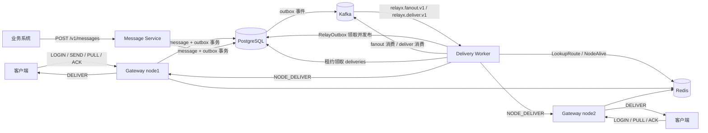

# Phase 5 架构说明

本文描述 Phase 5 分布式 Delivery Engine 的组件、端到端数据流、职责边界、部署形态与故障边界。Phase 5 位于 `phase5/` 独立 module（`relayx/phase5`），在 Phase 4 的 Gateway 集群之上把「受理」与「投递」拆成两条独立链路。

## 1. 设计边界

- PostgreSQL 是消息、投递状态、租约与 outbox 的唯一真值来源；任何组件都可以崩溃重启并从数据库恢复。
- Kafka 只承担事件分发，不保存需要恢复的业务状态；丢失或重复事件只影响延迟，不破坏最终结果。
- Redis 只承担节点成员与在线路由，不保存 payload，也不参与可靠投递。
- 受理与投递解耦：受理事务提交即返回，投递由独立的 Delivery Worker 异步推进。
- 全链路语义是 at-least-once：重复投递可能发生，由客户端 `(tenant_id, from_user, client_msg_id)` 幂等键与状态机条件更新吸收。
- 不保证跨消息顺序；同一 `(tenant_id, user)` 与同一 `(tenant_id, user, device)` 的事件落在同一分区，仅保证同键事件的分区顺序。

## 2. 组件图

| 组件 | 代码位置 | 职责与不变量 |
| --- | --- | --- |
| Gateway | `cmd/gateway`、`internal/gateway` | 维持客户端连接与本地会话；SEND 只做目标预校验后调用共享受理路径；处理 `NODE_DELIVER` 时把 DELIVER 帧入队到本地会话；不变量：受理成功即已持久化，投递失败不回滚受理 |
| Message Service | `cmd/message-service`、`internal/message` | HTTP 受理；租户来自 `X-Tenant-ID` > 请求体 `tenant_id` > `-default-tenant`；不发布 Kafka，只写 outbox |
| Outbox Relay | `internal/outbox`、`store.RelayOutbox` | 单批至多 `-outbox-batch` 行；不变量：发布成功才把 `state` 置 1，失败只增加 `attempts` 并推迟 `next_attempt_at` |
| Fan-out Worker | `internal/engine/fanout.go` | 一次事件展开为一个或多个收件人批次；不变量：`InsertDeliveries` 幂等，重复事件不会产生重复投递行 |
| Delivery Worker | `internal/engine/engine.go` | 按 `mod(delivery_id, shards) = shard_index` 领取已到期且租约空闲的行；不变量：只有仍持有 `worker_id` 的条件更新才能改状态 |
| PostgreSQL | `internal/store` | 事务边界：受理 = message + outbox；fan-out = N 条 deliveries；过期 = deliveries + message |
| Redis | `internal/registry` | 路由与节点存活；查不到视为「无路由」，查询报错按可重试故障处理，不阻塞受理 |
| Kafka | `internal/broker` | `acks=all` 生产、手动提交消费；不变量：处理函数返回错误时 offset 不提交 |

## 3. 端到端数据流

以一次 `SEND` 为例（HTTP `POST /v1/messages` 走同一条受理事务）：

1. **目标解析**（仅 Gateway）：`target_type=user` 时用 `ListEndpoints` 校验目标用户至少有一个端点；`target_type=endpoint` 时只在本节点会话表中按 session ID 解析，解析结果作为 `TargetUser/TargetDevice`。HTTP Message Service 不预解析，`user` 目标由 fan-out 展开，`endpoint` 目标必须是 `user:device` 或受理时写入 `endpoints`。
2. **受理事务**：`AcceptMessage` 在单个事务里插入 `messages`（`ON CONFLICT (tenant_id, from_user, client_msg_id) DO NOTHING`）和一行 `outbox`（`topic=relayx.fanout.v1`）。冲突时回查原 `id` 并返回 `Duplicate`，不写任何新行。
3. **返回受理结果**：Gateway 返回 `SEND_ACK accepted|duplicate`；HTTP 返回 `202` 与 `{message_id, duplicate, tenant_id}`。此时尚无 deliveries、也没有推送。
4. **Outbox Relay**：Relay 在事务内 `SELECT ... WHERE state = 0 AND next_attempt_at <= now() ORDER BY id LIMIT n FOR UPDATE SKIP LOCKED`，逐条 `Publish` 到 Kafka；成功行置 `state = 1, published_at = now()`，失败行 `attempts + 1` 并设置指数退避，本批停止。
5. **`relayx.fanout.v1`**：事件体包含 `tenant_id`、`message_id`、`from_user/from_device`、`target_type`、`target`、可选的 `target_user/target_device`、`payload`、`expire_at`，分区键为 `tenant|user`。
6. **Fan-out Worker**：消费事件后按 `target_type` 处理：`endpoint` 校验 `endpoints` 是否存在后生成一条投递；`user` 按 `device_id` 分页（页大小 `-fanout-batch`）遍历端点。每批调用 `InsertDeliveries`（`ON CONFLICT (message_id, user_id, device_id) DO NOTHING`），并向 `relayx.deliver.v1` 逐条发布唤醒事件，分区键为 `tenant|user|device`。处理成功才提交 offset。
7. **`relayx.deliver.v1`**：事件体只含 `tenant_id`、`message_id`、`user_id`、`device_id`，是唤醒提示，不是投递指令。
8. **Delivery Worker 领取**：收到唤醒事件调用 `Notify()` 提前扫描，同时每 `-scan-interval` 定时扫描。`ClaimDueDeliveries` 选出 `state IN (0,1)`、`next_retry_at` 为空或已到、`lease_until` 为空或已过期、且命中本分片的行，`FOR UPDATE SKIP LOCKED` 后写入 `lease_until = now + lease_ttl` 与 `worker_id`。
9. **路由与推送**：Worker 进程没有本地会话（`sessions`/`deliverer` 为 nil，测试除外），因此走 `LookupRoute` → `NodeAlive` → `LookupNode`，通过 Hub 发送 `NODE_DELIVER`，由持有会话的 Gateway 调用 `deliverer.Deliver` 把 DELIVER 帧入队。
10. **两级 ACK**：客户端回 `RECEIPT_ACK` 时 `ApplyReceiptAck` 把 SENT 置为 RECEIPT_ACKED；`BUSINESS_ACK` 把 SENT/RECEIPT_ACKED 置为 BUSINESS_ACKED 或 BUSINESS_FAILED。两条语句都在同一语句内重算 `messages.state`。
11. **状态聚合**：`messages.state` 由投递行聚合：全部为终态（3..6）为 COMPLETED(2)，存在终态但未全终态为 PARTIAL(1)，否则 ACCEPTED(0)；EXPIRED(3) 不会被覆盖。

## 4. 数据职责

| 数据 | 存储 | 写入方 | 生命周期 |
| --- | --- | --- | --- |
| 消息与 payload | `messages` | Gateway / Message Service | 由 `expire_at` 决定 |
| 事务性事件 | `outbox` | 受理事务 | 发布后保留（`state = 1`），不主动删除 |
| 投递状态、attempts、租约 | `deliveries` | fan-out / Delivery Worker / ACK | 随消息级联删除 |
| 端点 | `endpoints` | LOGIN、显式 endpoint 受理 | 持久 |
| 租户配额 | `tenants` | 运维或脚本 `UpsertTenant` | 持久 |
| 节点成员与在线路由 | Redis | Gateway Keeper / 登录 / 断线 | `node_ttl` 或会话关闭 |
| 事件 | Kafka | Relay / fan-out | 由 broker 保留策略决定 |

## 5. 部署形态

### 5.1 单节点

所有组件在同一台机器上：一个 Gateway（`-kafka-brokers 127.0.0.1:9092` 可让它兼任 relay）、一个 Message Service、一个 Delivery Worker（`-worker-shards 1 -worker-shard-index 0`）、一个 Kafka broker、一个 PostgreSQL、一个 Redis。

- Delivery Worker 不持有客户端会话（`sessions`/`deliverer` 为 nil），必须设置 `-redis-addr` 才能解析路由并转发 `NODE_DELIVER`；不设置时所有投递都会按「无路由」延后，只能靠客户端 PULL 取走。
- 单 Worker 也走租约：崩溃后租约到期，重启的 Worker 或另一个 Worker 可以接管。

### 5.2 集群

- 多个 Gateway 组成 Phase 4 的 Redis 集群（节点成员、路由、登录版本、踢人）。
- 多个 Delivery Worker 用同一 `-worker-shards N` 和互不相同（可重复覆盖）的 `-worker-shard-index` 并行扫描；每行只属于 `mod(delivery_id, N)` 对应的分片。
- Worker 使用同一个 Kafka 消费组 `relayx-fanout` / `relayx-delivery`，Kafka 在组内分配分区。
- Relay 可以在任意数量的进程中运行：`FOR UPDATE SKIP LOCKED` + 行锁到事务提交保证同一行不会被并发发布。
- 建议 Gateway 只写 outbox（不配置 `-kafka-brokers`），由 Delivery Worker 统一运行 relay，避免每个 Gateway 都持有 Kafka 生产者。

## 6. 故障边界

| 场景 | 检测方式 | 系统行为 | 恢复 | 代价 |
| --- | --- | --- | --- | --- |
| Kafka 停机 | Relay `Publish` 返回错误；Consumer `FetchMessage` 返回错误 | 受理仍成功（只写 outbox）；outbox 行按指数退避积压；delivery-worker 的消费者返回错误后主循环退出（进程退出），需要重连重启 | Kafka 恢复后重启 Worker；Relay 继续发布积压行 | 投递延迟等于停机时长；outbox 表膨胀 |
| Delivery Worker 崩溃 | 租约不再续期，`lease_until` 到期 | 已领取的行在 `lease_ttl`（默认 30s）后可被其它 Worker 领取；Kafka offset 未提交，事件会重投 | 重启或由其它 Worker 接管 | 崩溃瞬间正在推送的行可能已送达但未记为 SENT，产生重复推送 |
| Gateway 节点死亡 | 客户端 TCP 断开；Redis hash 过期 | 该节点上的会话全部消失；Worker 的 `NodeAlive` 变 false，路由被回收后按无路由处理 | 客户端切换节点重新登录并 PULL；离线消息由 PULL 或后续路由恢复 | 回收窗口为 `node_ttl + cleanup`（默认 25s）；期间可能无路由延后，若路由查询报错则消耗 attempts |
| DB 短暂不可用 | `ClaimDueDeliveries` / `AcceptMessage` / `RelayOutbox` 返回错误 | 受理返回 `SEND_ACK internal` 或 HTTP 500；Worker 记录警告并在下一个扫描周期重试；已提交数据不受影响 | DB 恢复后自动继续 | 受理短暂失败；重试间隔内延迟上升 |
| Worker 与 Redis 失联 | `LookupRoute` / `NodeAlive` 返回错误 | 该行按推送失败处理：消耗一次 attempt 并按指数退避重试 | Redis 恢复后重新解析路由 | 持续故障会把行推到 `-retry-max-attempts` 后 FAILED |
| 消息过期 | Worker 每轮 `ListExpiredMessages` | `ExpireMessage` 把非终态投递置 EXPIRED、清空租约，消息置 EXPIRED | 无 | 过期后不再推送，也不被 PULL 返回 |

## 7. 配置

Gateway 沿用 Phase 4 的集群与可靠性参数，并新增：

| 参数 | 默认值 | 说明 |
| --- | --- | --- |
| `-tenant-id` | `default` | SEND 受理时写入的租户，不能为空 |
| `-kafka-brokers` | 空 | 非空时在 Gateway 进程内启动 Outbox Relay |
| `-outbox-batch` | `100` | 单次 relay 发布上限 |
| `-outbox-interval` | `500ms` | relay 轮询间隔 |

Delivery Worker 参数见 [README 第 3.1 节](README.md#31-常用参数)。

## 8. 已知限制

- 事件是至少一次；`relayx.deliver.v1` 只是唤醒提示，丢失只影响唤醒延迟，定时扫描仍会推进。
- Kafka 消费者遇到处理错误会返回并终止 Worker 主循环，当前实现不自动重连；需要由进程管理器重启。
- 每个 Worker 的租户令牌桶与在途计数是进程内状态，多个 Worker 之间不共享配额。
- 分片数变化需要整体重启；`mod(id, shards)` 使用 ID 而非哈希，扩容时行会迁移到新分片，见 [ADR-017](adr/ADR-017.md)。
- 过期扫描与租约扫描都在 Worker 主循环串行执行，单轮耗时会推迟下一轮开始时间。
