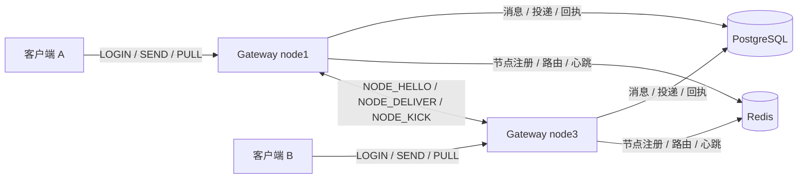

# Phase 4 架构说明

本文描述 Phase 4 集群模式的组件、关键流程、启动退出顺序、失败模式与配置。Phase 4 在 `phase4/` 独立 module（`relayx/phase5`）中实现，未配置 `-redis-addr` 时保持 Phase 3 的单节点行为。

## 1. 设计边界

- Redis 只承担服务发现与在线路由，不保存消息 payload，也不承担可靠投递。
- 节点间实时转发走直连 TCP；PostgreSQL 继续保存消息、投递状态与回执，是可靠性的唯一真值来源。
- 实时投递是尽力而为的单跳转发；端到端可靠性由 `deliveries` 的 SENT 行、owner 节点重试与 PULL 共同保证，语义为 at-least-once。
- 不保证跨节点顺序；session ID 只在单个节点内唯一。

## 2. 组件图

| 组件 | 代码位置 | 职责 |
| --- | --- | --- |
| 客户端传输层 | `internal/transport` | 接受客户端 TCP、帧编解码、心跳、队列与关闭；拒绝节点帧 |
| 业务处理器 | `internal/gateway` | 登录、发送、踢人、回执、PULL；决定本地或远程投递 |
| 会话管理 | `internal/session` | 本节点 `(user, device)` 到会话的映射，重复登录替换 |
| 投递 worker | `internal/delivery` | 扫描到期重试、按路由判断 owner、过期消息清理 |
| 注册表 | `internal/registry` | Redis 节点成员、路由、版本、回收；`Registry` 接口隔离 |
| 节点 Hub | `internal/cluster` | 节点握手、按需拨号、每节点单连接、有界发送队列 |
| 存储 | `internal/store` | PostgreSQL 消息、投递、回执、游标 PULL |
| 进程入口 | `cmd/gateway` | 配置解析、装配、启动顺序、信号退出 |

## 3. 数据职责

| 数据 | 存储 | 生命周期 | 说明 |
| --- | --- | --- | --- |
| 消息与 payload | PostgreSQL `messages` | 由 `message-ttl` 决定 | 可靠真值 |
| 投递状态与重试调度 | PostgreSQL `deliveries` | 随消息过期 | PENDING / SENT / ACKED / FAILED |
| 端点 | PostgreSQL `endpoints` | 持久 | `user` 目标的收件人来源 |
| 节点成员 | Redis | `node_ttl` | 心跳续期，过期即视为死亡 |
| 在线路由 | Redis | 会话关闭或节点回收时删除 | `(user, device)` 到 node/session/version |
| 登录版本 | Redis | 不设 TTL | 单调递增，用于踢人与删除 CAS |
| 节点连接 | 进程内 | 连接存续期间 | 每节点最多一个 peer |

## 4. 关键流程

### 4.1 登录

1. 客户端发送 `LOGIN(user, device)`。
2. 处理器解码；若该连接已经登录，返回 `LOGIN_ACK already logged in`。
3. 在 PostgreSQL 执行 `UpsertEndpoint`，失败返回 `LOGIN_ACK internal`（store unavailable）。
4. 集群模式下：
   - `NextVersion` 对 `ver:<user>\x00<device>` 执行 `INCR`，得到新版本。
   - `LookupRoute` 读取旧路由，用于后续踢人；查询失败只丢失踢人机会，不阻断登录。
5. 创建本地会话（本地 session ID、版本号），`Register` 替换本节点上同设备的旧会话并关闭旧连接。
6. `UpsertRoute` 原子写入路由并迁移 `node_routes` 索引。失败时撤销本地注册与 `conns` 映射，返回 `LOGIN_ACK internal`（cluster unavailable），避免本节点接收一个无法发布路由的设备。
7. 如果旧路由属于其它节点，异步发送 `NODE_KICK`；登录路径不等待对端。
8. 返回 `LOGIN_ACK OK` 与本地 session ID。

### 4.2 发送

1. 客户端发送 `SEND`，帧头 MsgID 是 `(from_user, client_msg_id)` 幂等键。
2. 处理器要求连接已登录；解析目标：
   - `user`：从 PostgreSQL `endpoints` 读取该用户的全部设备。
   - `endpoint:<session_id>`：只查本节点会话表。
3. 对每个收件人判断在线状态：
   - 本地存在会话：在线，本地投递。
   - 本地无会话且集群启用：`LookupRoute`，再 `NodeAlive`；都成功才视为远程在线。
   - 路由不存在、节点不存在或 Redis 查询失败：视为离线。
4. `AcceptMessage` 在 PostgreSQL 中原子写入消息与投递行：在线目标为 SENT（`attempts = 1` 并设置 `next_retry_at`），离线目标为 PENDING。重复的 `(from_user, msg_id)` 返回 `SEND_ACK duplicate`。
5. 返回 `SEND_ACK accepted`，此时消息已经持久化。
6. 本地在线目标直接入队 DELIVER；远程在线目标通过 `ForwardDeliver` 发送 `NODE_DELIVER`。
7. 实时投递或转发失败只影响首跳，投递行已经是 SENT，由 owner 节点重试与 PULL 兜底。

### 4.3 跨节点踢人

1. 设备从 node3 切换到 node2 登录，node2 读到旧路由 `node3 / version 5`，自己分配 `version 6`。
2. node2 写入新路由后，异步 `LookupNode(node3)` 并发送 `NODE_KICK(user, device, 6)`。
3. node3 的 Hub 收到后调用处理器：查找本地会话；如果不存在，或本地版本 `>= 6`，忽略。
4. 本地版本更旧时执行 `CloseReplaced`：先发送 CLOSE 帧，再关闭连接。客户端观察到 `server closed connection` 并退出。
5. node3 的连接关闭回调尝试用旧版本 5 删除路由；Redis 中版本已是 6、节点已是 node2，CAS 不匹配，删除为空操作。
6. `NODE_KICK` 没有 ACK 和重试；链路故障时旧会话不会被关闭，但路由已指向新节点，按 `user` 目标发送的新消息不会再路由到旧会话；旧节点上的本地 `endpoint:<session_id>` 定向发送仍可能命中它。

### 4.4 节点故障与客户端切换

1. 客户端配置多个网关地址（`-addr a,b,c`），连接其中一个并完成登录与初始 PULL。
2. 节点被杀死或网络断开，客户端读循环收到错误，日志输出 `connection lost, switching gateway node`。
3. 客户端按地址列表尝试下一个节点，重新 `LOGIN`；日志输出 `connected to <addr> as <name>`。
4. 新节点分配更高版本、写入路由；旧路由指向的节点已不可达，踢人失败只记录警告。
5. 客户端登录后立即 PULL，取回 SENT 与 PENDING 的消息。
6. 旧节点的 Redis hash 在 `node_ttl` 后过期；清理任务在下一个 `cleanup` 周期删除其路由索引与路由。
7. 在回收完成前，其它发送方可能仍把旧节点视为在线，转发失败后消息保持 SENT，等回收后由 PULL 恢复。

### 4.5 PULL 离线补投

1. 客户端登录后发送 `PULL(cursor=0, limit=N)`。
2. 处理器把 limit 限制在 `[1, pull-max-limit]`，未指定时使用 `pull-limit`。
3. `PullPending` 在事务中选取该设备 `state IN (PENDING, SENT)` 且 `id > cursor` 的投递，按投递 ID 升序，`FOR UPDATE` 锁定。
4. 选中的行先更新为 SENT、`attempts + 1`、按指数退避设置 `next_retry_at`，然后返回给处理器。
5. 处理器逐条向当前会话投递 DELIVER；中途失败则停止，`has_more = true`，游标停在最后一条成功投递。
6. 返回 `PULL_DONE(count, next_cursor, has_more)`；`has_more` 为真时客户端用 `next_cursor` 继续拉取。
7. PULL 只访问 PostgreSQL，不依赖 Redis；Redis 故障期间已经持久化的消息仍可被拉取。

## 5. 启动与退出顺序

### 5.1 启动

1. 解析命令行并校验配置。集群约束只在 `-redis-addr` 非空时检查。
2. 连接 PostgreSQL，Ping 并执行内嵌迁移。失败则进程退出，不监听任何端口。
3. 如配置了 `-pprof-addr`，启动 pprof HTTP 服务并设置 block/mutex profile 参数。
4. 集群启用时：
   - 用 `DBConnectTimeout` 作为超时连接 Redis 并 `PING`；失败则启动失败。
   - 创建并监听内部 Hub（`-node-addr`），通告地址为空时回退到 `-node-addr`。
   - 启动 Hub 接受入站连接。
   - 启动 Keeper：写入节点 hash、TTL 与 `nodes` 集合；失败则关闭 Hub 与 Redis 并退出。
5. 创建会话管理器与业务处理器，注入 NodeID、Registry、Forwarder；把 Registry 注入投递 worker。
6. 创建客户端传输层并绑定 `-addr`，注册连接关闭回调。
7. 启动投递 worker。
8. 启动 stats 日志循环（`-stats-interval > 0`），进入 `Serve` 与信号等待。

任何集群初始化失败都发生在客户端监听之前，不会留下半启动的 Gateway。

### 5.2 退出

收到 `SIGINT` 后：

1. 停止投递 worker，避免扫描与正在关闭的数据库连接池竞争。
2. `srv.Shutdown`：停止接受新连接，向所有客户端发送 CLOSE，等待连接协程退出；超时时间为 `-shutdown-timeout`。
3. 等待 `Serve` 返回。
4. 按 defer 的逆序清理：
   - 停止 stats 循环；
   - 再次 `worker.Stop`（空操作）；
   - `Keeper.Stop`：先停止心跳循环并等待，再 `DeregisterNode`（删除节点 hash、移出 `nodes`、删除路由索引）；
   - `Hub.Close`：关闭监听与所有 peer；
   - `Registry.Close`：关闭 Redis 客户端；
   - 关闭 pprof；
   - `Store.Close`：关闭 PostgreSQL 连接池。

Keeper 在 Hub 之前注销，目的是让其它节点先看到本节点离开，而不是继续拨号一个即将关闭的地址。

## 6. 失败模式

| 场景 | 检测方式 | 系统行为 | 恢复 | 代价与限制 |
| --- | --- | --- | --- | --- |
| Redis 不可用 | 登录时 `INCR` 失败；SEND 时路由查询失败；心跳失败 | 新登录返回 `LOGIN_ACK internal`（cluster unavailable），客户端退出；已登录会话保留；SEND 仍持久化，远程目标按离线处理；PULL 不受影响 | Redis 恢复后新登录成功；心跳继续生效 | 登录路径硬依赖；没有 HA、TLS 与认证示例；中断超过 `node_ttl` 时在线节点可能被误判为死亡，但心跳会重新注册并重建已丢失的 hash |
| Redis 数据丢失或容器重建 | 查询返回空 | 所有路由与节点成员消失；SEND 将目标视为离线；心跳会重新注册并重建节点 hash | 节点心跳自愈；客户端重新登录写入路由；PULL 取回离线消息 | 路由不会自动重建；`ver` 计数器可能从头开始 |
| 节点崩溃 | 客户端 TCP 断开；Redis hash 到期 | 客户端切换到其它节点并重新登录；路由在 `node_ttl + cleanup` 内被回收 | 新节点接管；PULL 补投 | 回收前转发可能失败；窗口默认 25s |
| 节点间链路故障 | 拨号失败、写超时、读错误 | 本次 `ForwardDeliver` 失败，帧可能丢失；后续拨号失败时进入 100ms 到 2s 的退避；owner 节点仍可在本地重试 | 链路恢复后重新拨号；未确认消息由 owner 重试或 PULL 恢复 | 没有中继路径；`NODE_KICK` 可能丢失，旧会话保持到自然断开 |
| 客户端断线 | TCP 读错误或心跳超时 | 连接关闭回调删除本地会话与路由（版本 CAS） | 客户端重连并登录；PULL 拉取离线消息 | 断线瞬间正在转发的帧可能丢失，依赖 SENT 重试/PULL |
| Redis 中断超过 `node_ttl` 后恢复 | 节点 hash 已过期，清理任务运行 | 存活节点可能被误判为死亡，其路由被回收；心跳会重新注册并重建已丢失的 hash | 受影响设备重新登录 | 现有测试只覆盖约 1s 的短暂中断，未覆盖超过 TTL 的场景 |
| 两个进程使用同一 `node_id` | 节点握手发现同 ID 连接 | Hub 替换旧连接，旧连接以 `replaced by new connection` 关闭 | 无自动恢复 | 不支持；由部署方保证唯一 |
| 消息过期 | worker 扫描 `expire_at` | 投递行随消息过期，不再重试或 PULL | 无 | 过期后不保证送达 |

## 7. 单节点兼容模式

`-redis-addr` 为空时：

- 不连接 Redis，不监听内部节点端口，不创建 Hub 与 Keeper。
- 登录不分配集群版本，不写路由，不发送踢人。
- SEND 只在本地会话表中查找收件人；没有本地会话即离线。
- 投递 worker 没有 `Routes`，本地无会话时直接清除重试调度，行为与 Phase 3 一致。
- 客户端连接收到任何节点帧都会被当作协议违规，关闭原因为 `node frame on client connection`。
- 节点相关参数仍可传入，但 `node-addr`、`node-ttl` 与 `node-heartbeat-interval` 的集群约束不校验。

协议层始终认识 0x10 到 0x14 的帧类型，因此同一个二进制既可用于单节点，也可用于集群，切换只需要增加 `-redis-addr` 等参数。

## 8. 配置

集群相关参数：

| 参数 | 默认值 | 说明 | 约束 |
| --- | --- | --- | --- |
| `-node-id` | 空 | 节点唯一标识；为空时使用 `hostname-pid` | 长度不超过 64；集群内部必须唯一 |
| `-node-addr` | `127.0.0.1:9100` | 节点间内部监听地址 | 集群模式下必须是合法的 `host:port` |
| `-node-advertise-addr` | 空 | 通告给其它节点回拨的地址；为空回退到 `-node-addr` | 集群模式下必须是合法的 `host:port`，且其它节点可达 |
| `-redis-addr` | 空 | Redis 地址；为空关闭集群 | 非空时启用集群；连接失败则启动失败 |
| `-redis-password` | 空 | Redis 密码 | 为空表示不认证 |
| `-redis-db` | 0 | Redis 逻辑库 | 不能为负 |
| `-node-heartbeat-interval` | 5s | 节点心跳与 TTL 续期间隔 | 必须为正 |
| `-node-ttl` | 15s | 节点 hash 存活时间 | 集群模式下至少为心跳间隔的 2 倍 |
| `-node-cleanup-interval` | 10s | 死亡节点清理间隔 | 集群模式下必须小于 `node-ttl` |
| `-node-dial-timeout` | 1s | 拨号与握手超时 | 必须为正；握手总超时为 2 倍该值 |

与集群行为相关、沿用 Phase 3 的参数：

| 参数 | 默认值 | 说明 |
| --- | --- | --- |
| `-addr` | `127.0.0.1:9000` | 客户端监听地址 |
| `-dsn` | 本地 `relayx` 库 | PostgreSQL DSN |
| `-max-body` | 1 MiB | 单帧 body 上限，同时约束节点帧；各节点应保持一致 |
| `-retry-interval` | 1s | 重试扫描间隔 |
| `-retry-max-attempts` | 5 | 单条投递最大推送次数 |
| `-retry-backoff-base` | 2s | 指数退避基数 |
| `-retry-backoff-max` | 1min | 指数退避上限 |
| `-pull-limit` | 100 | PULL 默认页大小 |
| `-pull-max-limit` | 500 | PULL 最大页大小 |
| `-shutdown-timeout` | 5s | 优雅退出超时 |

## 9. Redis 键

前缀默认 `relayx:`，`\x00` 是 user 与 device 的分隔符。

| 键 | 类型 | 字段 / 值 | TTL |
| --- | --- | --- | --- |
| `relayx:nodes` | SET | 所有已注册 node ID | 无，回收时移除 |
| `relayx:node:<id>` | HASH | `addr`、`started_at` | `node_ttl`，心跳续期 |
| `relayx:route:<user>\x00<device>` | HASH | `node`、`session`、`version`、`created_at` | 无，会话关闭或回收时删除 |
| `relayx:ver:<user>\x00<device>` | STRING | `INCR` 计数器 | 无 |
| `relayx:node_routes:<id>` | SET | 该节点拥有的完整路由键 | 无 |
| `relayx:node_cleanup:<id>` | STRING | 回收锁，值为该死节点 ID | `PX 30000` |

写路径：

- 登录：`INCR ver` -> `LookupRoute` -> `UpsertRoute`（Lua 同时迁移索引）。
- 断线：`DeleteRouteIfVersion`（Lua 同时校验 version 与 node）。
- 心跳：`PEXPIRE node` + `SADD nodes`。
- 回收：`SET NX` 锁 -> 二次 `EXISTS` -> 按 `node_routes` 逐条校验删除 -> 删除索引与 `nodes` 成员 -> 释放锁。

## 10. 已知限制

- `endpoint:<session_id>` 定向 SEND 只查本节点会话；session ID 不是全局唯一，跨节点必须使用 `user` 目标。
- 节点间实时转发是单跳 at-most-once；端到端 at-least-once 依赖 SENT 行、owner 重试与 PULL。
- 重试只由路由指向的 owner 节点处理；其它节点跳过且不写库。owner 已死但尚未回收时，消息会延迟到 TTL + cleanup 后才由 PULL 恢复。
- 故障窗口不超过 `node_ttl + cleanup_interval`，默认 15s + 10s；测试使用 1.5s + 0.5s。
- Redis 是登录路径的硬依赖；Redis 不可用时新登录失败，SEND 仍可持久化，PULL 不依赖 Redis。Redis 本身无 HA，示例配置无 TLS/密码。
- 无跨节点顺序保证；`node_id` 唯一性由部署方保证。
- 同一设备并发登录到不同节点时，路由以最后一次 `UpsertRoute` 为准；未获得路由的会话不会被主动踢下线。

相关文档：[节点协议](protocol-node.md)、[集群测试报告](cluster-test-report.md)、[ADR-013](adr/ADR-013.md)、[ADR-014](adr/ADR-014.md)、[ADR-015](adr/ADR-015.md)。
